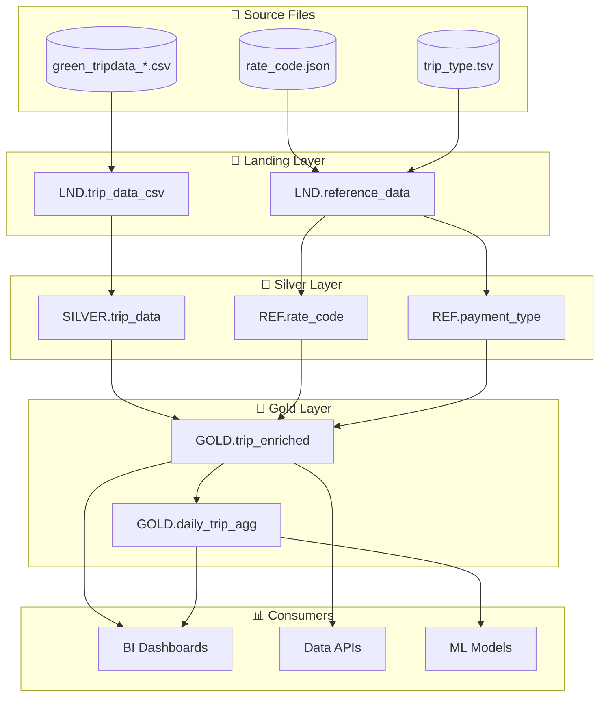

# Create Data Lineage Documentation

## Purpose
Document complete data lineage showing how data flows from source systems through transformations to final consumption points, enabling impact analysis, root cause investigation, and regulatory compliance.

## Process

### Step 1: Gather Lineage Requirements
ASK the user:

1. **Scope**: Which pipelines/tables to document?
2. **Granularity**: Table-level, column-level, or both?
3. **Systems**: What source and target systems exist?
4. **Compliance**: Any regulatory requirements (GDPR, SOX)?
5. **Tools**: Any existing lineage tools (Purview, DataHub)?

### Step 2: Map Data Flow Architecture

**System-Level Lineage Diagram:**
```
┌─────────────────────────────────────────────────────────────────────────────┐
│                        DATA LINEAGE - NYC TAXI PIPELINE                      │
└─────────────────────────────────────────────────────────────────────────────┘

┌─────────────────┐     ┌─────────────────┐     ┌─────────────────┐
│  SOURCE SYSTEMS │     │  DATA PLATFORM  │     │   CONSUMPTION   │
└────────┬────────┘     └────────┬────────┘     └────────┬────────┘
         │                       │                       │
    ┌────┴────┐            ┌─────┴─────┐           ┌─────┴─────┐
    │         │            │           │           │           │
┌───▼───┐ ┌───▼───┐   ┌────▼────┐ ┌────▼────┐ ┌───▼───┐ ┌─────▼─────┐
│  CSV  │ │Parquet│   │ LANDING │ │  SILVER │ │ GOLD  │ │    BI     │
│ Files │ │ Files │   │ (Bronze)│ │         │ │       │ │  REPORTS  │
└───┬───┘ └───┬───┘   └────┬────┘ └────┬────┘ └───┬───┘ └─────┬─────┘
    │         │            │           │          │           │
    │    ┌────┴────┐       │      ┌────┴────┐     │      ┌────┴────┐
    │    │  JSON   │       │      │   REF   │     │      │   API   │
    │    │  Files  │       │      │ Tables  │     │      │ Service │
    │    └────┬────┘       │      └────┬────┘     │      └────┬────┘
    │         │            │           │          │           │
    └─────────┴────────────┴───────────┴──────────┴───────────┘
                           │
                    ┌──────▼──────┐
                    │   LINEAGE   │
                    │   METADATA  │
                    └─────────────┘

LEGEND:
  ───► Data Flow Direction
  [□]  Source System
  [◇]  Transformation Layer
  [○]  Consumption Point
```

### Step 3: Document Table-Level Lineage

**Table Lineage Template:**
```markdown
## Table Lineage: {TARGET_TABLE}

### Overview
| Attribute | Value |
|-----------|-------|
| **Target Table** | {schema}.{table_name} |
| **Layer** | Landing / Silver / Gold |
| **Update Frequency** | Daily / Hourly / Real-time |
| **Data Owner** | {owner_name} |
| **Last Updated** | {timestamp} |

### Upstream Dependencies (Sources)

```
                    ┌─────────────────────┐
                    │ GOLD.trip_enriched  │
                    └──────────┬──────────┘
                               │
              ┌────────────────┼────────────────┐
              │                │                │
     ┌────────▼────────┐ ┌─────▼─────┐ ┌────────▼────────┐
     │SILVER.trip_data │ │REF.rate   │ │REF.payment_type │
     │    (primary)    │ │  _code    │ │                 │
     └────────┬────────┘ └───────────┘ └─────────────────┘
              │
     ┌────────▼────────┐
     │LND.trip_data_csv│
     └────────┬────────┘
              │
     ┌────────▼────────┐
     │green_tripdata_  │
     │  2021-*.csv     │
     └─────────────────┘
```

| Level | Source Object | Relationship | Join/Filter Condition |
|-------|---------------|--------------|----------------------|
| 1 | SILVER.trip_data | Primary Source | WHERE quality_flag = 'VALID' |
| 1 | REF.rate_code | Lookup | ON trip.rate_code_id = ref.rate_code_id |
| 1 | REF.payment_type | Lookup | ON trip.payment_type = ref.payment_type_id |
| 2 | LND.trip_data_csv | Transformation | Type conversion + validation |
| 3 | green_tripdata_*.csv | File Ingestion | External files |

### Downstream Dependencies (Consumers)

| Consumer | Type | Usage | Impact Level |
|----------|------|-------|--------------|
| GOLD.daily_trip_agg | Table | Aggregation source | 🔴 High |
| GOLD.monthly_metrics | Table | Metrics calculation | 🔴 High |
| Trip Analysis Dashboard | Report | Direct consumption | 🟡 Medium |
| Revenue API | API | Data endpoint | 🔴 High |
| Data Science Models | ML | Training data | 🟡 Medium |

### Impact Analysis

**If this table is unavailable:**
- ❌ Daily dashboards will show stale data
- ❌ Revenue API will return errors
- ❌ Aggregation tables won't refresh
- ⚠️ ML model retraining will be blocked

**If this table has data quality issues:**
- ⚠️ Incorrect metrics in dashboards
- ⚠️ Financial reporting discrepancies
- ⚠️ Downstream aggregations affected
```

### Step 4: Document Column-Level Lineage

**Column Lineage Template:**
```markdown
## Column Lineage: {TABLE}.{COLUMN}

### GOLD.trip_enriched.total_revenue

#### Column Information
| Attribute | Value |
|-----------|-------|
| **Column** | total_revenue |
| **Data Type** | DECIMAL(12,2) |
| **Business Definition** | Total revenue from trip including all charges |
| **Calculation** | Derived from multiple source columns |

#### Source Columns
```
total_revenue (GOLD.trip_enriched)
     │
     └── Calculated From:
          │
          ├── fare_amount (SILVER.trip_data)
          │        └── fare_amount (LND.trip_data_csv)
          │                 └── fare_amount (CSV file)
          │
          ├── extra (SILVER.trip_data)
          │        └── extra (LND.trip_data_csv)
          │
          ├── mta_tax (SILVER.trip_data)
          │        └── mta_tax (LND.trip_data_csv)
          │
          ├── tip_amount (SILVER.trip_data)
          │        └── tip_amount (LND.trip_data_csv)
          │
          ├── tolls_amount (SILVER.trip_data)
          │        └── tolls_amount (LND.trip_data_csv)
          │
          └── improvement_surcharge (SILVER.trip_data)
                   └── improvement_surcharge (LND.trip_data_csv)
```

#### Transformation Logic
```sql
-- Step 1: Landing (raw string values)
fare_amount VARCHAR -- "15.50"

-- Step 2: Silver (typed, validated)
fare_amount DECIMAL(10,2) -- CAST(fare_amount AS DECIMAL(10,2))

-- Step 3: Gold (calculated)
total_revenue = 
    COALESCE(fare_amount, 0) + 
    COALESCE(extra, 0) + 
    COALESCE(mta_tax, 0) + 
    COALESCE(tip_amount, 0) + 
    COALESCE(tolls_amount, 0) + 
    COALESCE(improvement_surcharge, 0)
```

#### Column Lineage Matrix

| Target Column | Source Table | Source Column | Transformation |
|---------------|--------------|---------------|----------------|
| total_revenue | SILVER.trip_data | fare_amount | COALESCE(..., 0) + |
| total_revenue | SILVER.trip_data | extra | COALESCE(..., 0) + |
| total_revenue | SILVER.trip_data | mta_tax | COALESCE(..., 0) + |
| total_revenue | SILVER.trip_data | tip_amount | COALESCE(..., 0) + |
| total_revenue | SILVER.trip_data | tolls_amount | COALESCE(..., 0) + |
| total_revenue | SILVER.trip_data | improvement_surcharge | COALESCE(..., 0) |
```

### Step 5: Generate Lineage Metadata (JSON)

**Machine-Readable Lineage:**
```json
{
  "lineage_version": "1.0",
  "generated_date": "2026-01-26T16:00:00Z",
  "pipeline": "nyc_taxi_pipeline",
  "tables": [
    {
      "qualified_name": "GOLD.trip_enriched",
      "layer": "Gold",
      "upstream": [
        {
          "qualified_name": "SILVER.trip_data",
          "relationship": "transformation",
          "join_condition": null,
          "filter": "quality_flag = 'VALID'"
        },
        {
          "qualified_name": "REF.rate_code",
          "relationship": "lookup",
          "join_condition": "rate_code_id = rate_code_id"
        }
      ],
      "downstream": [
        {
          "qualified_name": "GOLD.daily_trip_agg",
          "relationship": "aggregation",
          "impact_level": "high"
        }
      ],
      "columns": [
        {
          "name": "total_revenue",
          "data_type": "DECIMAL(12,2)",
          "source_columns": [
            {"table": "SILVER.trip_data", "column": "fare_amount", "transformation": "COALESCE"},
            {"table": "SILVER.trip_data", "column": "extra", "transformation": "COALESCE"},
            {"table": "SILVER.trip_data", "column": "mta_tax", "transformation": "COALESCE"},
            {"table": "SILVER.trip_data", "column": "tip_amount", "transformation": "COALESCE"},
            {"table": "SILVER.trip_data", "column": "tolls_amount", "transformation": "COALESCE"},
            {"table": "SILVER.trip_data", "column": "improvement_surcharge", "transformation": "COALESCE"}
          ],
          "calculation": "SUM of all source columns with COALESCE for nulls"
        }
      ]
    }
  ]
}
```

### Step 6: Create Lineage Visualization

**Mermaid Diagram:**
```markdown

```

### Step 7: Document Data Transformations Timeline

**Processing Timeline:**
```markdown
## Data Processing Timeline

### Daily Pipeline Execution

| Time (UTC) | Process | Source | Target | Duration |
|------------|---------|--------|--------|----------|
| 02:00 | File Arrival | External SFTP | /raw/incoming/ | - |
| 02:15 | Landing Load | CSV files | LND.trip_data_csv | ~15 min |
| 02:30 | Reference Load | JSON/TSV files | REF.* tables | ~5 min |
| 02:35 | Silver Transform | LND tables | SILVER.trip_data | ~30 min |
| 03:05 | Gold Enrichment | SILVER + REF | GOLD.trip_enriched | ~20 min |
| 03:25 | Gold Aggregation | GOLD.trip_enriched | GOLD.daily_trip_agg | ~10 min |
| 03:35 | Quality Validation | All layers | Validation report | ~10 min |
| 03:45 | ✅ Pipeline Complete | - | - | ~1h 45m total |

### Data Freshness SLA

| Table | Expected Refresh | SLA | Current Status |
|-------|------------------|-----|----------------|
| GOLD.trip_enriched | Daily 04:00 UTC | 99.9% | ✅ On Track |
| GOLD.daily_trip_agg | Daily 04:00 UTC | 99.9% | ✅ On Track |
```

## Output

Generate the following artifacts:

1. **Lineage Documentation** (Markdown)
   - System-level overview
   - Table-level lineage
   - Column-level lineage

2. **Visual Diagrams** (Mermaid/PlantUML)
   - Data flow diagrams
   - Dependency graphs

3. **Machine-Readable Lineage** (JSON)
   - Lineage metadata
   - Import-ready format for lineage tools

4. **Impact Analysis Matrix** (Markdown)
   - Upstream/downstream dependencies
   - Risk assessment

## Completion Criteria

Lineage documentation is complete when:
- ✅ All tables have upstream/downstream documented
- ✅ Column-level lineage for key business columns
- ✅ Transformation logic documented
- ✅ Visual diagrams created
- ✅ Impact analysis completed
- ✅ Machine-readable export generated
- ✅ Processing timeline documented
