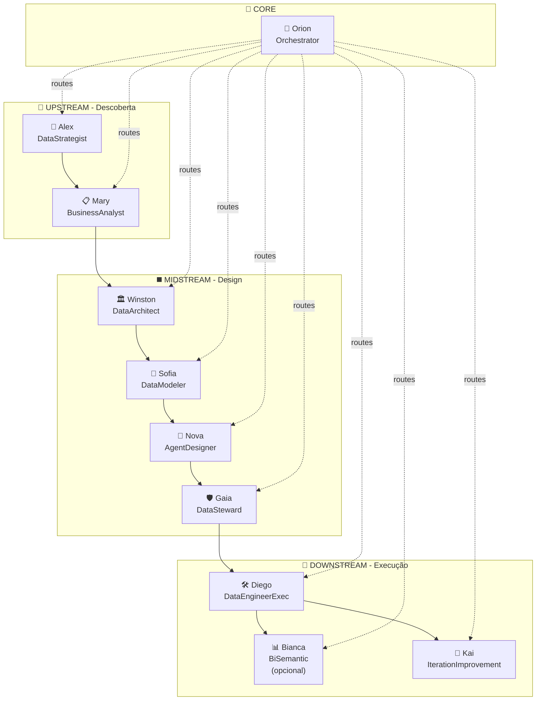

# 🧭 Mapeamento Completo de Agentes - Avanade™ Core Data Engineering

> **Data:** 4 de Fevereiro de 2026  
> **Versão:** 2.0  
> **Status:** ✅ COMPLETO  
> **Total de Agentes:** 10 + 1 Master Agent

---

## 📊 Visão Geral das Esteiras



---

## 📋 Tabela de Agentes

| # | Chatmode | Persona | Esteira | Gate | Status | Arquivo |
|---|----------|---------|---------|------|--------|---------|
| 1 | `data-strategist` | Alex 🎯 | UPSTREAM | G1 | ✅ Completo | [data-strategist.chatmode.md](.github/chatmodes/data-strategist.chatmode.md) |
| 2 | `business-analyst` | Mary 📋 | UPSTREAM | G1 | ✅ Completo | [business-analyst.chatmode.md](.github/chatmodes/business-analyst.chatmode.md) |
| 3 | `data-architect` | Winston 🏛️ | MIDSTREAM | G2 | ✅ Completo | [data-architect.chatmode.md](.github/chatmodes/data-architect.chatmode.md) |
| 4 | `data-modeler` | Sofia 🧩 | MIDSTREAM | G2 | ✅ Completo | [data-modeler.chatmode.md](.github/chatmodes/data-modeler.chatmode.md) |
| 5 | `agent-designer` | Nova 🧠 | MIDSTREAM | G2 | ✅ Completo | [agent-designer.chatmode.md](.github/chatmodes/agent-designer.chatmode.md) |
| 6 | `data-steward` | Gaia 🛡️ | MIDSTREAM | G2 | ✅ Completo | [data-steward.chatmode.md](.github/chatmodes/data-steward.chatmode.md) |
| 7 | `data-engineer-exec` | Diego 🛠️ | DOWNSTREAM | G3 | ✅ Completo | [data-engineer-exec.chatmode.md](.github/chatmodes/data-engineer-exec.chatmode.md) |
| 8 | `bi-semantic` | Bianca 📊 | DOWNSTREAM | G3 (opt) | ✅ Completo | [bi-semantic.chatmode.md](.github/chatmodes/bi-semantic.chatmode.md) |
| 9 | `iteration-improvement` | Kai 🔁 | DOWNSTREAM | Post-G3 | ✅ Completo | [iteration-improvement.chatmode.md](.github/chatmodes/iteration-improvement.chatmode.md) |
| 10 | `orchestrator` | Orion 🧭 | CORE | All | ✅ Completo | [orchestrator.chatmode.md](.github/chatmodes/orchestrator.chatmode.md) |
| 11 | `master-agent` | Master 🎛️ | CORE | All | ✅ Extra | [master-agent.chatmode.md](.github/chatmodes/master-agent.chatmode.md) |

---

## 🔄 Comandos por Agente

### 🔼 UPSTREAM

#### Alex 🎯 (DataStrategist)
| Comando | Descrição |
|---------|-----------|
| `*define-problem` | Criar declaração do problema de negócio |
| `*create-kpis` | Definir KPIs e métricas de sucesso |
| `*success-criteria` | Estabelecer critérios de sucesso |
| `*stakeholders` | Mapear stakeholders (RACI) |
| `*value-prop` | Criar proposta de valor dos dados |
| `*strategy-summary` | Gerar resumo da estratégia |
| `*help` | Ver todos os comandos |

#### Mary 📋 (BusinessAnalyst)
| Comando | Descrição |
|---------|-----------|
| `*create-sttm` | Criar Source-to-Target Mapping |
| `*analytical-questions` | Definir perguntas analíticas |
| `*dq-initial` | Requisitos iniciais de qualidade |
| `*business-rules` | Documentar regras de negócio |
| `*source-analysis` | Analisar fontes de dados |
| `*help` | Ver todos os comandos |

### ◼️ MIDSTREAM

#### Winston 🏛️ (DataArchitect)
| Comando | Descrição |
|---------|-----------|
| `*create-architecture` | Criar documento de arquitetura |
| `*create-data-model` | Projetar modelo dimensional |
| `*document-decisions` | Criar ADRs (Architecture Decision Records) |
| `*tech-stack` | Documentar seleção de tecnologias |
| `*security-design` | Projetar arquitetura de segurança |
| `*status` | Ver progresso dos artefatos Gate 2 |
| `*help` | Ver todos os comandos |

#### Sofia 🧩 (DataModeler)
| Comando | Descrição |
|---------|-----------|
| `*data-model` | Criar/refinar modelo lógico |
| `*data-contracts` | Definir contratos de dados |
| `*granularity` | Definir granularidade de tabelas |
| `*metrics` | Documentar métricas e KPIs |
| `*metadata` | Criar catálogo de metadados |
| `*status` | Ver progresso dos artefatos Gate 2 |
| `*help` | Ver todos os comandos |

#### Nova 🧠 (AgentDesigner)
| Comando | Descrição |
|---------|-----------|
| `*agent-blueprint` | Criar blueprint de agente |
| `*agent-contracts` | Definir contratos entre agentes |
| `*guardrails` | Projetar guardrails e gates |
| `*orchestration` | Desenhar fluxo de orquestração |
| `*autonomy-matrix` | Definir níveis de autonomia |
| `*status` | Ver progresso dos artefatos |
| `*help` | Ver todos os comandos |

#### Gaia 🛡️ (DataSteward)
| Comando | Descrição |
|---------|-----------|
| `*create-dq-rules` | Definir regras de Data Quality |
| `*create-governance` | Criar framework de governança |
| `*classify-data` | Classificar dados por sensibilidade |
| `*map-compliance` | Mapear requisitos de compliance (LGPD/GDPR) |
| `*document-lineage` | Documentar linhagem de dados |
| `*status` | Ver progresso dos artefatos |
| `*help` | Ver todos os comandos |

### 🔽 DOWNSTREAM

#### Diego 🛠️ (DataEngineerExec)
| Comando | Descrição |
|---------|-----------|
| `*create-ddl` | Criar scripts DDL (tabelas, views) |
| `*create-etl` | Criar scripts ETL/ELT |
| `*create-tests` | Criar testes unitários |
| `*profile-data` | Analisar perfil dos dados |
| `*create-pipeline` | Criar pipeline completo |
| `*validate-quality` | Validar qualidade dos dados |
| `*create-sttm` | Criar Source-to-Target Mapping |
| `*create-lineage` | Documentar linhagem de dados |
| `*create-catalog` | Criar catálogo de dados |
| `*setup-monitoring` | Configurar observabilidade |
| `*optimize-pipeline` | Otimizar performance |
| `*document-pipeline` | Documentar pipeline |
| `*code-review` | Peer review de código |
| `*generate-test-data` | Gerar dados de teste |
| `*check-gate-2` | Verificar Gate 2 |
| `*gate-3-ready` | Validar Gate 3 |
| `*run-demo` | Demonstração completa |
| `*help` | Ver todos os comandos |

#### Bianca 📊 (BiSemantic) - OPCIONAL
| Comando | Descrição |
|---------|-----------|
| `*create-semantic-model` | Criar modelo semântico Power BI |
| `*create-dax` | Gerar medidas DAX |
| `*create-dashboard` | Criar especificação de dashboard |
| `*create-report` | Especificar layout de relatórios |
| `*optimize-dataset` | Otimizar performance do dataset |
| `*create-rls` | Configurar Row-Level Security |
| `*validate-model` | Validar modelo semântico |
| `*run-demo` | Demonstração completa |
| `*help` | Ver todos os comandos |

#### Kai 🔁 (IterationImprovement)
| Comando | Descrição |
|---------|-----------|
| `*improvement-backlog` | Criar backlog de melhorias |
| `*retrospective` | Facilitar retrospectiva |
| `*metrics-analysis` | Analisar métricas de processo (DORA) |
| `*cost-optimization` | Identificar oportunidades de custo |
| `*lead-time-analysis` | Analisar e otimizar lead time |
| `*incident-review` | Transformar incidente em ação preventiva |
| `*status` | Ver progresso das melhorias |
| `*help` | Ver todos os comandos |

### 🧭 CORE

#### Orion 🧭 (Orchestrator)
| Comando | Descrição |
|---------|-----------|
| `*status` | Ver status geral do projeto |
| `*gate-1` | Validar Gate 1 (UPSTREAM → MIDSTREAM) |
| `*gate-2` | Validar Gate 2 (MIDSTREAM → DOWNSTREAM) |
| `*gate-3` | Validar Gate 3 (DOWNSTREAM → PRODUCTION) |
| `*route` | Recomendar próximo agente |
| `*artifacts` | Listar artefatos por fase |
| `*audit` | Ver trilha de auditoria |
| `*help` | Ver todos os comandos |

---

## 🎯 Responsabilidades por Gate

### Gate 1 - Descoberta (UPSTREAM)
| Artefato | Owner | Reviewer |
|----------|-------|----------|
| problem-statement.md | Alex 🎯 | Mary 📋 |
| kpis.md | Alex 🎯 | Mary 📋 |
| success-criteria.md | Alex 🎯 | Orion 🧭 |
| sttm.md | Mary 📋 | Winston 🏛️ |
| analytical-questions.md | Mary 📋 | Alex 🎯 |
| dq-initial.md | Mary 📋 | Gaia 🛡️ |

### Gate 2 - Design (MIDSTREAM)
| Artefato | Owner | Reviewer |
|----------|-------|----------|
| architecture.md | Winston 🏛️ | Sofia 🧩 |
| data-model.md | Sofia 🧩 | Winston 🏛️ |
| data-contracts.md | Sofia 🧩 | Diego 🛠️ |
| tech-stack.md | Winston 🏛️ | Diego 🛠️ |
| dq-rules.md | Gaia 🛡️ | Sofia 🧩 |
| governance.md | Gaia 🛡️ | Orion 🧭 |
| agent-blueprint.md | Nova 🧠 | Winston 🏛️ |
| orchestration-flow.md | Nova 🧠 | Orion 🧭 |

### Gate 3 - Execução (DOWNSTREAM)
| Artefato | Owner | Reviewer |
|----------|-------|----------|
| ddl/*.sql | Diego 🛠️ | Gaia 🛡️ |
| etl/*.sql | Diego 🛠️ | Gaia 🛡️ |
| tests/*.sql | Diego 🛠️ | Gaia 🛡️ |
| documentation.md | Diego 🛠️ | Mary 📋 |
| semantic-model.json | Bianca 📊 | Diego 🛠️ |
| dashboard-spec.md | Bianca 📊 | Mary 📋 |
| dq-validation.md | Gaia 🛡️ | Diego 🛠️ |

### Post-Gate 3 - Melhoria Contínua
| Artefato | Owner | Reviewer |
|----------|-------|----------|
| improvement-backlog.md | Kai 🔁 | Orion 🧭 |
| retrospective.md | Kai 🔁 | Team |
| optimization-report.md | Kai 🔁 | Winston 🏛️ |
| cost-optimization.md | Kai 🔁 | Diego 🛠️ |
| incident-review.md | Kai 🔁 | Gaia 🛡️ |

---

## 📁 Estrutura de Arquivos

```
.github/chatmodes/
├── data-strategist.chatmode.md      # Alex 🎯 (UPSTREAM)
├── business-analyst.chatmode.md     # Mary 📋 (UPSTREAM)
├── data-architect.chatmode.md       # Winston 🏛️ (MIDSTREAM)
├── data-modeler.chatmode.md         # Sofia 🧩 (MIDSTREAM)
├── agent-designer.chatmode.md       # Nova 🧠 (MIDSTREAM)
├── data-steward.chatmode.md         # Gaia 🛡️ (MIDSTREAM)
├── data-engineer-exec.chatmode.md   # Diego 🛠️ (DOWNSTREAM)
├── bi-semantic.chatmode.md          # Bianca 📊 (DOWNSTREAM - opcional)
├── iteration-improvement.chatmode.md # Kai 🔁 (DOWNSTREAM - pós Gate 3)
├── orchestrator.chatmode.md         # Orion 🧭 (CORE)
└── master-agent.chatmode.md         # Master 🎛️ (CORE - Extra)
```

---

## 🚀 Como Usar

### Ativar um Agente
```
@data-strategist olá        # Ativa Alex
@business-analyst *help     # Ativa Mary e mostra ajuda
@data-engineer-exec *status # Ativa Diego e mostra status
@orchestrator *gate-1       # Ativa Orion e valida Gate 1
```

### Fluxo Típico de Projeto Completo
```
1. @data-strategist *define-problem        # Alex define o problema
2. @data-strategist *create-kpis           # Alex define KPIs
3. @business-analyst *create-sttm          # Mary mapeia dados
4. @business-analyst *analytical-questions # Mary define perguntas
5. @orchestrator *gate-1                   # Orion valida Gate 1

6. @data-architect *create-architecture    # Winston projeta arquitetura
7. @data-modeler *data-model               # Sofia cria modelo lógico
8. @data-modeler *data-contracts           # Sofia define contratos
9. @data-steward *create-dq-rules          # Gaia define regras DQ
10. @orchestrator *gate-2                  # Orion valida Gate 2

11. @data-engineer-exec *create-ddl        # Diego cria DDLs
12. @data-engineer-exec *create-etl        # Diego cria ETLs
13. @data-engineer-exec *create-tests      # Diego cria testes
14. @data-engineer-exec *setup-monitoring  # Diego configura observabilidade
15. @bi-semantic *create-semantic-model    # Bianca cria modelo BI (opcional)
16. @orchestrator *gate-3                  # Orion valida Gate 3

17. @iteration-improvement *metrics-analysis    # Kai analisa métricas
18. @iteration-improvement *cost-optimization   # Kai otimiza custos
19. @iteration-improvement *retrospective       # Kai facilita retro
```

### Handoff entre Agentes
Cada agente sugere automaticamente o próximo passo após completar uma tarefa, facilitando o fluxo de trabalho.

---

## ✅ Status dos 10 Agentes

| # | Agente | Persona | Fase | Gate | Status |
|---|--------|---------|------|------|--------|
| 1 | DataStrategist | Alex 🎯 | UPSTREAM | Gate 1 | ✅ Completo |
| 2 | BusinessAnalyst | Mary 📋 | UPSTREAM | Gate 1 | ✅ Completo |
| 3 | DataArchitect | Winston 🏛️ | MIDSTREAM | Gate 2 | ✅ Completo |
| 4 | DataModeler | Sofia 🧩 | MIDSTREAM | Gate 2 | ✅ Completo |
| 5 | AgentDesigner | Nova 🧠 | MIDSTREAM | Gate 2 | ✅ Completo |
| 6 | DataSteward | Gaia 🛡️ | MIDSTREAM | Gate 2 | ✅ Completo |
| 7 | DataEngineerExec | Diego 🛠️ | DOWNSTREAM | Gate 3 | ✅ Completo |
| 8 | BiSemantic | Bianca 📊 | DOWNSTREAM | Gate 3 (opt) | ✅ Completo |
| 9 | IterationImprovement | Kai 🔁 | DOWNSTREAM | Pós-G3 | ✅ Completo |
| 10 | Orchestrator | Orion 🧭 | CORE | Todos | ✅ Completo |

---

*Powered by Avanade™ Core - Data Engineering Agents v2.0*
*Atualizado em 4 de Fevereiro de 2026*
