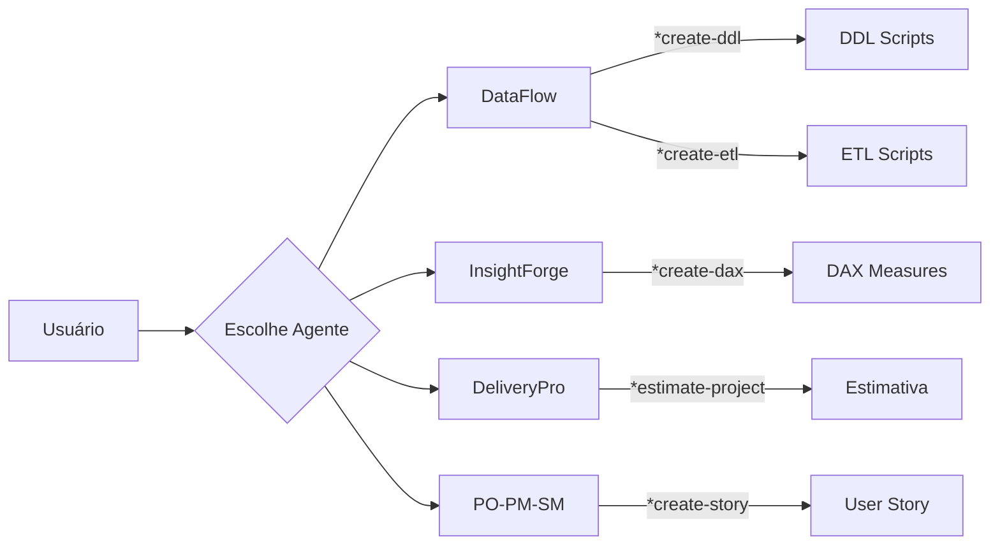
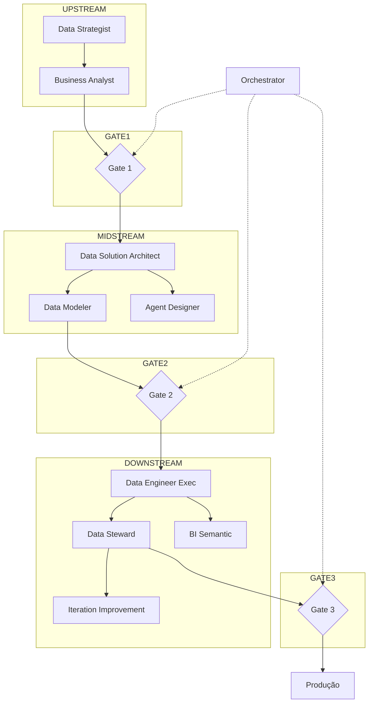

# 📊 Análise Comparativa: Agentes Existentes vs Data-Migration 

**Documento de Referência**  
**Versão:** 1.0  
**Data:** 4 de Fevereiro de 2026  
**Autor:** Master Agent - Avanade Method

---

## 📑 Sumário

1. [Visão Geral](#1-visão-geral)
2. [Comparação de Arquiteturas](#2-comparação-de-arquiteturas)
3. [Mapeamento de Agentes](#3-mapeamento-de-agentes)
4. [Comparação Detalhada por Agente](#4-comparação-detalhada-por-agente)
5. [Sistema de Workflows e Gates](#5-sistema-de-workflows-e-gates)
6. [Diferenças de Configuração](#6-diferenças-de-configuração)
7. [Gaps e Oportunidades](#7-gaps-e-oportunidades)
8. [Recomendações de Convergência](#8-recomendações-de-convergência)
9. [Glossário](#9-glossário)

---

## 1. Visão Geral

### 1.1 Os Dois Ecossistemas

Este workspace contém **dois ecossistemas distintos de agentes de IA** para projetos de dados:

| Aspecto | Agentes Existentes | Data-Migration (BMAD-Data) |
|---------|-------------------|---------------------------|
| **Framework** | Avanade™ Core | BMAD-Data (Híbrido) |
| **Abordagem** | Task-First (comandos `*`) | Method-First + Agent-First |
| **Ativação** | VS Code Chat Modes | BMAD Module + CLI |
| **Foco Principal** | Execução imediata de tarefas | SDLC completo com gates |
| **Orquestração** | Manual (usuário escolhe agente) | Automática (Orchestrator) |
| **Status** | ✅ Operacional | 🔧 Specs definidas |

### 1.2 Filosofias de Design

```
┌─────────────────────────────────────────────────────────────────────────┐
│                      AGENTES EXISTENTES                                  │
│  ┌─────────┐   ┌─────────┐   ┌─────────┐   ┌─────────┐                 │
│  │DataFlow │   │Insight  │   │Delivery │   │PO-PM-SM │                 │
│  │  🔄     │   │Forge 📊 │   │Pro 📋   │   │Suite    │                 │
│  └────┬────┘   └────┬────┘   └────┬────┘   └────┬────┘                 │
│       │             │             │             │                       │
│       └─────────────┴──────┬──────┴─────────────┘                       │
│                            ▼                                            │
│                   [Usuário Escolhe Agente]                              │
│                   [Executa Comando *task]                               │
│                   [Recebe Artefato Imediato]                            │
└─────────────────────────────────────────────────────────────────────────┘

┌─────────────────────────────────────────────────────────────────────────┐
│                      DATA-MIGRATION (BMAD-Data)                          │
│                                                                          │
│   UPSTREAM          MIDSTREAM           DOWNSTREAM                       │
│  ┌────────┐        ┌────────┐          ┌────────┐                       │
│  │Strategy│──G1──▶│Architect│──G2────▶│Engineer│──G3──▶ PROD           │
│  │Analyst │        │Modeler │          │Steward │                       │
│  └────────┘        │Designer│          │BI      │                       │
│                    └────────┘          │Iterate │                       │
│                                        └────────┘                       │
│                            ▲                                            │
│                     [Orchestrator]                                      │
│                     [Gates Obrigatórios]                                │
│                     [Contratos MID→DOWN]                                │
└─────────────────────────────────────────────────────────────────────────┘
```

---

## 2. Comparação de Arquiteturas

### 2.1 Estrutura de Pastas

| Componente | Agentes Existentes | Data-Migration |
|------------|-------------------|----------------|
| **Configuração** | `.avanade-core/core-config.yaml` | `module.yaml` |
| **Definição de Agentes** | `.avanade-core/agents/*.md` | `agents/*.spec.md` + `agents/*.md` |
| **Tasks/Workflows** | `.avanade-core/tasks/*.md` | `workflows/*/workflow.md` + `steps-c/` |
| **Templates** | `.avanade-core/templates/*.yaml` | Templates inline nos workflows |
| **Checklists** | `.avanade-core/checklists/*.md` | Embutido nos gates |
| **Dados de Referência** | `.avanade-core/data/*.md` | `docs/*.md` |
| **Ativação** | `.github/chatmodes/*.chatmode.md` | CLI + Module Installer |
| **Saídas** | `*-outputs/` por agente | `_bmad-output/{project}/` |

### 2.2 Modelo de Execução

| Característica | Agentes Existentes | Data-Migration |
|----------------|-------------------|----------------|
| **Trigger** | Comando `*task` pelo usuário | Workflow sequencial |
| **Estado** | Sem memória entre sessões | Sidecar para estado persistente |
| **Validação** | Checklists opcionais | Gates obrigatórios |
| **Dependências** | Implícitas | Contratos explícitos |
| **Versionamento** | Arquivos com timestamp | Git-native com artefatos MD |

### 2.3 Níveis de Automação

```
Nível de Automação (1-10)

Agentes Existentes:
├── Geração de Código:      ████████░░ 8/10 (alto)
├── Documentação:           ████████░░ 8/10 (alto)
├── Orquestração:           ███░░░░░░░ 3/10 (manual)
├── Validação/Gates:        ████░░░░░░ 4/10 (opcional)
└── Rastreabilidade:        █████░░░░░ 5/10 (timestamps)

Data-Migration (BMAD-Data):
├── Geração de Código:      ███████░░░ 7/10 (via specs)
├── Documentação:           ████████░░ 8/10 (alto)
├── Orquestração:           ████████░░ 8/10 (automático)
├── Validação/Gates:        █████████░ 9/10 (obrigatório)
└── Rastreabilidade:        █████████░ 9/10 (audit trail)
```

---

## 3. Mapeamento de Agentes

### 3.1 Correspondência Direta

| # | BMAD-Data Agent | Agente Existente | Cobertura |
|---|-----------------|------------------|-----------|
| 1 | **Data Engineer Exec** (Diego 🛠️) | **DataFlow** (🔄) | ⚡ 90% |
| 2 | **BI Semantic** (Bianca 📊) | **InsightForge** (📊) | ⚡ 95% |
| 3 | **Data Solution Architect** (Winston 🏛️) | ❌ Não existe | 🔴 0% |
| 4 | **Data Modeler** (Sofia 🧩) | ❌ Não existe | 🔴 0% |
| 5 | **Data Strategist** (Alex 🎯) | **ProductVision** (PM) parcial | 🟡 40% |
| 6 | **Business Analyst** (Mary 📋) | ❌ Não existe | 🔴 0% |
| 7 | **Agent Designer** (Nova 🧠) | ❌ Não existe | 🔴 0% |
| 8 | **Data Steward** (Gaia 🛡️) | ❌ Não existe | 🔴 0% |
| 9 | **Iteration Improvement** (Kai 🔁) | ❌ Não existe | 🔴 0% |
| 10 | **Orchestrator** (Orion 🧭) | **Master Agent** parcial | 🟡 30% |

### 3.2 Agentes Sem Correspondência

#### Existentes sem equivalente no BMAD-Data:
| Agente Existente | Gap no BMAD-Data |
|------------------|------------------|
| **DeliveryPro** (📋) | Estimativas, roadmaps, budget |
| **BacklogMaster** (PO 📝) | Gestão de backlog, stories |
| **SprintPro** (SM 🏃) | Organização de sprints |

#### BMAD-Data sem equivalente existente:
| Agente BMAD-Data | Gap nos Existentes |
|------------------|-------------------|
| **Data Solution Architect** | Arquitetura técnica formal |
| **Data Modeler** | Modelagem lógica dedicada |
| **Business Analyst** | Requisitos → STTM |
| **Data Steward** | Governança e compliance |
| **Agent Designer** | Meta-design de agentes |
| **Iteration Improvement** | Melhoria contínua formal |

---

## 4. Comparação Detalhada por Agente

### 4.1 Data Engineer: DataFlow vs Diego

| Aspecto | DataFlow (Existente) | Diego (BMAD-Data) |
|---------|---------------------|-------------------|
| **Nome** | DataFlow | Diego |
| **Ícone** | 🔄 | 🛠️ |
| **Esteira** | N/A (standalone) | DOWNSTREAM |
| **Pré-requisitos** | Nenhum | Gate 2 aprovado + Contracts |

#### Comandos/Capacidades:

| Capacidade | DataFlow | Diego |
|------------|----------|-------|
| Criar DDL | `*create-ddl` | `delivery` workflow |
| Criar ETL | `*create-etl` | `delivery` workflow |
| Pipeline completo | `*create-pipeline` | `delivery` workflow |
| Profiling | `*profile-data` | Via Business Analyst |
| Data Quality | `*validate-quality` | Via Data Steward |
| Testes | `*create-tests` | `unit-tests` workflow |
| Documentação | `*document-pipeline` | Inline + `observability` |
| Code Review | `*code-review` | ❌ Não documentado |
| Lineage | `*create-lineage-doc` | Via Data Modeler |
| STTM | `*create-sttm` | Via Business Analyst |

#### Diferenças Principais:

```yaml
DataFlow:
  autonomia: Alta (executa qualquer tarefa imediatamente)
  validação: Opcional (checklists disponíveis)
  inputs: Definidos pelo usuário em tempo real
  outputs: Arquivos com timestamp em data-outputs/
  
Diego:
  autonomia: Limitada (requer contracts aprovados)
  validação: Obrigatória (Gate 2 + Gate 3)
  inputs: Data Contracts + Metric Contracts formais
  outputs: Versionados em _bmad-output/implementation-artifacts/
```

---

### 4.2 BI Developer: InsightForge vs Bianca

| Aspecto | InsightForge (Existente) | Bianca (BMAD-Data) |
|---------|-------------------------|-------------------|
| **Nome** | InsightForge | Bianca |
| **Ícone** | 📊 | 📊 |
| **Esteira** | N/A (standalone) | DOWNSTREAM (opcional) |
| **Ativação** | Sempre disponível | `enable_bi_agent = true` |

#### Comandos/Capacidades:

| Capacidade | InsightForge | Bianca |
|------------|--------------|--------|
| Semantic Model | `*create-semantic-model` | `semantic-layer` workflow |
| DAX Measures | `*create-dax` | `semantic-layer` workflow |
| Dashboard | `*create-dashboard` | `dashboards` workflow |
| Report | `*create-report` | ❌ Não documentado |
| RLS | `*create-rls` | ❌ Não documentado |
| Optimization | `*optimize-dataset` | ❌ Não documentado |
| Documentation | `*document-bi` | Inline |
| Validation | `*validate-model` | ❌ Não documentado |
| Requirements | `*profile-requirements` | ❌ Não documentado |
| HTML Preview | `*generate-dashboard-html` | ❌ Não documentado |

#### Diferenças Principais:

```yaml
InsightForge:
  maturidade: Alta (13+ comandos, templates, checklists)
  outputs: Múltiplos formatos (.md, .dax, .html, .yaml)
  personas: Suporta design orientado a personas
  preview: Gera HTML preview de dashboards
  
Bianca:
  maturidade: Baixa (spec only, 3 comandos planejados)
  outputs: Modelo semântico + medidas baseline
  foco: Entrega incremental com validação humana
  dependência: Recebe gold layer do Diego
```

---

### 4.3 Orchestrator: Master Agent vs Orion

| Aspecto | Master Agent (Existente) | Orion (BMAD-Data) |
|---------|-------------------------|-------------------|
| **Nome** | Master Agent | Orion |
| **Ícone** | (não definido) | 🧭 |
| **Função** | Coordenador/Roteador | State Machine + Gates |

#### Capacidades:

| Capacidade | Master Agent | Orion |
|------------|--------------|-------|
| Roteamento para agentes | ✅ Manual/Sugestivo | ✅ Automático por artefatos |
| Validação de gates | ❌ | ✅ G1, G2, G3 |
| Status do projeto | ❌ | ✅ `workflow-status` |
| Auditoria | ❌ | ✅ 100% das decisões |
| Memória persistente | ❌ | ✅ Sidecar |
| Escalação para humanos | ✅ Implícito | ✅ Explícito |

#### Diferenças Principais:

```yaml
Master Agent:
  tipo: Assistente de navegação
  decisão: Baseada em conversa natural
  controle: Sugere, não impõe
  estado: Sem memória entre sessões
  
Orion:
  tipo: State machine formal
  decisão: Baseada em artefatos existentes
  controle: Gates obrigatórios
  estado: Persistente por projeto (sidecar)
```

---

### 4.4 Agentes Exclusivos do BMAD-Data

#### 4.4.1 Data Strategist (Alex 🎯)

```yaml
esteira: UPSTREAM
papel: Definir valor, escopo e sucesso do projeto
outputs:
  - Problem Statement
  - KPIs / OKRs
  - Success Criteria
equivalente_existente: ProductVision (parcial)
gap_existente: |
  ProductVision foca em features/epics, não em métricas de dados.
  Alex é especializado em projetos de dados com KPIs mensuráveis.
```

#### 4.4.2 Business Analyst (Mary 📋)

```yaml
esteira: UPSTREAM
papel: Traduzir negócio em requisitos técnicos
outputs:
  - Analytical Questions
  - Decision Requirements
  - Regras Técnicas
  - STTM (Source-to-Target Mapping)
equivalente_existente: Nenhum
gap_existente: |
  DataFlow tem *create-sttm, mas não há agente dedicado
  a análise de negócio com foco em dados.
```

#### 4.4.3 Data Solution Architect (Winston 🏛️)

```yaml
esteira: MIDSTREAM
papel: Definir arquitetura técnica ótima e governável
outputs:
  - AOD (Architecture Option Document)
  - DDS (Design Decision Summary)
  - Estratégia de Segurança
  - Estratégia de Observabilidade
equivalente_existente: Nenhum
gap_existente: |
  Nenhum agente existente produz documentação
  de arquitetura formal para projetos de dados.
```

#### 4.4.4 Data Modeler (Sofia 🧩)

```yaml
esteira: MIDSTREAM
papel: Garantir coerência do modelo de dados
outputs:
  - Modelo Lógico
  - Definições de Métricas
  - Metadados / Glossário
  - Data Contracts
equivalente_existente: Nenhum (parcial no DataFlow)
gap_existente: |
  DataFlow gera DDL, mas não há modelagem lógica
  separada da física, nem glossário formal.
```

#### 4.4.5 Agent Designer (Nova 🧠)

```yaml
esteira: MIDSTREAM
papel: Definir arquitetura multiagente e contratos
outputs:
  - Blueprint Multiagente
  - Agent Contracts
  - Regras de Autonomia
equivalente_existente: Nenhum
gap_existente: |
  Totalmente novo - meta-design de agentes.
  Não existe conceito equivalente nos agentes atuais.
```

#### 4.4.6 Data Steward (Gaia 🛡️)

```yaml
esteira: DOWNSTREAM
papel: Garantir qualidade, conformidade e auditoria
outputs:
  - Monitoring Spec
  - DQ Rules com thresholds
  - Logs de Governança
equivalente_existente: Nenhum (parcial no DataFlow)
gap_existente: |
  DataFlow tem *validate-quality, mas não há
  agente dedicado a governança e compliance LGPD/GDPR.
```

#### 4.4.7 Iteration Improvement (Kai 🔁)

```yaml
esteira: DOWNSTREAM
papel: Evoluir continuamente a solução
outputs:
  - Improvement Backlog
  - Hipóteses Revisadas
  - Retrospectives
equivalente_existente: Nenhum
gap_existente: |
  Nenhum agente existente foca em melhoria
  contínua baseada em métricas pós-produção.
```

---

## 5. Sistema de Workflows e Gates

### 5.1 Comparação de Fluxo

#### Agentes Existentes (Fluxo Livre)



#### BMAD-Data (Fluxo Controlado)



### 5.2 Definição dos Gates

#### Gate 1 (UP → MID)

| Critério | Responsável |
|----------|-------------|
| Problema claro e documentado | Data Strategist |
| KPIs definidos com valores-alvo | Data Strategist |
| Escopo acordado com stakeholders | Data Strategist |
| Dados de entrada identificados | Business Analyst |
| **Accountable:** Data Product Manager / CDO | |

#### Gate 2 (MID → DOWN) - Definition of Ready

| Critério | Responsável |
|----------|-------------|
| Arquitetura definida e aprovada | Data Solution Architect |
| Modelo lógico aprovado | Data Modeler |
| Data & Metric Contracts fechados | Data Modeler |
| Critérios de qualidade definidos | Data Solution Architect |
| Estimativas de esforço validadas | Data Solution Architect |
| **Accountable:** Data Solution Architect | |

#### Gate 3 (DOWN → PROD)

| Critério | Responsável |
|----------|-------------|
| Código versionado em repositório | Data Engineer Exec |
| Testes passando (> 80% cobertura) | Data Engineer Exec |
| Monitoramento ativo configurado | Data Steward |
| Rollback definido e testado | Data Engineer Exec |
| Documentação técnica completa | Data Engineer Exec |
| **Accountable:** Data Engineering Lead | |

### 5.3 Contratos MID → DOWN

Os agentes existentes **não possuem** sistema de contratos formal. O BMAD-Data define:

#### Data Contract

```yaml
schema:
  columns: [nome, tipo, nullable]
  primary_keys: [...]
  foreign_keys: [...]
dq_rules:
  - rule: "valor > 0"
    severity: ERROR
  - rule: "não nulo"
    severity: WARN
owner: "time-xyz"
sla: "99.5%"
formato: "parquet"
```

#### Metric Contract

```yaml
nome: "Revenue Total"
formula: "SUM(sales.amount)"
granularidade: "daily"
dimensoes: [region, product, date]
fonte_verdade: "gold.fact_sales"
```

#### Agent Execution Contract

```yaml
acoes_permitidas:
  - gerar código
  - criar arquivos
  - executar testes
acoes_proibidas:
  - alterar produção diretamente
  - aprovar próprios artefatos
  - ignorar gates
```

---

## 6. Diferenças de Configuração

### 6.1 Configuração de Projeto

#### Agentes Existentes (`core-config.yaml`)

```yaml
markdownExploder: true
projectContext:
  contextFolder: context
  legacyCodePath: context/codigo-legado
prd:
  prdFile: docs/prd.md
  prdVersion: v4
architecture:
  architectureFile: docs/architecture.md
devStoryLocation: docs/stories
slashPrefix: Avanade
```

#### BMAD-Data (`module.yaml`)

```yaml
code: data_agents
name: "Data & Agentic AI — BMAD-Data"
default_selected: false

platform_target:
  prompt: "Qual plataforma alvo?"
  default: "databricks"
  single-select:
    - databricks
    - snowflake

project_code:
  prompt: "Código do projeto?"
  default: "trip-data-poc"

artifacts_root:
  default: "{output_folder}"

enable_bi_agent:
  default: false
```

### 6.2 Definição de Agentes

#### Agentes Existentes (`.chatmode.md`)

```yaml
agent:
  name: DataFlow
  id: data-engineer
  title: Data Engineering & Pipeline Specialist
  icon: 🔄
  whenToUse: Use for data ingestion, ETL/ELT...
  customization: null

persona:
  role: Senior Data Engineer & Pipeline Architect
  style: Precise, methodical, quality-focused

commands:
  - trigger: CP
    command: "*create-pipeline"
    description: Design a complete data pipeline
    dependency: create-data-pipeline.md
```

#### BMAD-Data (`.spec.md`)

```yaml
agent:
  metadata:
    id: "_bmad/data_agents/agents/data-engineer-exec.md"
    name: "Diego"
    title: "Data Engineer Execution Agent"
    icon: "🛠️"
    module: "data_agents"
    hasSidecar: true

persona:
  role: Executar tecnicamente a solução...
  identity: Engenheiro de dados hands-on...
  communication_style: Prático e técnico...
  principles:
    - Nunca pular gates
    - Código executável e testado
    - Templates parametrizados
```

### 6.3 Estrutura de Saídas

| Aspecto | Agentes Existentes | BMAD-Data |
|---------|-------------------|-----------|
| **Pasta Base** | `{agent}-outputs/` | `_bmad-output/{project}/` |
| **Organização** | Por tipo de artefato | Por esteira (planning/implementation) |
| **Naming** | `{type}_{name}_{timestamp}.{ext}` | Livre, versionado Git |
| **Separação** | Por agente | Por projeto/piloto |

```
# Agentes Existentes
bi-developer-agent/bi-outputs/
├── dashboards/
├── dax-measures/
├── semantic-models/
└── validation/

# BMAD-Data
_bmad-output/trip-data-poc/
├── planning-artifacts/
│   ├── architecture.md
│   ├── data-model.md
│   ├── gate-1-report.md
│   └── gate-2-report.md
└── implementation-artifacts/
    ├── sql/
    ├── pyspark/
    └── tests/
```

---

## 7. Gaps e Oportunidades

### 7.1 Gaps nos Agentes Existentes

| Gap | Impacto | Solução Potencial |
|-----|---------|-------------------|
| **Sem orquestração formal** | Usuário deve conhecer todos os agentes | Implementar Orchestrator |
| **Sem gates obrigatórios** | Risco de executar sem validação | Adicionar gates opcionais |
| **Sem contratos formais** | Dependências implícitas | Definir Data/Metric Contracts |
| **Sem Business Analyst** | Requisitos pulam para execução | Criar agente ou task |
| **Sem Data Modeler** | Modelo lógico junto com físico | Criar agente ou task |
| **Sem Governance Agent** | DQ como task, não governança | Criar agente Data Steward |
| **Sem memória persistente** | Cada sessão é isolada | Implementar sidecars |

### 7.2 Gaps no BMAD-Data

| Gap | Impacto | Solução Potencial |
|-----|---------|-------------------|
| **Sem Delivery Lead** | Sem estimativas de projeto | Integrar com DeliveryPro |
| **Sem PO/SM** | Sem gestão ágil de backlog | Integrar com PO-PM-SM |
| **Specs não implementadas** | Agentes são apenas specs | Gerar agents definitivos |
| **Sem HTML previews** | BI menos visual | Copiar de InsightForge |
| **Sem checklists dedicados** | Gates são binários | Adicionar checklists |
| **CLI limitado** | Não roda sem Node.js | Expandir CLI |

### 7.3 Oportunidades de Convergência

```
┌─────────────────────────────────────────────────────────────────┐
│                    MODELO CONVERGIDO                            │
│                                                                 │
│  ┌──────────────────────────────────────────────────────────┐  │
│  │              ORCHESTRATOR (Master Agent+)                 │  │
│  │  - Roteamento inteligente (Master Agent)                 │  │
│  │  - Gates opcionais/obrigatórios (Orion)                  │  │
│  │  - Status do projeto                                      │  │
│  └──────────────────────────────────────────────────────────┘  │
│                            │                                    │
│         ┌──────────────────┼──────────────────┐                │
│         ▼                  ▼                  ▼                │
│  ┌────────────┐     ┌────────────┐     ┌────────────┐         │
│  │  UPSTREAM  │     │  MIDSTREAM │     │ DOWNSTREAM │         │
│  │            │     │            │     │            │         │
│  │ Strategist │     │ Architect  │     │ DataFlow+  │         │
│  │ Analyst    │     │ Modeler    │     │ Insight+   │         │
│  │ (PO-PM-SM) │     │ Designer   │     │ Steward    │         │
│  │            │     │            │     │ Iterate    │         │
│  │ DeliveryPro│     │            │     │            │         │
│  └────────────┘     └────────────┘     └────────────┘         │
│                                                                 │
└─────────────────────────────────────────────────────────────────┘
```

---

## 8. Recomendações de Convergência

### 8.1 Curto Prazo (Quick Wins)

| # | Ação | Esforço | Impacto |
|---|------|---------|---------|
| 1 | Adicionar tasks `*create-sttm` e `*create-data-contract` ao DataFlow | Baixo | Médio |
| 2 | Criar checklist de "Definition of Ready" para DataFlow | Baixo | Médio |
| 3 | Adicionar workflow-status ao Master Agent | Baixo | Alto |
| 4 | Implementar gate-2-checklist no DataFlow | Médio | Alto |

### 8.2 Médio Prazo (Novos Agentes)

| # | Ação | Esforço | Impacto |
|---|------|---------|---------|
| 1 | Criar agente **Data Architect** (Winston) | Médio | Alto |
| 2 | Criar agente **Data Steward** (Gaia) | Médio | Alto |
| 3 | Criar agente **Business Analyst** (Mary) | Médio | Médio |
| 4 | Implementar Orchestrator com gates opcionais | Alto | Alto |

### 8.3 Longo Prazo (Convergência Total)

| # | Ação | Esforço | Impacto |
|---|------|---------|---------|
| 1 | Unificar frameworks Avanade Core + BMAD | Alto | Muito Alto |
| 2 | Implementar sidecars para memória persistente | Alto | Alto |
| 3 | Criar sistema de contratos universal | Alto | Alto |
| 4 | Integrar DeliveryPro no fluxo UP→MID→DOWN | Médio | Médio |

### 8.4 Matriz de Priorização

```
                    IMPACTO
              Baixo │ Médio │ Alto
         ┌─────────┼───────┼───────┐
   Baixo │         │  1,2  │   3   │
ESFORÇO  ├─────────┼───────┼───────┤
   Médio │         │  BA   │ Arch, │
         │         │       │ Stew  │
         ├─────────┼───────┼───────┤
   Alto  │         │       │ Orch, │
         │         │       │ Conv  │
         └─────────┴───────┴───────┘

Legenda:
1,2,3 = Quick wins (recomendados primeiro)
BA = Business Analyst
Arch = Data Architect
Stew = Data Steward
Orch = Orchestrator
Conv = Convergência total
```

---

## 9. Glossário

| Termo | Definição |
|-------|-----------|
| **BMAD** | Build, Maintain, And Deploy - Framework de módulos |
| **AOD** | Architecture Option Document |
| **DDS** | Design Decision Summary |
| **STTM** | Source-to-Target Mapping |
| **DQ** | Data Quality |
| **Gate** | Ponto de validação obrigatório entre esteiras |
| **Sidecar** | Memória persistente por agente/projeto |
| **Contract** | Acordo formal de I/O entre componentes |
| **Chatmode** | Arquivo de ativação de agente no VS Code |
| **Spec** | Especificação de agente (não implementado) |
| **Esteira** | Fase do SDLC (UP/MID/DOWN) |

---

## Anexos

### A. Lista Completa de Agentes

| ID | Nome | Ícone | Framework | Esteira |
|----|------|-------|-----------|---------|
| data-engineer | DataFlow | 🔄 | Existente | N/A |
| bi-developer | InsightForge | 📊 | Existente | N/A |
| delivery-lead | DeliveryPro | 📋 | Existente | N/A |
| product-manager | ProductVision | 📋 | Existente | N/A |
| product-owner | BacklogMaster | 📝 | Existente | N/A |
| scrum-master | SprintPro | 🏃 | Existente | N/A |
| master-agent | Master Agent | - | Existente | N/A |
| data-strategist | Alex | 🎯 | BMAD-Data | UPSTREAM |
| business-analyst | Mary | 📋 | BMAD-Data | UPSTREAM |
| data-solution-architect | Winston | 🏛️ | BMAD-Data | MIDSTREAM |
| data-modeler | Sofia | 🧩 | BMAD-Data | MIDSTREAM |
| agent-designer | Nova | 🧠 | BMAD-Data | MIDSTREAM |
| data-engineer-exec | Diego | 🛠️ | BMAD-Data | DOWNSTREAM |
| bi-semantic | Bianca | 📊 | BMAD-Data | DOWNSTREAM |
| data-steward | Gaia | 🛡️ | BMAD-Data | DOWNSTREAM |
| iteration-improvement | Kai | 🔁 | BMAD-Data | DOWNSTREAM |
| orchestrator | Orion | 🧭 | BMAD-Data | CORE |

### B. Referências

- [README.md](../README.md) - Documentação principal do workspace
- [PRD_Data_Agentic_AI_v2.md](../data-migration/docs/PRD_Data_Agentic_AI_v2.md) - PRD do BMAD-Data
- [architecture.md](../data-migration/architecture.md) - Arquitetura do BMAD-Data
- [DATAFLOW-AGENT-MANUAL.md](../Agent-data-engineer/dataflow-agent-export/DATAFLOW-AGENT-MANUAL.md) - Manual do DataFlow
- [BI-DEVELOPER-AGENT-MANUAL.md](../bi-developer-agent/BI-DEVELOPER-AGENT-MANUAL.md) - Manual do InsightForge

---

**Documento gerado automaticamente pelo Master Agent**  
**Avanade™ Core + BMAD-Data Analysis**
