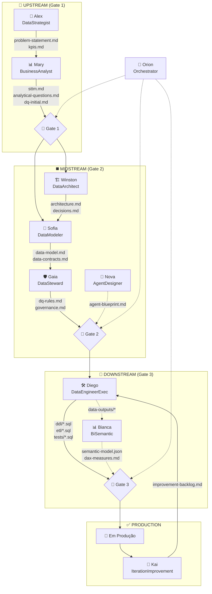
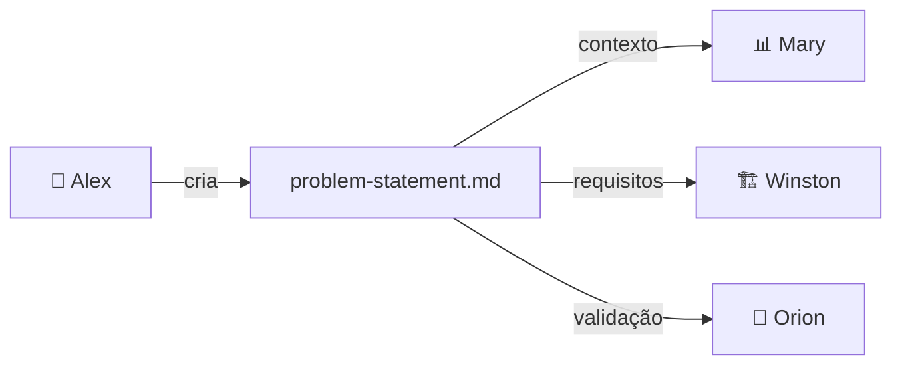
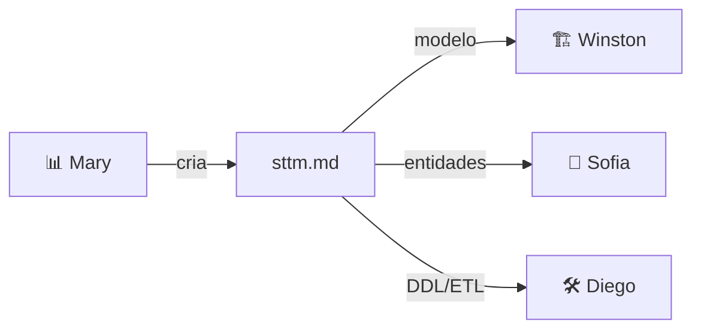
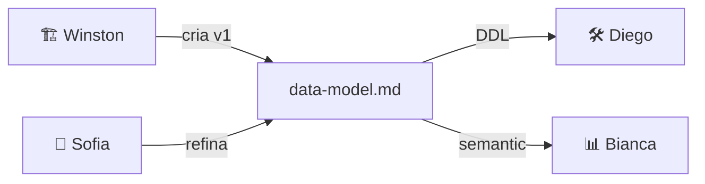
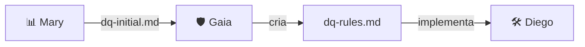
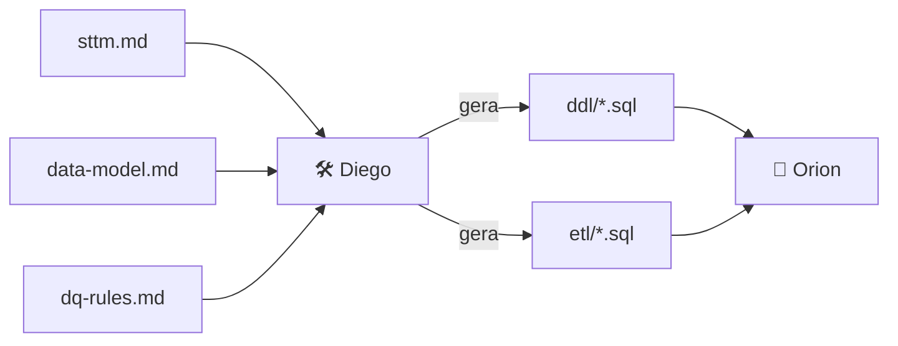

# 📄 Artifact Flow Map - Avanade™ Core Data Engineering Agents

**Versão:** 1.0  
**Data:** 4 de Fevereiro de 2026  
**Propósito:** Documentar o fluxo completo de artefatos entre agentes

---

## 📋 Índice

1. [Visão Geral do Fluxo](#1-visão-geral-do-fluxo)
2. [Mapa de Artefatos por Gate](#2-mapa-de-artefatos-por-gate)
3. [Fluxo Detalhado de Artefatos](#3-fluxo-detalhado-de-artefatos)
4. [Pré-requisitos por Agente](#4-pré-requisitos-por-agente)
5. [Guia Rápido: O que criar antes de cada agente](#5-guia-rápido-o-que-criar-antes-de-cada-agente)
6. [Dependências Visuais](#6-dependências-visuais)

---

## 1. Visão Geral do Fluxo



---

## 2. Mapa de Artefatos por Gate

### 🚪 Gate 1: UPSTREAM → MIDSTREAM

| Artefato | Criado Por | Usado Por | Obrigatório |
|----------|------------|-----------|-------------|
| `problem-statement.md` | 🎯 Alex | Mary, Winston, Orion | ✅ Sim |
| `kpis.md` | 🎯 Alex | Mary, Sofia, Bianca, Orion | ✅ Sim |
| `success-criteria.md` | 🎯 Alex | Orion | ⚠️ Recomendado |
| `stakeholders.md` | 🎯 Alex | Winston, Nova | 📝 Opcional |
| `value-proposition.md` | 🎯 Alex | Stakeholders | 📝 Opcional |
| `sttm.md` | 📊 Mary | Winston, Sofia, Diego | ✅ Sim |
| `analytical-questions.md` | 📊 Mary | Winston, Bianca | ✅ Sim |
| `dq-initial.md` | 📊 Mary | Gaia | ✅ Sim |
| `business-rules.md` | 📊 Mary | Diego | 📝 Opcional |

### 🚪 Gate 2: MIDSTREAM → DOWNSTREAM

| Artefato | Criado Por | Usado Por | Obrigatório |
|----------|------------|-----------|-------------|
| `architecture.md` | 🏗️ Winston | Sofia, Diego, Gaia | ✅ Sim |
| `data-model.md` | 🏗️ Winston / 🧩 Sofia | Diego, Bianca | ✅ Sim |
| `decisions.md` (ADRs) | 🏗️ Winston | Diego, Equipe | ⚠️ Recomendado |
| `tech-stack.md` | 🏗️ Winston | Diego | 📝 Opcional |
| `security-design.md` | 🏗️ Winston | Gaia, Diego | 📝 Opcional |
| `data-contracts.md` | 🧩 Sofia | Diego, Gaia | ✅ Sim |
| `metrics-catalog.md` | 🧩 Sofia | Bianca | ⚠️ Recomendado |
| `granularity-spec.md` | 🧩 Sofia | Diego | 📝 Opcional |
| `dq-rules.md` | 🛡️ Gaia | Diego | ✅ Sim |
| `governance.md` | 🛡️ Gaia | Diego, Bianca | ⚠️ Recomendado |
| `classification.md` | 🛡️ Gaia | Diego | 📝 Opcional |
| `agent-blueprint.md` | 🧠 Nova | Orion | 📝 Opcional |
| `orchestration-flow.md` | 🧠 Nova | Orion | 📝 Opcional |

### 🚪 Gate 3: DOWNSTREAM → PRODUCTION

| Artefato | Criado Por | Usado Por | Obrigatório |
|----------|------------|-----------|-------------|
| `ddl/*.sql` | 🛠️ Diego | Orion, DBA | ✅ Sim |
| `etl/*.sql` | 🛠️ Diego | Orion, Scheduler | ✅ Sim |
| `tests/*.sql` | 🛠️ Diego | Orion, CI/CD | ✅ Sim |
| `pipeline-doc.md` | 🛠️ Diego | Kai, Equipe | ⚠️ Recomendado |
| `observability-config.yaml` | 🛠️ Diego | Kai, Ops | ⚠️ Recomendado |
| `data-catalog.md` | 🛠️ Diego | Bianca, Equipe | 📝 Opcional |
| `lineage-doc.md` | 🛠️ Diego | Gaia | 📝 Opcional |
| `semantic-model.json` | 📊 Bianca | Stakeholders | 📝 Opcional* |
| `dax-measures.md` | 📊 Bianca | Stakeholders | 📝 Opcional* |
| `dashboard-spec.md` | 📊 Bianca | Stakeholders | 📝 Opcional* |

> *Bianca é um agente opcional - só necessário se o projeto precisa de camada BI.

### 🔄 Pós-Gate 3: Melhoria Contínua

| Artefato | Criado Por | Usado Por | Propósito |
|----------|------------|-----------|-----------|
| `improvement-backlog.md` | 🔁 Kai | Diego, Gaia | Ações de melhoria |
| `retrospective.md` | 🔁 Kai | Equipe | Learnings |
| `optimization-report.md` | 🔁 Kai | Alex, Stakeholders | ROI e métricas |
| `incident-review.md` | 🔁 Kai | Diego, Gaia | Prevenção |

---

## 3. Fluxo Detalhado de Artefatos

### 📄 problem-statement.md



**Conteúdo esperado:**
- Business context
- Clear problem description
- Quantified impact
- Scope boundaries (in/out)
- Stakeholders

---

### 📄 sttm.md (Source-to-Target Mapping)



**Conteúdo esperado:**
- Source systems
- Target tables (por camada)
- Field mapping (source → target)
- Data types
- Transformation rules
- PK/FK identification

---

### 📄 data-model.md



**Conteúdo esperado:**
- Entity definitions (Facts/Dims)
- Relationships and cardinality
- Granularity per table
- SCD types for dimensions
- Naming conventions

---

### 📄 dq-rules.md



**Conteúdo esperado:**
- Rules by layer (Landing/Silver/Gold)
- Rule categories (completeness, validity, etc.)
- Severity levels and actions
- Quarantine strategy
- Thresholds

---

### 📄 ddl/*.sql e etl/*.sql



**Conteúdo esperado DDL:**
- CREATE TABLE statements
- Constraints (PK, FK, NOT NULL)
- Indexes
- Partitioning

**Conteúdo esperado ETL:**
- INSERT/MERGE statements
- Transformation logic
- Error handling
- Logging

---

## 4. Pré-requisitos por Agente

### 🎯 Alex (DataStrategist)
```
📥 ENTRADA NECESSÁRIA:
❌ Nenhum artefato prévio
✅ Apenas contexto verbal do projeto

📤 SAÍDA PRODUZIDA:
• problem-statement.md
• kpis.md
• success-criteria.md
```

### 📊 Mary (BusinessAnalyst)
```
📥 ENTRADA NECESSÁRIA:
✅ problem-statement.md (de Alex)
✅ kpis.md (de Alex)
⚠️ success-criteria.md (recomendado)

📤 SAÍDA PRODUZIDA:
• sttm.md
• analytical-questions.md
• dq-initial.md
```

### 🏗️ Winston (DataArchitect)
```
📥 ENTRADA NECESSÁRIA:
✅ Gate 1 APROVADO
✅ sttm.md (de Mary)
✅ analytical-questions.md (de Mary)
⚠️ problem-statement.md (contexto)

📤 SAÍDA PRODUZIDA:
• architecture.md
• data-model.md (v1)
• decisions.md
```

### 🧩 Sofia (DataModeler)
```
📥 ENTRADA NECESSÁRIA:
✅ Gate 1 APROVADO
✅ sttm.md (de Mary)
✅ architecture.md (de Winston)
⚠️ kpis.md (para métricas)

📤 SAÍDA PRODUZIDA:
• data-model.md (refinado)
• data-contracts.md
• metrics-catalog.md
```

### 🧠 Nova (AgentDesigner)
```
📥 ENTRADA NECESSÁRIA:
⚠️ architecture.md (de Winston)
⚠️ problem-statement.md (contexto)
⚠️ stakeholders.md (autonomy levels)

📤 SAÍDA PRODUZIDA:
• agent-blueprint.md
• agent-contracts.md
• orchestration-flow.md
```

### 🛡️ Gaia (DataSteward)
```
📥 ENTRADA NECESSÁRIA:
✅ Gate 1 APROVADO
✅ dq-initial.md (de Mary)
✅ data-model.md (de Winston/Sofia)
✅ architecture.md (de Winston)

📤 SAÍDA PRODUZIDA:
• dq-rules.md
• governance.md
• classification.md
```

### 🛠️ Diego (DataEngineerExec)
```
📥 ENTRADA NECESSÁRIA:
✅ Gate 2 APROVADO
✅ architecture.md (de Winston)
✅ data-model.md (de Sofia)
✅ dq-rules.md (de Gaia)
⚠️ sttm.md (de Mary)

📤 SAÍDA PRODUZIDA:
• ddl/*.sql
• etl/*.sql
• tests/*.sql
• pipeline-doc.md
• observability-config.yaml
```

### 📊 Bianca (BiSemantic) - OPCIONAL
```
📥 ENTRADA NECESSÁRIA:
⚠️ Gate 2 aprovado (ou Gate 3 paralelo)
✅ data-model.md (de Sofia)
⚠️ metrics-catalog.md (de Sofia)
⚠️ analytical-questions.md (de Mary)
⚠️ Tabelas Gold (de Diego)

📤 SAÍDA PRODUZIDA:
• semantic-model.json
• dax-measures.md
• dashboard-spec.md
```

### 🔁 Kai (IterationImprovement)
```
📥 ENTRADA NECESSÁRIA:
✅ Gate 3 APROVADO
✅ Pipelines em produção (de Diego)
⚠️ observability-config.yaml (de Diego)
⚠️ Histórico de incidentes
⚠️ Métricas de execução

📤 SAÍDA PRODUZIDA:
• improvement-backlog.md
• retrospective.md
• optimization-report.md
```

### 🧭 Orion (Orchestrator)
```
📥 ENTRADA NECESSÁRIA:
• Todos os artefatos de todos os agentes

📤 SAÍDA PRODUZIDA:
• Gate validations
• Routing decisions
• Status reports
• Audit trail
```

---

## 5. Guia Rápido: O que criar antes de cada agente

### Sequência Recomendada

```
1. 🎯 @data-strategist → Nada necessário, apenas contexto verbal
   └─ Criar: problem-statement.md, kpis.md

2. 📊 @business-analyst → Precisa: problem-statement.md, kpis.md
   └─ Criar: sttm.md, analytical-questions.md, dq-initial.md

3. 🧭 @orchestrator *gate-1 → Validar artefatos UPSTREAM

4. 🏗️ @data-architect → Precisa: Gate 1, sttm.md
   └─ Criar: architecture.md, data-model.md, decisions.md

5. 🧩 @data-modeler → Precisa: architecture.md, sttm.md
   └─ Criar: data-contracts.md, metrics-catalog.md

6. 🛡️ @data-steward → Precisa: dq-initial.md, data-model.md
   └─ Criar: dq-rules.md, governance.md

7. 🧭 @orchestrator *gate-2 → Validar artefatos MIDSTREAM

8. 🛠️ @data-engineer-exec → Precisa: Gate 2, architecture.md, data-model.md, dq-rules.md
   └─ Criar: ddl/*.sql, etl/*.sql, tests/*.sql

9. 📊 @bi-semantic (opcional) → Precisa: data-model.md, tabelas Gold
   └─ Criar: semantic-model.json, dax-measures.md

10. 🧭 @orchestrator *gate-3 → Validar artefatos DOWNSTREAM

11. 🔁 @iteration-improvement → Precisa: Gate 3, pipelines em produção
    └─ Criar: improvement-backlog.md, retrospective.md
```

---

## 6. Dependências Visuais

### Matriz de Dependência Completa

```
                 PRODUZ →
         ┌────┬────┬────┬────┬────┬────┬────┬────┬────┬────┐
CONSOME  │Alex│Mary│Wins│Sofi│Nova│Gaia│Dieg│Bian│Kai │Orio│
    ↓    │ 🎯 │ 📊 │ 🏗️ │ 🧩 │ 🧠 │ 🛡️ │ 🛠️ │ 📊 │ 🔁 │ 🧭 │
├────────┼────┼────┼────┼────┼────┼────┼────┼────┼────┼────┤
│ 🎯 Alex│  - │    │    │    │    │    │    │    │    │    │
│ 📊 Mary│ ✅ │  - │    │    │    │    │    │    │    │    │
│ 🏗️ Wins│ ⚠️ │ ✅ │  - │    │    │    │    │    │    │ ✅ │
│ 🧩 Sofi│ ⚠️ │ ✅ │ ✅ │  - │    │    │    │    │    │    │
│ 🧠 Nova│ ⚠️ │    │ ✅ │ ⚠️ │  - │    │    │    │    │    │
│ 🛡️ Gaia│    │ ✅ │ ✅ │ ✅ │    │  - │    │    │    │ ✅ │
│ 🛠️ Dieg│    │ ⚠️ │ ✅ │ ✅ │    │ ✅ │  - │    │    │ ✅ │
│ 📊 Bian│ ⚠️ │ ⚠️ │    │ ✅ │    │ ⚠️ │ ⚠️ │  - │    │    │
│ 🔁 Kai │ ⚠️ │    │    │    │    │ ⚠️ │ ✅ │ ⚠️ │  - │    │
│ 🧭 Orio│ ✅ │ ✅ │ ✅ │ ✅ │ ⚠️ │ ✅ │ ✅ │ ⚠️ │ ⚠️ │  - │
└────────┴────┴────┴────┴────┴────┴────┴────┴────┴────┴────┘

✅ = Dependência obrigatória
⚠️ = Dependência recomendada/opcional
```

---

## 📚 Referências

- [GUIA-DE-USO-AGENTES.md](GUIA-DE-USO-AGENTES.md) - Guia completo de uso
- [AGENT-MAPPING.md](AGENT-MAPPING.md) - Mapeamento de comandos
- [gate-criteria-reference.md](../orchestrator-agent/.avanade-core/data/gate-criteria-reference.md) - Critérios de gates

---

*Avanade™ Core Data Engineering Agents - Artifact Flow Map v1.0*
