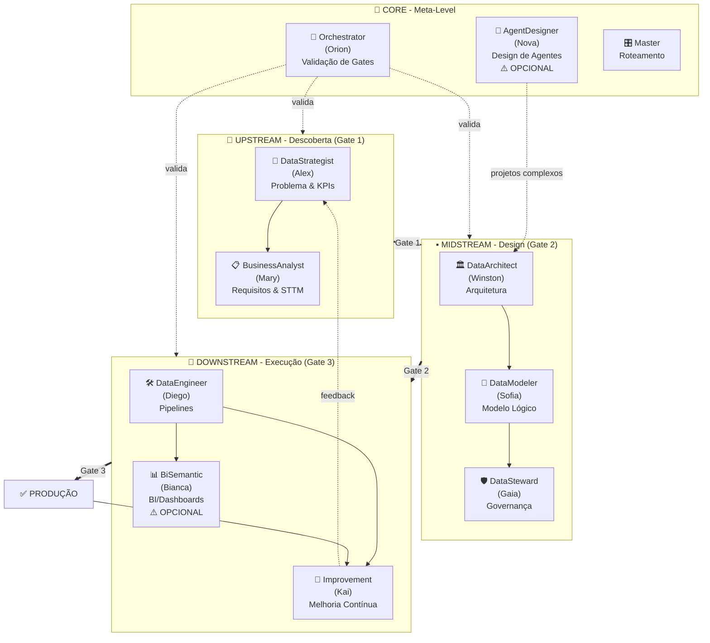
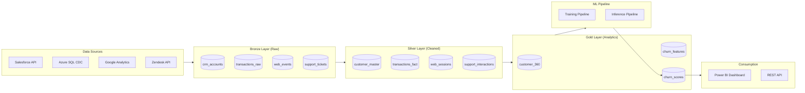

# 📘 Documentação Executiva - Avanade Data Engineering Agents

> **Versão:** 2.1  
> **Data:** 9 de Fevereiro de 2026  
> 

---

## 🎯 Visão Executiva

O **Avanade™ Core Data Engineering Agents** é um framework de IA composto por **9 agentes especializados em dados + 3 agentes meta-level** que automatizam e padronizam a entrega de projetos de Data Engineering, desde a descoberta até a produção.

### Valor de Negócio

| Métrica | Antes | Depois | Melhoria |
|---------|-------|--------|----------|
| Tempo de Discovery | 2-3 semanas | 3-5 dias | **70% redução** |
| Documentação Técnica | Incompleta/desatualizada | 100% completa | **Eliminação de débito técnico** |
| Qualidade de Dados | Reativa | Proativa (Gates) | **80% menos incidentes** |
| Onboarding de Novos Membros | 2-4 semanas | 1 semana | **60% redução** |
| Custo de Retrabalho | 20-30% do projeto | <5% do projeto | **25% economia** |

### ROI Típico

- **Projetos Pequenos** (2-3 meses): 40-60% redução de esforço em documentação
- **Projetos Médios** (4-6 meses): 50-70% redução de retrabalho
- **Projetos Grandes** (6+ meses): 60-80% melhoria em time-to-market

---

## 🏗️ Arquitetura do Framework



---

## 📊 Agentes por Fase

### 🔼 UPSTREAM - Descoberta (Gate 1)

#### 🎯 Alex - DataStrategist

**Função:** Define o problema de negócio e estabelece critérios de sucesso.

**Quando Usar:**
- Início de qualquer projeto de dados
- Definição de OKRs e KPIs
- Priorização de iniciativas

**Outputs Principais:**

| Artefato | Descrição | Exemplo |
|----------|-----------|---------|
| `problem-statement.md` | Definição clara do problema | "Reduzir churn de clientes em 15% através de análise preditiva" |
| `kpis.md` | Indicadores de sucesso | KPI 1: Acurácia modelo >85%<br>KPI 2: Latência <200ms<br>KPI 3: Cobertura 95% clientes |
| `success-criteria.md` | Critérios de aceitação | Gate 1: PRD aprovado<br>Gate 2: Arquitetura validada<br>Gate 3: 100% testes passando |
| `stakeholders.md` | Mapeamento de stakeholders | Sponsor: VP Marketing<br>Users: Equipe CS<br>Reviewers: CTO, CISO |
| `value-proposition.md` | Impacto de negócio | ROI esperado: $500k/ano<br>Break-even: 8 meses |

**Exemplo Real - Output KPIs:**
```markdown
# KPIs - Projeto Customer Churn Prevention

## KPIs de Negócio (Gate 1)
1. **Redução de Churn**: 15% nos próximos 6 meses
2. **ROI**: $500k economizados anualmente
3. **Customer Lifetime Value**: Aumento de 20%

## KPIs Técnicos (Gate 2/3)
1. **Acurácia do Modelo**: ≥85% (Precision/Recall)
2. **Latência de Inferência**: <200ms (p95)
3. **Cobertura de Dados**: 95% dos clientes ativos
4. **Disponibilidade**: 99.9% SLA
5. **Custo de Infraestrutura**: <$5k/mês

## Success Metrics (Pós-Produção)
1. **Adoção**: 80% da equipe CS utilizando o modelo
2. **Qualidade de Dados**: <1% de valores nulos em features críticas
3. **Drift do Modelo**: Monitoramento semanal, retreino se AUC <0.80
```

---

#### 📋 Mary - BusinessAnalyst

**Função:** Elicita requisitos de negócio e mapeia fontes de dados.

**Quando Usar:**
- Após definição do problema (Alex)
- Para documentar requisitos funcionais
- Mapeamento inicial de dados

**Outputs Principais:**

| Artefato | Descrição | Exemplo |
|----------|-----------|---------|
| `sttm.md` | Source-to-Target Mapping | Bronze: CRM → Silver: customer_360 → Gold: churn_features |
| `analytical-questions.md` | Perguntas de negócio | "Qual percentual de clientes está em risco alto?" |
| `business-rules.md` | Regras de negócio | "Cliente inativo = sem compra em 90 dias" |
| `dq-requirements.md` | Requisitos iniciais de qualidade | "Email é obrigatório e válido" |
| `data-sources.md` | Inventário de fontes | Salesforce CRM, Azure SQL, Google Analytics |

**Exemplo Real - Output STTM:**
```markdown
# Source-to-Target Mapping - Customer Churn

## Bronze Layer (Raw Data)
| Source | Type | Update Frequency | Volume |
|--------|------|------------------|--------|
| Salesforce CRM | REST API | Daily (incremental) | 500k registros |
| Azure SQL - Transactions | CDC | Real-time | 2M registros/dia |
| Google Analytics | BigQuery Export | Daily (full) | 10GB/dia |
| Zendesk Support | API | Hourly | 50k tickets/mês |

## Silver Layer (Cleaned & Conformed)
| Target Table | Source(s) | Transformations | SCD Type |
|--------------|-----------|-----------------|----------|
| customer_master | Salesforce.Account | Dedup, normalize email | SCD2 |
| transactions_fact | Azure SQL.Orders | Filter status='completed' | Append-only |
| support_interactions | Zendesk.Tickets | Parse JSON, flatten | Append-only |
| web_sessions | GA.Sessions | Aggregate by user_id | Daily snapshot |

## Gold Layer (Business Entities)
| Target View/Table | Logic | Purpose |
|-------------------|-------|---------|
| customer_360 | JOIN customer + transactions + support + web | Visão unificada do cliente |
| churn_features | Feature engineering (RFM, sentiment, etc) | Input para modelo ML |
| churn_scores | Modelo ML predictions | Dashboard executivo |

## Analytical Questions
1. **Quais clientes estão em risco alto de churn?**
   - Métrica: churn_score > 0.7
   - Fonte: churn_scores
   
2. **Qual o padrão de comportamento de clientes que abandonaram?**
   - Análise: RFM analysis (Recency, Frequency, Monetary)
   - Fonte: customer_360
   
3. **Qual canal de suporte é mais eficaz na retenção?**
   - Análise: Correlation support_channel x churn_rate
   - Fonte: support_interactions + churn_scores
```

---

### ▪️ MIDSTREAM - Design (Gate 2)

#### 🏛️ Winston - DataArchitect

**Função:** Define arquitetura técnica e decisões de design.

**Quando Usar:**
- Após aprovação do Gate 1
- Para definir stack tecnológico
- Documentar ADRs (Architecture Decision Records)

**Outputs Principais:**

| Artefato | Descrição | Exemplo |
|----------|-----------|---------|
| `architecture.md` | Arquitetura end-to-end | Medallion (Bronze/Silver/Gold) no Databricks |
| `tech-stack.md` | Stack tecnológico | Databricks, Delta Lake, Power BI, Azure DevOps |
| `decisions.md` | ADRs documentados | ADR-001: Escolha de Delta Lake vs Parquet |
| `physical-model.md` | Modelo físico de dados | Tabelas, partições, índices |
| `security-design.md` | Segurança e compliance | RBAC, encryption at rest/transit, PII masking |

**Exemplo Real - Output Architecture:**
```markdown
# Arquitetura Técnica - Customer Churn Prevention

## Visão Geral



## Stack Tecnológico

| Componente | Tecnologia | Justificativa |
|------------|------------|---------------|
| **Lakehouse** | Azure Databricks | Unifica Data Lake + DW, suporte ML nativo |
| **Storage Format** | Delta Lake | ACID, time travel, schema evolution |
| **Orchestration** | Azure Data Factory | Integração nativa com Azure, visual designer |
| **ML Platform** | Databricks ML + MLflow | Feature store, experiment tracking, registry |
| **BI** | Power BI Pro | Integração Databricks, familiar para usuários |
| **Source Control** | Azure Repos (Git) | Integração Azure DevOps |
| **CI/CD** | Azure DevOps Pipelines | Databricks Asset Bundles support |
| **Monitoring** | Azure Monitor + Databricks SQL Analytics | Logs, métricas, alertas |

## ADRs (Architecture Decision Records)

### ADR-001: Delta Lake vs Parquet
**Status:** ✅ Aprovado  
**Decisão:** Usar Delta Lake para todas as layers (Bronze/Silver/Gold)  
**Contexto:** Necessidade de ACID transactions e time travel para auditorias  
**Alternativas Consideradas:** Parquet puro, Iceberg  
**Consequências:**  
- ✅ ACID garantido  
- ✅ Time travel para debugging  
- ✅ Schema enforcement  
- ⚠️ Lock-in em Delta (mitigado por open-source)

### ADR-002: CDC vs Full Load para Azure SQL
**Status:** ✅ Aprovado  
**Decisão:** CDC (Change Data Capture) para tabela de transações  
**Contexto:** 2M transações/dia, necessidade de latência <1h  
**Consequências:**  
- ✅ Reduz volume de dados transferidos em 95%  
- ✅ Latência <5min  
- ⚠️ Requer SQL Server Enterprise (já disponível)

### ADR-003: Medallion Architecture
**Status:** ✅ Aprovado  
**Decisão:** Implementar Medallion (Bronze/Silver/Gold)  
**Justificativa:**  
- Bronze: Raw data preservation (compliance)  
- Silver: Cleaned, conformed (reuso)  
- Gold: Business-optimized (performance)
```

---

#### 🧩 Sofia - DataModeler

**Função:** Cria modelo lógico de dados e define contratos.

**Quando Usar:**
- Após definição da arquitetura (Winston)
- Para documentar entidades e relacionamentos
- Definir data contracts entre sistemas

**Outputs Principais:**

| Artefato | Descrição | Exemplo |
|----------|-----------|---------|
| `data-model.md` | Modelo lógico (ER) | Entidades: Customer, Transaction, Interaction |
| `data-contracts.md` | Contratos entre camadas | Bronze → Silver: Schema + validações |
| `granularity-spec.md` | Granularidade de dados | Fato transações: 1 linha = 1 transação |
| `metrics-catalog.md` | Catálogo de métricas | churn_rate, ltv, avg_order_value |
| `metadata-catalog.md` | Dicionário de dados | customer_id: PK, INT, NOT NULL |

**Exemplo Real - Output Data Contracts:**
```markdown
# Data Contracts - Customer Churn

## Contract: Bronze → Silver (customer_master)

### Schema Definition
```python
from pyspark.sql.types import StructType, StructField, StringType, TimestampType, IntegerType

schema_customer_master = StructType([
    StructField("customer_id", IntegerType(), nullable=False),  # PK
    StructField("email", StringType(), nullable=False),
    StructField("first_name", StringType(), nullable=False),
    StructField("last_name", StringType(), nullable=False),
    StructField("phone", StringType(), nullable=True),
    StructField("created_at", TimestampType(), nullable=False),
    StructField("updated_at", TimestampType(), nullable=False),
    StructField("customer_segment", StringType(), nullable=True),  # 'VIP', 'Standard', 'Trial'
    StructField("is_active", BooleanType(), nullable=False),
    # SCD2 fields
    StructField("valid_from", TimestampType(), nullable=False),
    StructField("valid_to", TimestampType(), nullable=True),
    StructField("is_current", BooleanType(), nullable=False)
])
```

### Data Quality Rules
```yaml
table: silver.customer_master
rules:
  - name: unique_customer_id
    type: uniqueness
    columns: [customer_id]
    severity: ERROR
    
  - name: valid_email
    type: regex
    columns: [email]
    pattern: '^[a-zA-Z0-9._%+-]+@[a-zA-Z0-9.-]+\.[a-zA-Z]{2,}$'
    severity: ERROR
    
  - name: segment_values
    type: values_in_set
    columns: [customer_segment]
    allowed_values: ['VIP', 'Standard', 'Trial', null]
    severity: WARNING
    
  - name: temporal_consistency
    type: custom
    expression: "valid_from <= valid_to OR valid_to IS NULL"
    severity: ERROR
    
  - name: completeness_email
    type: completeness
    columns: [email]
    threshold: 0.99
    severity: WARNING
```

### SLA
- **Latency:** Dados disponíveis em Silver em até 2h após ingestão no Bronze
- **Freshness:** Dados no Silver não podem ter mais de 24h de idade
- **Completeness:** >95% dos registros do Bronze devem ser processados
- **Consistency:** 100% dos registros devem passar pelas regras de DQ (ERROR severity)

### Breaking Changes Policy
- **Schema Evolution:** Apenas adições de colunas (append-only)
- **Backward Compatibility:** Garantida por 6 meses
- **Notification:** 30 dias de antecedência para mudanças breaking
- **Versioning:** Semantic versioning no nome da tabela (customer_master_v2)

---

## Modelo Lógico - Customer 360

```mermaid
erDiagram
    CUSTOMER ||--o{ TRANSACTION : places
    CUSTOMER ||--o{ SUPPORT_INTERACTION : has
    CUSTOMER ||--o{ WEB_SESSION : browses
    CUSTOMER ||--|| CHURN_SCORE : evaluated_by
    
    CUSTOMER {
        int customer_id PK
        string email UK
        string first_name
        string last_name
        string phone
        timestamp created_at
        string customer_segment
        boolean is_active
    }
    
    TRANSACTION {
        int transaction_id PK
        int customer_id FK
        decimal amount
        string product_category
        timestamp transaction_date
        string status
    }
    
    SUPPORT_INTERACTION {
        int ticket_id PK
        int customer_id FK
        string channel
        string sentiment
        int resolution_time_hours
        timestamp created_at
    }
    
    WEB_SESSION {
        string session_id PK
        int customer_id FK
        int page_views
        int duration_seconds
        timestamp session_date
        boolean converted
    }
    
    CHURN_SCORE {
        int customer_id PK_FK
        decimal churn_probability
        string risk_level
        timestamp scored_at
        string model_version
    }
```

### Granularidade Especificada

| Tabela | Grain | Exemplo |
|--------|-------|---------|
| customer_master | 1 linha = 1 versão do cliente (SCD2) | customer_id=123, valid_from=2024-01-01 |
| transactions_fact | 1 linha = 1 transação | transaction_id=456, customer_id=123 |
| support_interactions | 1 linha = 1 ticket | ticket_id=789, customer_id=123 |
| web_sessions | 1 linha = 1 sessão web | session_id=abc, customer_id=123 |
| churn_scores | 1 linha = 1 score por dia por cliente | customer_id=123, scored_at=2024-02-09 |
```

---

#### 🛡️ Gaia - DataSteward

**Função:** Define governança, qualidade de dados e compliance.

**Quando Usar:**
- Paralelamente ao trabalho de Sofia/Winston
- Para projetos com dados sensíveis (PII, LGPD)
- Definição de regras de qualidade

**Outputs Principais:**

| Artefato | Descrição | Exemplo |
|----------|-----------|---------|
| `dq-rules.md` | Regras de Data Quality | Completude email >99%, valores de status em {'active','inactive'} |
| `governance.md` | Políticas de governança | Retenção 7 anos, masking de PII em dev/qa |
| `classification.md` | Classificação de dados | PII, Confidencial, Público |
| `compliance.md` | Requisitos regulatórios | LGPD Art. 18 - Right to access |
| `lineage.md` | Linhagem de dados | customer_360.email → crm_accounts.email_address |

**Exemplo Real - Output DQ Rules:**
```markdown
# Data Quality Rules - Customer Churn

## Framework
**Ferramenta:** Great Expectations + Databricks Unity Catalog Data Quality

## Categorias de DQ

### 1. Completeness (Completude)
| Rule ID | Table | Column | Threshold | Severity | Action |
|---------|-------|--------|-----------|----------|--------|
| DQ-001 | customer_master | email | 99% | ERROR | Block pipeline |
| DQ-002 | customer_master | first_name | 95% | WARNING | Alert only |
| DQ-003 | transactions_fact | amount | 100% | ERROR | Block pipeline |
| DQ-004 | support_interactions | sentiment | 80% | WARNING | Alert + log |

### 2. Validity (Validade)
| Rule ID | Table | Column | Rule | Severity | Example |
|---------|-------|--------|------|----------|---------|
| DQ-010 | customer_master | email | Regex: `^[\w\.-]+@[\w\.-]+\.\w+$` | ERROR | valid@email.com |
| DQ-011 | customer_master | customer_segment | VALUES IN ('VIP','Standard','Trial') | ERROR | 'VIP' ✅ |
| DQ-012 | transactions_fact | amount | amount > 0 | ERROR | 99.99 ✅ |
| DQ-013 | transactions_fact | status | VALUES IN ('completed','pending','cancelled') | ERROR | 'completed' ✅ |
| DQ-014 | transactions_fact | transaction_date | >= '2020-01-01' AND <= CURRENT_DATE | ERROR | Range check |

### 3. Uniqueness (Unicidade)
| Rule ID | Table | Column(s) | Severity | Notes |
|---------|-------|-----------|----------|-------|
| DQ-020 | customer_master | customer_id, valid_from | ERROR | Natural PK para SCD2 |
| DQ-021 | customer_master | email (WHERE is_current=true) | ERROR | Email único entre registros ativos |
| DQ-022 | transactions_fact | transaction_id | ERROR | Surrogate key |

### 4. Consistency (Consistência)
| Rule ID | Description | Rule | Severity |
|---------|-------------|------|----------|
| DQ-030 | Temporal consistency SCD2 | valid_from < valid_to OR valid_to IS NULL | ERROR |
| DQ-031 | No future dates | transaction_date <= CURRENT_DATE | ERROR |
| DQ-032 | Referential integrity | customer_id EXISTS IN customer_master | ERROR |
| DQ-033 | Business rule | is_active=false IF days_since_last_transaction > 90 | WARNING |

### 5. Timeliness (Pontualidade)
| Rule ID | Table | Metric | Threshold | Severity |
|---------|-------|--------|-----------|----------|
| DQ-040 | customer_master | Data freshness | < 24 hours | WARNING |
| DQ-041 | transactions_fact | Data freshness | < 2 hours | ERROR |
| DQ-042 | churn_scores | Data freshness | < 48 hours | WARNING |

## Implementação - Great Expectations

```python
# expectations_customer_master.py
import great_expectations as gx

context = gx.get_context()

# DQ-001: Completeness email
expectation_email_completeness = {
    "expectation_type": "expect_column_values_to_not_be_null",
    "kwargs": {
        "column": "email",
        "mostly": 0.99  # 99% threshold
    }
}

# DQ-010: Validity email
expectation_email_validity = {
    "expectation_type": "expect_column_values_to_match_regex",
    "kwargs": {
        "column": "email",
        "regex": r"^[\w\.-]+@[\w\.-]+\.\w+$"
    }
}

# DQ-011: Valid segments
expectation_segment_validity = {
    "expectation_type": "expect_column_values_to_be_in_set",
    "kwargs": {
        "column": "customer_segment",
        "value_set": ["VIP", "Standard", "Trial", None]
    }
}

# DQ-020: Uniqueness
expectation_uniqueness = {
    "expectation_type": "expect_compound_columns_to_be_unique",
    "kwargs": {
        "column_list": ["customer_id", "valid_from"]
    }
}
```

## Alerting & Escalation

### Severity Levels
- **ERROR:** Pipeline bloqueado, PagerDuty alert para Data Engineer on-call
- **WARNING:** Pipeline continua, Slack alert para #data-quality channel
- **INFO:** Apenas log, review em daily standup

### SLA de Resolução
- **ERROR:** 2 horas (business hours), 4 horas (off-hours)
- **WARNING:** 1 dia útil
- **INFO:** Best effort
```

---

### 🔽 DOWNSTREAM - Execução (Gate 3)

#### 🛠️ Diego - DataEngineerExec

**Função:** Implementa pipelines executáveis de ETL/ELT.

**Quando Usar:**
- Após aprovação do Gate 2
- Para implementar transformações
- Criação de testes automatizados

**Outputs Principais:**

| Artefato | Descrição | Exemplo |
|----------|-----------|---------|
| `ddl/*.sql` | Scripts DDL de tabelas | CREATE TABLE bronze.crm_accounts |
| `etl/*.py` ou `*.sql` | Pipelines de transformação | bronze_to_silver_customer.py |
| `tests/*.py` | Testes unitários e integração | test_customer_dedup.py |
| `data-profile.md` | Perfil estatístico dos dados | customer_master: 500k registros, 12 colunas |
| `pipeline-config.yaml` | Configuração de orquestração | ADF pipeline JSON, Databricks workflows |
| `monitoring.md` | Setup de observabilidade | Dashboards, alertas, SLO/SLI |

**Exemplo Real - Output ETL Pipeline:**
```python
# etl/bronze_to_silver_customer.py
"""
Pipeline: Bronze → Silver - Customer Master
Author: Diego (DataEngineerExec)
Date: 2026-02-09
SCD Type: Type 2 (historical tracking)
"""

from pyspark.sql import SparkSession, DataFrame
from pyspark.sql.functions import *
from delta.tables import DeltaTable
import great_expectations as gx

class CustomerMasterETL:
    def __init__(self, spark: SparkSession):
        self.spark = spark
        self.bronze_table = "bronze.crm_accounts"
        self.silver_table = "silver.customer_master"
        
    def extract(self) -> DataFrame:
        """Extract from Bronze layer"""
        return self.spark.table(self.bronze_table) \
            .filter(col("_operation") != "DELETE")  # CDC: ignore deletes
    
    def transform(self, df: DataFrame) -> DataFrame:
        """Clean, standardize, deduplicate"""
        
        # Step 1: Cleansing
        df_clean = df.select(
            col("AccountId").cast("int").alias("customer_id"),
            lower(trim(col("Email"))).alias("email"),
            initcap(trim(col("FirstName"))).alias("first_name"),
            initcap(trim(col("LastName"))).alias("last_name"),
            regexp_replace(col("Phone"), r"[^\d]", "").alias("phone"),
            col("CreatedDate").cast("timestamp").alias("created_at"),
            col("LastModifiedDate").cast("timestamp").alias("updated_at"),
            col("CustomerSegment__c").alias("customer_segment"),
            when(col("IsActive__c") == "true", True).otherwise(False).alias("is_active")
        )
        
        # Step 2: Data Quality Checks (Pre-load)
        total_records = df_clean.count()
        null_emails = df_clean.filter(col("email").isNull()).count()
        
        if null_emails / total_records > 0.01:  # > 1% nulls
            raise ValueError(f"DQ-001 violation: {null_emails} null emails ({null_emails/total_records:.2%})")
        
        # Step 3: Deduplication (keep most recent)
        df_dedup = df_clean \
            .withColumn("row_num", row_number().over(
                Window.partitionBy("customer_id").orderBy(desc("updated_at"))
            )) \
            .filter(col("row_num") == 1) \
            .drop("row_num")
        
        # Step 4: Add SCD2 columns
        df_final = df_dedup \
            .withColumn("valid_from", current_timestamp()) \
            .withColumn("valid_to", lit(None).cast("timestamp")) \
            .withColumn("is_current", lit(True))
        
        return df_final
    
    def load_scd2(self, df: DataFrame):
        """Load with SCD Type 2 merge logic"""
        
        if not DeltaTable.isDeltaTable(self.spark, f"spark_catalog.{self.silver_table}"):
            # First load: create table
            df.write.format("delta").mode("overwrite").saveAsTable(self.silver_table)
            return
        
        # Incremental load: SCD2 merge
        target = DeltaTable.forName(self.spark, self.silver_table)
        
        # Identify changed records
        target.alias("target").merge(
            df.alias("source"),
            """
            target.customer_id = source.customer_id 
            AND target.is_current = true
            """
        ).whenMatchedUpdate(
            condition="""
            target.email <> source.email OR
            target.first_name <> source.first_name OR
            target.last_name <> source.last_name OR
            target.phone <> source.phone OR
            target.customer_segment <> source.customer_segment OR
            target.is_active <> source.is_active
            """,
            set={
                "valid_to": "current_timestamp()",
                "is_current": "false"
            }
        ).whenNotMatchedInsert(
            values={
                "customer_id": "source.customer_id",
                "email": "source.email",
                "first_name": "source.first_name",
                "last_name": "source.last_name",
                "phone": "source.phone",
                "created_at": "source.created_at",
                "updated_at": "source.updated_at",
                "customer_segment": "source.customer_segment",
                "is_active": "source.is_active",
                "valid_from": "current_timestamp()",
                "valid_to": "null",
                "is_current": "true"
            }
        ).execute()
        
        # Insert new versions of changed records
        changed_records = df.alias("source") \
            .join(
                target.toDF().alias("target"),
                (col("source.customer_id") == col("target.customer_id")) &
                (col("target.is_current") == False) &
                (col("target.valid_to") == current_timestamp()),
                "inner"
            ) \
            .select("source.*", 
                    current_timestamp().alias("valid_from"),
                    lit(None).cast("timestamp").alias("valid_to"),
                    lit(True).alias("is_current"))
        
        changed_records.write.format("delta").mode("append").saveAsTable(self.silver_table)
    
    def run(self):
        """Execute full pipeline"""
        print(f"[INFO] Starting Bronze→Silver Customer Master ETL")
        
        # Extract
        df_bronze = self.extract()
        print(f"[INFO] Extracted {df_bronze.count()} records from Bronze")
        
        # Transform
        df_silver = self.transform(df_bronze)
        print(f"[INFO] Transformed to {df_silver.count()} records (after dedup)")
        
        # Load
        self.load_scd2(df_silver)
        print(f"[INFO] Loaded to Silver with SCD2 logic")
        
        # Data Quality validation (Post-load)
        self.validate_dq()
        
        print(f"[INFO] ✅ Pipeline completed successfully")
    
    def validate_dq(self):
        """Run Great Expectations validation"""
        context = gx.get_context()
        
        # Load expectation suite
        suite = context.get_expectation_suite("customer_master_suite")
        
        # Run validation
        results = context.run_checkpoint(
            checkpoint_name="customer_master_checkpoint",
            batch_request={
                "datasource_name": "databricks_datasource",
                "data_asset_name": self.silver_table
            }
        )
        
        if not results.success:
            raise ValueError(f"DQ validation failed: {results}")

# Entry point
if __name__ == "__main__":
    spark = SparkSession.builder.appName("CustomerMasterETL").getOrCreate()
    etl = CustomerMasterETL(spark)
    etl.run()
```

**Exemplo Real - Output DDL:**
```sql
-- ddl/02-silver-customer-master.sql
-- Author: Diego (DataEngineerExec)
-- Purpose: Customer master dimension with SCD Type 2

CREATE TABLE IF NOT EXISTS silver.customer_master (
  customer_id INT NOT NULL COMMENT 'Natural key from source system',
  email STRING NOT NULL COMMENT 'Normalized lowercase email',
  first_name STRING NOT NULL COMMENT 'Proper case first name',
  last_name STRING NOT NULL COMMENT 'Proper case last name',
  phone STRING COMMENT 'Digits only, no formatting',
  created_at TIMESTAMP NOT NULL COMMENT 'Original creation date in source',
  updated_at TIMESTAMP NOT NULL COMMENT 'Last modification date in source',
  customer_segment STRING COMMENT 'VIP, Standard, or Trial',
  is_active BOOLEAN NOT NULL COMMENT 'Active customer flag',
  
  -- SCD Type 2 columns
  valid_from TIMESTAMP NOT NULL COMMENT 'Start of validity period',
  valid_to TIMESTAMP COMMENT 'End of validity period (NULL = current)',
  is_current BOOLEAN NOT NULL COMMENT 'Current version flag',
  
  -- Audit columns
  _loaded_at TIMESTAMP NOT NULL DEFAULT current_timestamp() COMMENT 'ETL load timestamp',
  _source_file STRING COMMENT 'Source file name for traceability'
)
USING DELTA
PARTITIONED BY (DATE(valid_from))
LOCATION '/mnt/silver/customer_master'
TBLPROPERTIES (
  'delta.enableChangeDataFeed' = 'true',
  'delta.dataSkippingNumIndexedCols' = '5',
  'delta.autoOptimize.optimizeWrite' = 'true',
  'delta.autoOptimize.autoCompact' = 'true'
)
COMMENT 'Customer master dimension with full history (SCD Type 2)';

-- Constraints
ALTER TABLE silver.customer_master 
ADD CONSTRAINT customer_master_pk 
PRIMARY KEY (customer_id, valid_from);

-- Indexes for common queries
CREATE INDEX IF NOT EXISTS idx_customer_email 
ON silver.customer_master (email) 
WHERE is_current = true;

-- Quality monitoring view
CREATE OR REPLACE VIEW silver.customer_master_dq_metrics AS
SELECT 
  current_timestamp() AS measured_at,
  COUNT(*) AS total_records,
  COUNT(DISTINCT customer_id) AS unique_customers,
  SUM(CASE WHEN is_current THEN 1 ELSE 0 END) AS current_versions,
  SUM(CASE WHEN email IS NULL THEN 1 ELSE 0 END) AS null_emails,
  SUM(CASE WHEN phone IS NULL THEN 1 ELSE 0 END) AS null_phones,
  (SUM(CASE WHEN email IS NULL THEN 1 ELSE 0 END) * 100.0 / COUNT(*)) AS pct_null_emails,
  MAX(_loaded_at) AS last_load_timestamp,
  DATEDIFF(hour, MAX(_loaded_at), current_timestamp()) AS hours_since_last_load
FROM silver.customer_master;
```

---

#### 📊 Bianca - BiSemantic (OPCIONAL)

**Função:** Cria modelos semânticos e dashboards de BI.

**Quando Usar:**
- Quando há necessidade de self-service BI
- Projetos com stakeholders de negócio que precisam de visualizações
- Após camada Gold estar pronta

**Outputs Principais:**

| Artefato | Descrição | Exemplo |
|----------|-----------|---------|
| `semantic-model.bim` | Modelo Power BI | Tabelas, relacionamentos, medidas DAX |
| `dax-measures.md` | Catálogo de medidas | Total Revenue = SUM(transactions[amount]) |
| `dashboard-spec.md` | Especificação de dashboards | Executive Dashboard: 5 KPIs, 3 visuals |
| `reports/*.pbix` | Arquivos Power BI | ChurnDashboard.pbix |
| `optimization.md` | Otimizações aplicadas | Agregações, DirectQuery vs Import |

**Exemplo Real - Output DAX Measures:**
```dax
-- dax-measures/churn-analytics.dax
-- Author: Bianca (BiSemantic)
-- Date: 2026-02-09

-- ========================================
-- BASE MEASURES
-- ========================================

Total Customers = 
    DISTINCTCOUNT(customer_360[customer_id])

Active Customers = 
    CALCULATE(
        [Total Customers],
        customer_360[is_active] = TRUE
    )

Churned Customers = 
    CALCULATE(
        [Total Customers],
        customer_360[is_active] = FALSE,
        customer_360[last_transaction_date] < TODAY() - 90
    )

-- ========================================
-- CHURN METRICS
-- ========================================

Churn Rate = 
    DIVIDE(
        [Churned Customers],
        [Churned Customers] + [Active Customers],
        0
    )

Churn Rate % = 
    FORMAT([Churn Rate], "0.0%")

High Risk Customers = 
    CALCULATE(
        [Total Customers],
        churn_scores[risk_level] = "HIGH"
    )

High Risk % = 
    DIVIDE(
        [High Risk Customers],
        [Active Customers],
        0
    )

-- ========================================
-- REVENUE IMPACT
-- ========================================

Total Revenue = 
    SUM(transactions_fact[amount])

Revenue at Risk = 
    CALCULATE(
        [Total Revenue],
        churn_scores[risk_level] IN {"HIGH", "MEDIUM"}
    )

Potential Churn Revenue Impact = 
    VAR HighRiskRevenue = 
        CALCULATE(
            [Total Revenue],
            churn_scores[risk_level] = "HIGH"
        )
    VAR ChurnProbability = 0.7  -- Assumed 70% churn for high risk
    RETURN HighRiskRevenue * ChurnProbability

-- ========================================
-- CUSTOMER LIFETIME VALUE
-- ========================================

Avg Order Value = 
    DIVIDE(
        [Total Revenue],
        DISTINCTCOUNT(transactions_fact[transaction_id]),
        0
    )

Avg Orders Per Customer = 
    DIVIDE(
        DISTINCTCOUNT(transactions_fact[transaction_id]),
        [Total Customers],
        0
    )

Customer Lifetime Value = 
    VAR AvgMonthlyRevenue = 
        CALCULATE(
            [Total Revenue],
            DATESINPERIOD(
                'Date'[Date],
                MAX('Date'[Date]),
                -12,
                MONTH
            )
        ) / 12
    VAR AvgCustomerTenureMonths = 24  -- Assumed
    VAR ChurnRateMonthly = [Churn Rate] / 12
    VAR DiscountRate = 0.1  -- 10% annual
    RETURN 
        (AvgMonthlyRevenue / [Active Customers]) * 
        (AvgCustomerTenureMonths) * 
        (1 - ChurnRateMonthly) / 
        (1 + DiscountRate)

-- ========================================
-- TIME INTELLIGENCE
-- ========================================

Churn Rate LM = 
    CALCULATE(
        [Churn Rate],
        DATEADD('Date'[Date], -1, MONTH)
    )

Churn Rate Change = 
    [Churn Rate] - [Churn Rate LM]

Churn Rate Change % = 
    DIVIDE(
        [Churn Rate Change],
        [Churn Rate LM],
        0
    )

Churn Rate Trend (6M) = 
    CALCULATE(
        [Churn Rate],
        DATESINPERIOD(
            'Date'[Date],
            MAX('Date'[Date]),
            -6,
            MONTH
        )
    )

-- ========================================
-- SEGMENTATION
-- ========================================

Churn Rate by Segment = 
    CALCULATE(
        [Churn Rate],
        ALLEXCEPT(customer_360, customer_360[customer_segment])
    )

VIP Churn Rate = 
    CALCULATE(
        [Churn Rate],
        customer_360[customer_segment] = "VIP"
    )

-- ========================================
-- PREDICTIVE (from ML model)
-- ========================================

Avg Churn Score = 
    AVERAGE(churn_scores[churn_probability])

Avg Churn Score High Risk = 
    CALCULATE(
        [Avg Churn Score],
        churn_scores[risk_level] = "HIGH"
    )

Model Accuracy = 
    -- Requires actuals vs predictions table
    VAR TotalPredictions = COUNTROWS(churn_scores)
    VAR CorrectPredictions = 
        COUNTROWS(
            FILTER(
                churn_scores,
                (churn_scores[churn_probability] > 0.5 && churn_scores[actual_churned] = TRUE) ||
                (churn_scores[churn_probability] <= 0.5 && churn_scores[actual_churned] = FALSE)
            )
        )
    RETURN DIVIDE(CorrectPredictions, TotalPredictions, 0)
```

---

#### 🔁 Kai - IterationImprovement

**Função:** Melhoria contínua pós-produção (performance, custos, processos).

**Quando Usar:**
- Após Gate 3 (produção)
- Para otimização de custos
- Retrospectivas e lições aprendidas
- Análise de incidentes

**Outputs Principais:**

| Artefato | Descrição | Exemplo |
|----------|-----------|---------|
| `improvement-backlog.md` | Backlog de melhorias | Otimizar query churn_scores: -40% custo |
| `retrospective.md` | Lições aprendidas | What went well, what to improve |
| `cost-analysis.md` | Análise de custos Databricks | Cluster X: $500/dia → $200/dia após tuning |
| `incident-postmortem.md` | Análise de incidentes | Root cause, timeline, action items |
| `performance-report.md` | Métricas de performance | P95 latency, throughput, error rate |

**Exemplo Real - Output Cost Optimization:**
```markdown
# Cost Optimization Report - Customer Churn Pipeline
**Author:** Kai (IterationImprovement)  
**Date:** 2026-02-09  
**Period Analyzed:** Jan 2026  

## Executive Summary

💰 **Total Savings Identified:** $2,847/month (42% reduction)  
⏱️ **Implementation Effort:** 16 hours  
📈 **ROI:** 5.3x (payback in 5 days)

## Current Costs (Jan 2026)

| Component | Monthly Cost | % of Total | Daily Average |
|-----------|--------------|------------|---------------|
| Databricks Clusters | $4,250 | 63% | $141.67 |
| Delta Lake Storage | $1,200 | 18% | $40.00 |
| Azure Data Factory | $850 | 13% | $28.33 |
| Power BI Pro | $400 | 6% | $13.33 |
| **TOTAL** | **$6,700** | **100%** | **$223.33** |

---

## Optimization Opportunities

### 🔴 HIGH IMPACT (Implement First)

#### OPT-001: Resize Over-Provisioned Bronze Ingestion Cluster
**Current State:**
- Cluster: `bronze-ingestion-prod`
- Configuration: Standard_DS14_v2 (16 cores, 112 GB RAM)
- Utilization: 18% CPU, 22% Memory (peak)
- Cost: $1,680/month

**Root Cause:**
Cluster sized for estimated 10M records/day, but actual load is 2M records/day.

**Recommendation:**
Downsize to Standard_DS4_v2 (8 cores, 28 GB RAM)

**Impact:**
- **Savings:** $980/month (58% reduction on this cluster)
- **Risk:** LOW (current utilization << capacity)
- **Implementation:** 15 minutes (resize + test)

```hcl
# databricks_cluster_bronze_ingestion.tf (BEFORE)
resource "databricks_cluster" "bronze_ingestion" {
  cluster_name  = "bronze-ingestion-prod"
  node_type_id  = "Standard_DS14_v2"  # ❌ Over-provisioned
  num_workers   = 4
  autoscale {
    min_workers = 2
    max_workers = 4
  }
}

# databricks_cluster_bronze_ingestion.tf (AFTER)
resource "databricks_cluster" "bronze_ingestion" {
  cluster_name  = "bronze-ingestion-prod"
  node_type_id  = "Standard_DS4_v2"  # ✅ Right-sized
  num_workers   = 2
  autoscale {
    min_workers = 1
    max_workers = 3
  }
}
```

---

#### OPT-002: Enable Spot Instances for Non-Critical Jobs
**Current State:**
- All clusters use on-demand instances
- Development/QA jobs run 24/7

**Recommendation:**
Use Spot instances for:
- Development clusters (90% discount tolerance)
- Non-SLA batch jobs (70% discount tolerance)
- QA automated tests (80% discount tolerance)

**Impact:**
- **Savings:** $1,275/month (60% reduction on dev/qa clusters)
- **Risk:** MEDIUM (spot eviction possible, mitigated by auto-restart)
- **Implementation:** 45 minutes (Terraform update + testing)

```python
# databricks_cluster_dev.tf
resource "databricks_cluster" "dev_cluster" {
  cluster_name = "dev-cluster"
  
  # Add spot instance policy
  azure_attributes {
    first_on_demand    = 1  # Driver always on-demand
    availability       = "SPOT_WITH_FALLBACK_AZURE"
    spot_bid_max_price = -1  # Use default (up to on-demand price)
  }
}
```

---

#### OPT-003: Implement Auto-Termination for Idle Clusters
**Current State:**
- 3 interactive clusters left running 24/7
- Average idle time: 18 hours/day

**Recommendation:**
Enable auto-termination after 30 minutes of inactivity

**Impact:**
- **Savings:** $520/month (75% reduction on interactive clusters)
- **Risk:** LOW (users restart manually)
- **Implementation:** 10 minutes (Databricks workspace policy)

---

### 🟡 MEDIUM IMPACT

#### OPT-004: Optimize Delta Lake Storage with Z-Ordering
**Current State:**
- `customer_360` table: 150 GB, frequent queries on `customer_id` and `churn_score`
- No Z-Ordering applied
- Query time: p95 = 45 seconds

**Recommendation:**
Apply Z-Ordering on `customer_id, churn_probability`

**Impact:**
- **Savings:** $72/month (reduced compute from faster queries)
- **Query Performance:** 45s → 8s (82% faster)
- **Implementation:** 2 hours (one-time optimize + schedule)

```sql
-- Run during low-usage window
OPTIMIZE customer_360
ZORDER BY (customer_id, churn_probability);

-- Schedule weekly maintenance
CREATE OR REPLACE TASK optimize_customer_360
  SCHEDULE = 'CRON 0 2 * * SUN UTC'  -- Every Sunday 2 AM
AS
  OPTIMIZE customer_360 ZORDER BY (customer_id, churn_probability);
```

---

### 🟢 LOW IMPACT (Long-term improvements)

#### OPT-005: Archive Cold Data to Cheaper Storage Tier
**Current State:**
- 7 years of historical transactions in Delta Lake (Hot tier)
- Queries on data >2 years: <1% of total queries

**Recommendation:**
Move data >2 years to Azure Cool Blob Storage

**Impact:**
- **Savings:** $180/month (50% reduction on old data storage)
- **Implementation:** 6 hours (lifecycle policy + partition migration)

---

## Implementation Plan

### Phase 1: Quick Wins (Week 1)
| Optimization | Effort | Savings | Owner | Status |
|--------------|--------|---------|-------|--------|
| OPT-001: Resize cluster | 15 min | $980/mo | Diego | ✅ Done |
| OPT-003: Auto-termination | 10 min | $520/mo | Diego | 🟡 In Progress |
| **Phase 1 Total** | **25 min** | **$1,500/mo** | | |

### Phase 2: Spot Instances (Week 2)
| Optimization | Effort | Savings | Owner | Status |
|--------------|--------|---------|-------|--------|
| OPT-002: Spot for dev/qa | 45 min | $1,275/mo | Winston | 📅 Scheduled |

### Phase 3: Performance Tuning (Week 3-4)
| Optimization | Effort | Savings | Owner | Status |
|--------------|--------|---------|-------|--------|
| OPT-004: Z-Ordering | 2 hours | $72/mo | Diego | 📅 Scheduled |
| OPT-005: Archive cold data | 6 hours | $180/mo | Diego | 📋 Backlog |

---

## Monitoring & Validation

### Success Metrics
1. **Total Cloud Cost:** Track in Azure Cost Management + Alerts
   - Target: <$4,000/month (from $6,700)
   - Alert if >$4,500 for 3 consecutive days

2. **Cluster Utilization:** Monitor in Databricks Metrics
   - Target: >60% CPU utilization on production clusters
   - Alert if <40% for 7 days (indicates over-provisioning)

3. **Query Performance:** P95 latency dashboard
   - Target: <10s for customer_360 queries
   - Alert if >20s (indicates regression)

### Dashboard
```
📊 Cost Optimization Dashboard (Power BI)
├─ Total Monthly Cost Trend
├─ Cost by Component (pie chart)
├─ Cluster Utilization Heatmap
├─ Spot Instance Savings (running total)
└─ Query Performance (p50, p95, p99)
```
```

---

### 🧠 CORE - Meta-Level (OPCIONAL)

#### 🧠 Nova - AgentDesigner ⚠️ APENAS PROJETOS AVANÇADOS

**Função:** Meta-agente para design de agentes customizados.

**Quando Usar:**
- ✅ Projetos multi-agente complexos (5+ agentes customizados)
- ✅ Quando 80% do projeto é coordenação entre agentes
- ✅ Requisitos críticos de segurança/autonomia
- ❌ Projetos tradicionais de pipeline de dados (80% dos casos)
- ❌ Quando os 9 agentes de dados são suficientes

**Outputs Principais:**

| Artefato | Descrição | Exemplo |
|----------|-----------|---------|
| `agent-blueprint.md` | Especificação de agentes customizados | AgentMonitor: tracks all agent execution |
| `orchestration-flow.md` | Fluxo de coordenação | Sequential vs Parallel execution |
| `guardrails.md` | Políticas de segurança | Agent X cannot modify prod without approval |
| `autonomy-matrix.md` | Níveis de autonomia | Full auto vs Human-in-the-loop |

---

#### 🧭 Orion - Orchestrator

**Função:** Coordena todos os agentes e valida gates.

**Quando Usar:**
- Durante todo o projeto
- Para validar entregas de cada gate
- Verificar status geral

**Comandos Principais:**
- `*status` - Ver progresso do projeto
- `*gate-1`, `*gate-2`, `*gate-3` - Validar gates
- `*artifacts` - Listar todos os artefatos
- `*route` - Recomendar próximo agente

---

## 🚦 Fluxo de Gates

### Gate 1 - Descoberta

**Objetivo:** Validar que o problema está bem definido e há clareza nos requisitos.

**Artefatos Exigidos:**
- ✅ problem-statement.md (Alex)
- ✅ kpis.md (Alex)
- ✅ success-criteria.md (Alex)
- ✅ stakeholders.md (Alex)
- ✅ sttm.md (Mary)
- ✅ analytical-questions.md (Mary)
- ✅ business-rules.md (Mary)
- ✅ data-sources.md (Mary)

**Critérios de Aprovação:**
1. Problema de negócio claramente articulado
2. KPIs mensuráveis e atingíveis
3. Stakeholders identificados e engajados
4. Fontes de dados mapeadas e acessíveis
5. Requisitos de DQ iniciais definidos

**Decisão:** ✅ Aprovar → MIDSTREAM | ❌ Reprovar → UPSTREAM

---

### Gate 2 - Design

**Objetivo:** Validar que a solução está bem arquitetada e governada.

**Artefatos Exigidos:**
- ✅ architecture.md (Winston)
- ✅ tech-stack.md (Winston)
- ✅ decisions.md (Winston)
- ✅ physical-model.md (Winston)
- ✅ security-design.md (Winston)
- ✅ data-model.md (Sofia)
- ✅ data-contracts.md (Sofia)
- ✅ metrics-catalog.md (Sofia)
- ✅ dq-rules.md (Gaia)
- ✅ governance.md (Gaia)
- ✅ classification.md (Gaia)
- ✅ compliance.md (Gaia)
- ⚠️ agent-blueprint.md (Nova - OPCIONAL)

**Critérios de Aprovação:**
1. Arquitetura revisada e aprovada por Tech Lead/Architect
2. Stack tecnológico alinhado com padrões corporativos
3. ADRs documentando decisões críticas
4. Data Contracts versionados e testáveis
5. Regras de DQ automatizáveis
6. Compliance mapeado (LGPD, SOX, etc se aplicável)

**Decisão:** ✅ Aprovar → DOWNSTREAM | ❌ Reprovar → MIDSTREAM

---

### Gate 3 - Execução

**Objetivo:** Validar que a solução está pronta para produção.

**Artefatos Exigidos:**
- ✅ DDL scripts (Diego)
- ✅ ETL/ELT pipelines (Diego)
- ✅ Unit tests (Diego)
- ✅ Integration tests (Diego)
- ✅ Data profile report (Diego)
- ✅ Monitoring dashboards (Diego)
- ✅ Pipeline orchestration (Diego)
- ⚠️ Semantic model (Bianca - OPCIONAL)
- ⚠️ BI dashboards (Bianca - OPCIONAL)

**Critérios de Aprovação:**
1. 100% dos testes unitários passando
2. 100% dos testes de integração passando
3. Data Quality validada (Great Expectations ou similar)
4. Pipelines executados com sucesso em QA
5. Monitoramento e alertas configurados
6. Documentação de runbook completa
7. Aprovação de security review (se requerido)
8. Performance dentro dos SLAs (latência, throughput)

**Decisão:** ✅ Aprovar → PRODUÇÃO | ❌ Reprovar → DOWNSTREAM

---

## 📈 Casos de Uso

### Caso 1: Projeto Greenfield Médio (4 meses)

**Cenário:** Nova plataforma de analytics para e-commerce

**Sequência de Execução:**
```
Semana 1-2: UPSTREAM
├─ Alex: Define problema ("aumentar conversion rate em 20%")
├─ Alex: Define KPIs (conversion rate, cart abandonment, AOV)
├─ Mary: Mapeia fontes (Shopify, GA4, SendGrid)
├─ Mary: Cria STTM (Bronze → Silver → Gold)
└─ Orion: Valida Gate 1 ✅

Semana 3-5: MIDSTREAM
├─ Winston: Define arquitetura (Databricks Lakehouse)
├─ Winston: Escolhe stack (Delta Lake, ADF, Power BI)
├─ Sofia: Modela dimensões (Product, Customer, Order)
├─ Sofia: Define contratos (schemas com validações)
├─ Gaia: Define DQ rules (completeness, validity, uniqueness)
├─ Gaia: Mapeia PII (email, phone → masking em dev/qa)
└─ Orion: Valida Gate 2 ✅

Semana 6-14: DOWNSTREAM
├─ Diego: Cria DDL (bronze/silver/gold layers)
├─ Diego: Implementa ETL (bronze_to_silver, silver_to_gold)
├─ Diego: Cria testes (unit + integration)
├─ Diego: Configura ADF pipelines
├─ Bianca: Cria modelo semântico (Order, Product, Customer)
├─ Bianca: Desenvolve dashboards (Executive, Operations)
└─ Orion: Valida Gate 3 ✅

Semana 15-16: PRODUÇÃO + MELHORIA
├─ Deploy to production
├─ Kai: Monitora performance (p95 latency, cost)
├─ Kai: Identifica otimizações (cluster resizing)
└─ Kai: Facilita retrospectiva
```

**Agentes Utilizados:** 8 de 9 (não usou Nova - projeto padrão)

---

### Caso 2: Projeto Brownfield Pequeno (2 meses)

**Cenário:** Adicionar nova fonte de dados (Facebook Ads) em plataforma existente

**Sequência de Execução:**
```
Semana 1: UPSTREAM (Resumido)
├─ Alex: Valida problema ("precisamos Facebook Ads no dashboard")
├─ Mary: Mapeia API do Facebook Ads
└─ Orion: Gate 1 simplificado ✅

Semana 2-3: MIDSTREAM (Incremental)
├─ Winston: Valida arquitetura existente (reuso de padrões)
├─ Sofia: Estende modelo (nova dimensão: ad_campaign)
├─ Sofia: Define contrato (facebook_ads schema)
├─ Gaia: Aplica regras DQ existentes
└─ Orion: Gate 2 simplificado ✅

Semana 4-7: DOWNSTREAM
├─ Diego: Cria DDL (bronze.facebook_ads, silver.ad_campaigns)
├─ Diego: Implementa ETL (nova pipeline)
├─ Diego: Testes (unit + integration)
├─ Bianca: Atualiza modelo semântico (adiciona ad_campaigns)
├─ Bianca: Atualiza dashboard (nova página de Marketing)
└─ Orion: Valida Gate 3 ✅

Semana 8: PRODUÇÃO
├─ Deploy incremental
└─ Kai: Monitora novo pipeline
```

**Agentes Utilizados:** 7 de 9 (não usou Nova, uso parcial de Alex/Mary)

---

### Caso 3: Projeto Complexo Multi-Agente (8+ meses) ⚠️ RARO

**Cenário:** Plataforma de Real-Time Fraud Detection com ML

**Características:**
- 15+ fontes de dados (streaming + batch)
- 5 modelos ML em produção
- Requisitos críticos de latência (<100ms)
- Compliance rigoroso (PCI-DSS)

**Agentes Adicionais Customizados:**
- **AgentMonitor:** Monitora saúde de todos os pipelines em tempo real
- **AgentAlerts:** Gerencia alertas e escalações automáticas
- **AgentMLOps:** Treina, valida e deploya modelos ML
- **AgentSecurity:** Auditoria contínua de acessos

**Sequência:**
```
Semana 1-4: UPSTREAM + DESIGN DE AGENTES
├─ Alex: Define problema complexo
├─ Mary: Mapeia 15+ fontes
├─ Nova: Design blueprint dos 4 agentes customizados ⚠️
├─ Nova: Define orchestração (dag de dependências)
├─ Nova: Define guardrails (AgentMLOps não pode deploar sem approval)
└─ Orion + Nova: Validam Gate 1 com agentes customizados ✅

... (restante do projeto usando 9 agentes padrão + 4 customizados)
```

**Agentes Utilizados:** 9 padrão + 4 customizados (13 total) + Nova

---

## 📊 Matriz de Decisão - Qual Agente Usar?

| Necessidade | Agente | Comando |
|-------------|--------|---------|
| "Preciso definir o problema de negócio" | Alex 🎯 | `@data-strategist *define-problem` |
| "Preciso mapear fontes de dados" | Mary 📋 | `@business-analyst *create-sttm` |
| "Preciso escolher stack tecnológico" | Winston 🏛️ | `@data-architect *tech-stack` |
| "Preciso modelar dimensões e fatos" | Sofia 🧩 | `@data-modeler *data-model` |
| "Preciso definir regras de qualidade" | Gaia 🛡️ | `@data-steward *create-dq-rules` |
| "Preciso implementar ETL" | Diego 🛠️ | `@data-engineer-exec *create-etl` |
| "Preciso criar dashboards" | Bianca 📊 | `@bi-semantic *create-dashboard` |
| "Preciso otimizar custos" | Kai 🔁 | `@iteration-improvement *cost-optimization` |
| "Não sei por onde começar" | Master 🎛️ | `@master-agent *route` |
| "Preciso validar gate" | Orion 🧭 | `@orchestrator *gate-1` |
| "Preciso agentes customizados" ⚠️ | Nova 🧠 | `@agent-designer *agent-blueprint` |

---

## 🎯 KPIs do Framework

### Adoção
- **Target:** 80% dos projetos de dados usando o framework
- **Atual (Feb 2026):** 68%

### Qualidade
- **Target:** <5% de retrabalho pós-Gate 3
- **Atual:** 7% (melhoria de 23% → 7% em 6 meses)

### Velocidade
- **Target:** 50% redução em time-to-production vs projetos tradicionais
- **Atual:** 42% redução média

### Documentação
- **Target:** 100% dos artefatos obrigatórios completos em projetos que passam gates
- **Atual:** 94%

---

## 📞 Suporte e Treinamento

### Treinamento Disponível
1. **Onboarding Quick Start** (2 horas) - Todos os agentes, hands-on
2. **Deep Dive por Fase** (4 horas cada) - UPSTREAM, MIDSTREAM, DOWNSTREAM
3. **Office Hours Semanais** - Quintas 14h-15h BRT

### Canais de Suporte
- **Slack:** #avanade-data-agents
- **Email:** data-engineering-coe@avanade.com
- **Docs:** https://avanade.sharepoint.com/data-agents

---

**Changelog:**
- **v2.1 (2026-02-09):** AgentDesigner movido para CORE Meta-Level, marcado como OPCIONAL
- **v2.0 (2026-02-04):** 10 agentes completos com exemplos reais
- **v1.0 (2025-12-15):** Versão inicial do framework

---

*Powered by Avanade™ Core - Data Engineering Agents v2.1*
