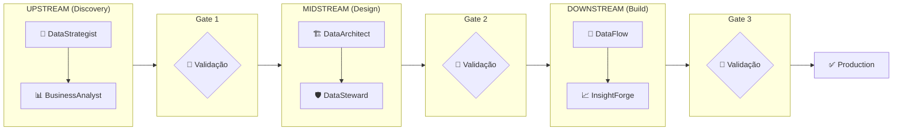

# 📘 Guia de Uso - Agentes Avanade™ Core para Data Engineering

**Versão:** 1.0  
**Data:** 4 de Fevereiro de 2026  
**Autor:** Avanade Method Team

---

## 📑 Índice

1. [Visão Geral](#1-visão-geral)
2. [Fluxo do Projeto](#2-fluxo-do-projeto)
3. [Agentes por Fase](#3-agentes-por-fase)
4. [Exemplos Práticos de Uso](#4-exemplos-práticos-de-uso)
5. [Referência Rápida de Comandos](#5-referência-rápida-de-comandos)
6. [Boas Práticas](#6-boas-práticas)

---

## 1. Visão Geral

O Avanade™ Core para Data Engineering é um framework de agentes de IA especializados que guiam você através de todas as fases de um projeto de dados, desde a definição do problema até a entrega em produção.

### Arquitetura de Fases e Gates

```
┌─────────────────────────────────────────────────────────────────────────────┐
│                           PROJETO DE DADOS                                   │
│                                                                              │
│  ┌───────────────────────────────────────────────────────────────────────┐  │
│  │                    🧭 ORCHESTRATOR (Coordenador)                       │  │
│  │         Valida gates, coordena transições, audita progresso           │  │
│  └───────────────────────────────────────────────────────────────────────┘  │
│                                    │                                         │
│  ══════════════════════════════════╪═══════════════════════════════════════ │
│                                    ▼                                         │
│  ┌─────────────────────────────────────────────────────────────────────┐    │
│  │                     FASE 1: UPSTREAM (Gate 1)                        │    │
│  │                                                                      │    │
│  │   🎯 DataStrategist          📊 BusinessAnalyst                     │    │
│  │   ├─ *define-problem         ├─ *create-sttm                        │    │
│  │   ├─ *create-kpis            ├─ *analytical-questions               │    │
│  │   └─ *success-criteria       └─ *dq-initial                         │    │
│  │                                                                      │    │
│  │   📄 Artefatos:               📄 Artefatos:                          │    │
│  │   • problem-statement.md      • sttm.md                              │    │
│  │   • kpis.md                   • analytical-questions.md             │    │
│  │   • success-criteria.md       • dq-initial.md                       │    │
│  └─────────────────────────────────────────────────────────────────────┘    │
│                                    │                                         │
│                          🧭 *gate-1 (Validação)                             │
│                                    ▼                                         │
│  ┌─────────────────────────────────────────────────────────────────────┐    │
│  │                    FASE 2: MIDSTREAM (Gate 2)                        │    │
│  │                                                                      │    │
│  │   🏗️ DataArchitect            🛡️ DataSteward                        │    │
│  │   ├─ *create-architecture     ├─ *create-dq-rules                   │    │
│  │   ├─ *create-data-model       ├─ *create-governance                 │    │
│  │   └─ *document-decisions      └─ *classify-data                     │    │
│  │                                                                      │    │
│  │   📄 Artefatos:               📄 Artefatos:                          │    │
│  │   • architecture.md           • dq-rules.md                          │    │
│  │   • data-model.md             • governance.md                        │    │
│  │   • decisions.md              • classification.md                    │    │
│  └─────────────────────────────────────────────────────────────────────┘    │
│                                    │                                         │
│                          🧭 *gate-2 (Validação)                             │
│                                    ▼                                         │
│  ┌─────────────────────────────────────────────────────────────────────┐    │
│  │                   FASE 3: DOWNSTREAM (Gate 3)                        │    │
│  │                                                                      │    │
│  │   🔄 DataFlow                  📈 InsightForge (BI)                  │    │
│  │   ├─ *create-ddl              ├─ *create-semantic-model             │    │
│  │   ├─ *create-etl              ├─ *create-dax                        │    │
│  │   ├─ *create-tests            └─ *create-report                     │    │
│  │   └─ *document-pipeline                                              │    │
│  │                                                                      │    │
│  │   📄 Artefatos:               📄 Artefatos:                          │    │
│  │   • ddl/*.sql                 • semantic-model.json                  │    │
│  │   • etl/*.sql                 • dax-measures.md                      │    │
│  │   • tests/*.sql               • report-spec.md                       │    │
│  └─────────────────────────────────────────────────────────────────────┘    │
│                                    │                                         │
│                          🧭 *gate-3 (Validação)                             │
│                                    ▼                                         │
│  ┌─────────────────────────────────────────────────────────────────────┐    │
│  │                        ✅ PRODUCTION                                  │    │
│  └─────────────────────────────────────────────────────────────────────┘    │
│                                                                              │
└──────────────────────────────────────────────────────────────────────────────┘
```

---

## 2. Fluxo do Projeto

### Sequência Recomendada



### O que é um Gate?

Um **Gate** é um ponto de validação obrigatório entre fases. O Orchestrator verifica se todos os artefatos necessários foram criados e estão completos antes de permitir a transição.

| Gate | De → Para | Artefatos Obrigatórios |
|------|-----------|------------------------|
| Gate 1 | UPSTREAM → MIDSTREAM | problem-statement, kpis, sttm, analytical-questions, dq-initial |
| Gate 2 | MIDSTREAM → DOWNSTREAM | architecture, data-model, dq-rules, governance |
| Gate 3 | DOWNSTREAM → PRODUCTION | ddl, etl, tests, documentation |

---

## 3. Agentes por Fase

### 🎯 DataStrategist (UPSTREAM)

**Função:** Define o "porquê" do projeto - problema de negócio, KPIs e critérios de sucesso.

**Quando usar:**
- Início de um novo projeto de dados
- Quando precisa justificar um investimento em dados
- Para alinhar stakeholders sobre objetivos

**Comandos:**
| Comando | Descrição |
|---------|-----------|
| `*help` | Lista todos os comandos disponíveis |
| `*define-problem` | Cria declaração de problema de negócio |
| `*create-kpis` | Define KPIs mensuráveis |
| `*success-criteria` | Estabelece critérios de sucesso |
| `*stakeholders` | Mapeia stakeholders |

---

### 📊 BusinessAnalyst (UPSTREAM)

**Função:** Traduz estratégia em requisitos técnicos - mapeamento de dados, regras de negócio.

**Quando usar:**
- Após definir o problema com DataStrategist
- Quando precisa mapear fontes para destinos
- Para documentar regras de transformação

**Comandos:**
| Comando | Descrição |
|---------|-----------|
| `*help` | Lista todos os comandos disponíveis |
| `*create-sttm` | Cria Source-to-Target Mapping |
| `*analytical-questions` | Define perguntas analíticas |
| `*dq-initial` | Requisitos iniciais de qualidade |
| `*business-rules` | Documenta regras de negócio |

---

### 🏗️ DataArchitect (MIDSTREAM)

**Função:** Projeta a arquitetura técnica - modelo de dados, decisões de tecnologia.

**Quando usar:**
- Após Gate 1 aprovado
- Para definir a estrutura técnica do pipeline
- Quando precisa documentar decisões arquiteturais (ADRs)

**Comandos:**
| Comando | Descrição |
|---------|-----------|
| `*help` | Lista todos os comandos disponíveis |
| `*create-architecture` | Cria documento de arquitetura |
| `*create-data-model` | Projeta modelo dimensional |
| `*document-decisions` | Cria ADRs (Architecture Decision Records) |

---

### 🛡️ DataSteward (MIDSTREAM)

**Função:** Define governança e qualidade - regras de DQ, classificação, compliance.

**Quando usar:**
- Em paralelo ou após DataArchitect
- Para definir regras de qualidade detalhadas
- Quando há requisitos de compliance (LGPD, GDPR)

**Comandos:**
| Comando | Descrição |
|---------|-----------|
| `*help` | Lista todos os comandos disponíveis |
| `*create-dq-rules` | Define regras de Data Quality |
| `*create-governance` | Cria framework de governança |
| `*classify-data` | Classifica dados por sensibilidade |

---

### 🔄 DataFlow (DOWNSTREAM)

**Função:** Implementa o pipeline - DDL, ETL, testes, documentação técnica.

**Quando usar:**
- Após Gate 2 aprovado
- Para gerar código SQL/Python do pipeline
- Para criar testes automatizados

**Comandos:**
| Comando | Descrição |
|---------|-----------|
| `*help` | Lista todos os comandos disponíveis |
| `*create-ddl` | Gera scripts de criação de tabelas |
| `*create-etl` | Gera código de transformação |
| `*create-tests` | Cria testes unitários e de integração |
| `*document-pipeline` | Documenta o pipeline |
| `*profile-data` | Perfila dados de origem |

---

### 📈 InsightForge (DOWNSTREAM)

**Função:** Desenvolve camada de BI - modelos semânticos, DAX, dashboards.

**Quando usar:**
- Quando há requisitos de visualização/BI
- Para criar medidas DAX complexas
- Para projetar dashboards

**Comandos:**
| Comando | Descrição |
|---------|-----------|
| `*help` | Lista todos os comandos disponíveis |
| `*create-semantic-model` | Cria modelo semântico Power BI |
| `*create-dax` | Gera medidas DAX |
| `*create-report` | Especifica layout de relatórios |
| `*optimize-dataset` | Otimiza performance do dataset |

---

### 🧭 Orchestrator (CORE)

**Função:** Coordena o projeto - valida gates, roteia para agentes, gera status.

**Quando usar:**
- Para verificar status do projeto
- Antes de mudar de fase (validar gate)
- Quando não sabe qual agente usar

**Comandos:**
| Comando | Descrição |
|---------|-----------|
| `*help` | Lista todos os comandos disponíveis |
| `*status` | Mostra status geral do projeto |
| `*gate-1` | Valida transição UPSTREAM → MIDSTREAM |
| `*gate-2` | Valida transição MIDSTREAM → DOWNSTREAM |
| `*gate-3` | Valida transição DOWNSTREAM → PRODUCTION |
| `*route` | Recomenda agente para uma tarefa |
| `*artifacts` | Lista artefatos por fase |

---

## 4. Exemplos Práticos de Uso

### 📌 Exemplo 1: Iniciando um Novo Projeto

**Cenário:** Você precisa criar um pipeline para análise de vendas.

```
Passo 1: Ative o DataStrategist
─────────────────────────────────
@data-strategist *define-problem

Usuário: "Precisamos analisar vendas por região para identificar 
oportunidades de crescimento. Atualmente leva 3 dias para gerar 
relatórios manuais."

→ O agente criará: docs/strategy/problem-statement.md

Passo 2: Defina KPIs
────────────────────
@data-strategist *create-kpis

Usuário: "Queremos medir: receita por região, crescimento MoM, 
ticket médio, e taxa de conversão."

→ O agente criará: docs/strategy/kpis.md

Passo 3: Mapeie os dados
────────────────────────
@business-analyst *create-sttm

Usuário: "Fontes: SAP (vendas), Salesforce (clientes), 
Planilha Excel (metas). Destino: Data Lake Azure."

→ O agente criará: docs/requirements/sttm.md

Passo 4: Valide o Gate 1
────────────────────────
@orchestrator *gate-1

→ O agente verificará se todos os artefatos estão completos
→ Se OK: "✅ Gate 1 aprovado! Pode avançar para MIDSTREAM"
→ Se não: "❌ Faltam artefatos: [lista]"
```

---

### 📌 Exemplo 2: Projetando a Arquitetura

**Cenário:** Gate 1 aprovado, agora precisa projetar a solução técnica.

```
Passo 1: Crie a arquitetura
───────────────────────────
@data-architect *create-architecture

Usuário: "Use Databricks com Medallion Architecture 
(Bronze/Silver/Gold), processamento em Spark."

→ O agente criará: docs/architecture/architecture.md

Passo 2: Projete o modelo de dados
──────────────────────────────────
@data-architect *create-data-model

Usuário: "Modelo dimensional com fato de vendas e dimensões 
de cliente, produto, tempo e região."

→ O agente criará: docs/architecture/data-model.md
→ Incluirá diagrama ERD em Mermaid

Passo 3: Defina regras de qualidade
───────────────────────────────────
@data-steward *create-dq-rules

Usuário: "Campos obrigatórios: customer_id, sale_date, amount. 
Não aceitar amounts negativos. CPF deve ser válido."

→ O agente criará: docs/governance/dq-rules.md

Passo 4: Valide o Gate 2
────────────────────────
@orchestrator *gate-2

→ "✅ Gate 2 aprovado! Pode avançar para DOWNSTREAM"
```

---

### 📌 Exemplo 3: Implementando o Pipeline

**Cenário:** Gate 2 aprovado, hora de gerar código.

```
Passo 1: Gere os DDLs
─────────────────────
@dataflow *create-ddl

→ O agente lerá data-model.md e gerará:
  • ddl/01-landing-tables.sql
  • ddl/02-bronze-tables.sql
  • ddl/03-silver-tables.sql
  • ddl/04-gold-tables.sql

Passo 2: Gere os ETLs
─────────────────────
@dataflow *create-etl

→ O agente lerá sttm.md e gerará:
  • etl/01-load-landing.sql
  • etl/02-transform-bronze.sql
  • etl/03-transform-silver.sql
  • etl/04-transform-gold.sql

Passo 3: Gere os testes
───────────────────────
@dataflow *create-tests

→ O agente lerá dq-rules.md e gerará:
  • tests/unit-tests.sql
  • tests/integration-tests.sql
  • tests/dq-validation.sql

Passo 4: Crie o modelo semântico (se BI)
────────────────────────────────────────
@insightforge *create-semantic-model

→ O agente criará:
  • semantic-models/sales-model.json
  • dax-measures/sales-measures.md
```

---

### 📌 Exemplo 4: Verificando Status a Qualquer Momento

```
@orchestrator *status

Resposta:
═══════════════════════════════════════════════════
  📊 PROJECT STATUS REPORT
═══════════════════════════════════════════════════

  Current Phase: MIDSTREAM
  Progress: ████████░░ 65%

  UPSTREAM (Gate 1)    ✅ Passed
  ├─ problem-statement.md  ✅
  ├─ kpis.md               ✅
  ├─ sttm.md               ✅
  └─ dq-initial.md         ✅

  MIDSTREAM (Gate 2)   🔄 In Progress
  ├─ architecture.md       ✅
  ├─ data-model.md         ✅
  ├─ dq-rules.md           ❌ Missing
  └─ governance.md         ❌ Missing

  DOWNSTREAM (Gate 3)  ⏳ Pending

  📌 Next Action: @data-steward *create-dq-rules
═══════════════════════════════════════════════════
```

---

### 📌 Exemplo 5: Não Sabe Qual Agente Usar?

```
@orchestrator *route

Usuário: "Preciso definir quais campos são PII e como 
protegê-los"

Resposta:
═══════════════════════════════════════════════════
  🧭 ROUTING RECOMMENDATION
═══════════════════════════════════════════════════

  Recommended Agent: 🛡️ DataSteward
  Command: @data-steward *classify-data

  Rationale: Classificação de dados sensíveis (PII) 
  é responsabilidade do DataSteward na fase MIDSTREAM.

  Alternative: Se precisar de ADR sobre segurança,
  use @data-architect *document-decisions
═══════════════════════════════════════════════════
```

---

## 5. Referência Rápida de Comandos

### Por Agente

| Agente | Ativação | Comandos Principais |
|--------|----------|---------------------|
| 🎯 DataStrategist | `@data-strategist` | `*define-problem`, `*create-kpis`, `*success-criteria` |
| 📊 BusinessAnalyst | `@business-analyst` | `*create-sttm`, `*analytical-questions`, `*dq-initial` |
| 🏗️ DataArchitect | `@data-architect` | `*create-architecture`, `*create-data-model`, `*document-decisions` |
| 🛡️ DataSteward | `@data-steward` | `*create-dq-rules`, `*create-governance`, `*classify-data` |
| 🔄 DataFlow | `@dataflow` | `*create-ddl`, `*create-etl`, `*create-tests`, `*profile-data` |
| 📈 InsightForge | `@insightforge` | `*create-semantic-model`, `*create-dax`, `*create-report` |
| 🧭 Orchestrator | `@orchestrator` | `*status`, `*gate-1`, `*gate-2`, `*gate-3`, `*route` |

### Atalhos Úteis

```
# Ver ajuda de qualquer agente
@<agente> *help

# Ver status geral
@orchestrator *status

# Não sabe qual agente usar?
@orchestrator *route <descreva o que precisa>
```

---

## 6. Boas Práticas

### ✅ Faça

1. **Siga a ordem das fases** - UPSTREAM → MIDSTREAM → DOWNSTREAM
2. **Valide os gates** - Não pule fases sem validar
3. **Use o Orchestrator quando tiver dúvidas** - `*route` ajuda a escolher o agente certo
4. **Verifique status regularmente** - `@orchestrator *status`
5. **Forneça contexto completo** - Quanto mais informação, melhores os artefatos

### ❌ Evite

1. **Pular fases** - Ir direto para código sem definir problema
2. **Ignorar validações de gate** - Pode causar retrabalho
3. **Usar agente errado** - Use `*route` se não tiver certeza
4. **Artefatos incompletos** - Preencha todos os campos obrigatórios

### 💡 Dicas

- **Começou agora?** Inicie sempre com `@data-strategist *define-problem`
- **Projeto existente?** Use `@orchestrator *status` para ver onde parou
- **Precisa de código rápido?** Garanta que Gate 2 passou antes de usar DataFlow
- **Projeto de BI?** InsightForge trabalha em conjunto com DataFlow

---

## 📞 Suporte

Dúvidas sobre o Avanade Method? Use:

```
@orchestrator *help
```

Ou consulte a documentação completa em `Docs/`.

---

*Powered by Avanade™ Core - Data Engineering Agents*
