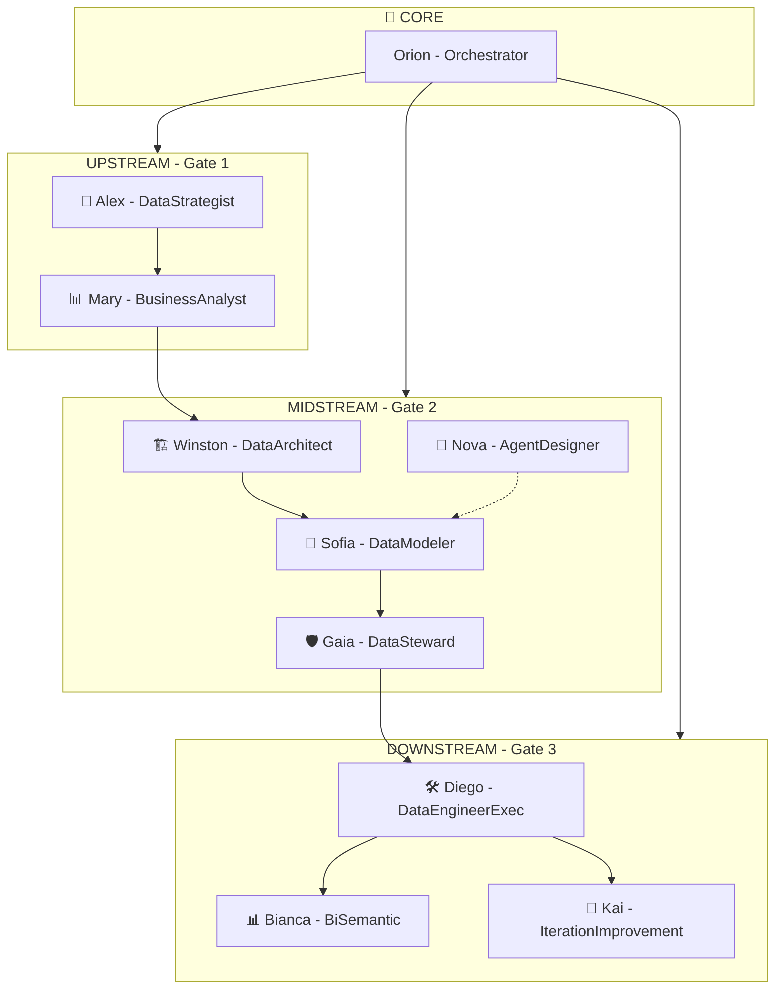
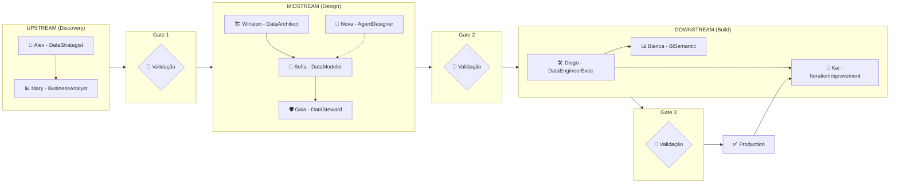
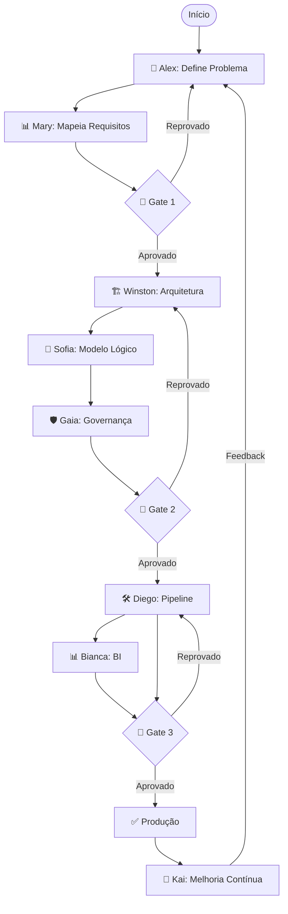

# 📘 Guia de Uso - Agentes Avanade™ Core para Data Engineering

**Versão:** 2.0  
**Data:** 4 de Fevereiro de 2026  
**Autor:** Avanade Method Team

---

## 📑 Índice

1. [Visão Geral](#1-visão-geral)
2. [Os 10 Agentes Especializados](#2-os-10-agentes-especializados)
3. [Fluxo do Projeto](#3-fluxo-do-projeto)
4. [Agentes por Fase](#4-agentes-por-fase)
5. [Exemplos Práticos de Uso](#5-exemplos-práticos-de-uso)
6. [Referência Rápida de Comandos](#6-referência-rápida-de-comandos)
7. [Boas Práticas](#7-boas-práticas)

---

## 1. Visão Geral

O Avanade™ Core para Data Engineering é um framework de **10 agentes de IA especializados** que guiam você através de todas as fases de um projeto de dados, desde a definição do problema até a entrega em produção e melhoria contínua.

### Resumo dos 10 Agentes

| # | Agente | Persona | Fase | Gate | Responsabilidade Principal |
|---|--------|---------|------|------|---------------------------|
| 1 | 🎯 DataStrategist | Alex | UPSTREAM | Gate 1 | Definição do problema e KPIs |
| 2 | 📊 BusinessAnalyst | Mary | UPSTREAM | Gate 1 | Requisitos e mapeamento de dados |
| 3 | 🏗️ DataArchitect | Winston | MIDSTREAM | Gate 2 | Arquitetura técnica e ADRs |
| 4 | 🧩 DataModeler | Sofia | MIDSTREAM | Gate 2 | Modelo lógico e contratos |
| 5 | 🧠 AgentDesigner | Nova | MIDSTREAM | Gate 2 | Blueprint de agentes |
| 6 | 🛡️ DataSteward | Gaia | MIDSTREAM | Gate 2 | Governança e qualidade |
| 7 | 🛠️ DataEngineerExec | Diego | DOWNSTREAM | Gate 3 | Pipelines executáveis |
| 8 | 📊 BiSemantic | Bianca | DOWNSTREAM | Gate 3 (Opcional) | Dashboards e BI |
| 9 | 🔁 IterationImprovement | Kai | DOWNSTREAM | Pós Gate 3 | Melhoria contínua |
| 10 | 🧭 Orchestrator | Orion | CORE | Todos | Coordenação e validação |

### Arquitetura de Fases e Gates

```
┌───────────────────────────────────────────────────────────────────────────────────┐
│                              PROJETO DE DADOS                                      │
│                                                                                    │
│  ┌─────────────────────────────────────────────────────────────────────────────┐  │
│  │                      🧭 ORCHESTRATOR - Orion (Coordenador)                   │  │
│  │            Valida gates, coordena transições, audita progresso              │  │
│  └─────────────────────────────────────────────────────────────────────────────┘  │
│                                        │                                           │
│  ══════════════════════════════════════╪═════════════════════════════════════════ │
│                                        ▼                                           │
│  ┌───────────────────────────────────────────────────────────────────────────┐    │
│  │                       FASE 1: UPSTREAM (Gate 1)                            │    │
│  │                                                                            │    │
│  │   🎯 DataStrategist (Alex)       📊 BusinessAnalyst (Mary)                │    │
│  │   ├─ *define-problem              ├─ *create-sttm                          │    │
│  │   ├─ *create-kpis                 ├─ *analytical-questions                 │    │
│  │   ├─ *success-criteria            ├─ *dq-initial                           │    │
│  │   ├─ *stakeholders                ├─ *business-rules                       │    │
│  │   ├─ *value-prop                  └─ *source-analysis                      │    │
│  │   └─ *strategy-summary                                                     │    │
│  │                                                                            │    │
│  │   📄 Artefatos:                   📄 Artefatos:                            │    │
│  │   • problem-statement.md          • sttm.md                                │    │
│  │   • kpis.md                       • analytical-questions.md                │    │
│  │   • success-criteria.md           • dq-initial.md                          │    │
│  │   • stakeholders.md               • business-rules.md                      │    │
│  │   • value-proposition.md                                                   │    │
│  └───────────────────────────────────────────────────────────────────────────┘    │
│                                        │                                           │
│                              🧭 *gate-1 (Validação)                               │
│                                        ▼                                           │
│  ┌───────────────────────────────────────────────────────────────────────────┐    │
│  │                       FASE 2: MIDSTREAM (Gate 2)                           │    │
│  │                                                                            │    │
│  │   🏗️ DataArchitect (Winston)     🧩 DataModeler (Sofia)                   │    │
│  │   ├─ *create-architecture         ├─ *data-model                           │    │
│  │   ├─ *create-data-model           ├─ *data-contracts                       │    │
│  │   ├─ *document-decisions          ├─ *granularity                          │    │
│  │   ├─ *tech-stack                  ├─ *metrics                              │    │
│  │   └─ *security-design             └─ *metadata                             │    │
│  │                                                                            │    │
│  │   🧠 AgentDesigner (Nova)         🛡️ DataSteward (Gaia)                   │    │
│  │   ├─ *agent-blueprint             ├─ *create-dq-rules                      │    │
│  │   ├─ *agent-contracts             ├─ *create-governance                    │    │
│  │   ├─ *guardrails                  ├─ *classify-data                        │    │
│  │   ├─ *orchestration               ├─ *map-compliance                       │    │
│  │   └─ *autonomy-matrix             └─ *document-lineage                     │    │
│  │                                                                            │    │
│  │   📄 Artefatos:                                                            │    │
│  │   • architecture.md • data-model.md • decisions.md • tech-stack.md         │    │
│  │   • data-contracts.md • metrics-catalog.md • granularity-spec.md           │    │
│  │   • agent-blueprint.md • orchestration-flow.md • guardrails.md             │    │
│  │   • dq-rules.md • governance.md • classification.md • compliance.md        │    │
│  └───────────────────────────────────────────────────────────────────────────┘    │
│                                        │                                           │
│                              🧭 *gate-2 (Validação)                               │
│                                        ▼                                           │
│  ┌───────────────────────────────────────────────────────────────────────────┐    │
│  │                      FASE 3: DOWNSTREAM (Gate 3)                           │    │
│  │                                                                            │    │
│  │   🛠️ DataEngineerExec (Diego)    📊 BiSemantic (Bianca) [Opcional]        │    │
│  │   ├─ *create-ddl                  ├─ *create-semantic-model                │    │
│  │   ├─ *create-etl                  ├─ *create-dax                           │    │
│  │   ├─ *create-tests                ├─ *create-dashboard                     │    │
│  │   ├─ *profile-data                ├─ *create-report                        │    │
│  │   ├─ *create-pipeline             ├─ *optimize-dataset                     │    │
│  │   ├─ *create-sttm                 ├─ *create-rls                           │    │
│  │   ├─ *create-lineage              └─ *validate-model                       │    │
│  │   ├─ *setup-monitoring                                                     │    │
│  │   ├─ *optimize-pipeline           🔁 IterationImprovement (Kai)            │    │
│  │   ├─ *document-pipeline           ├─ *improvement-backlog                  │    │
│  │   └─ *code-review                 ├─ *retrospective                        │    │
│  │                                   ├─ *metrics-analysis                     │    │
│  │   📄 Artefatos Diego:             ├─ *cost-optimization                    │    │
│  │   • ddl/*.sql                     ├─ *lead-time-analysis                   │    │
│  │   • etl/*.sql                     └─ *incident-review                      │    │
│  │   • tests/*.sql                                                            │    │
│  │   • documentation.md              📄 Artefatos Bianca:                     │    │
│  │   • observability-config.yaml     • semantic-model.json                    │    │
│  │                                   • dax-measures.md                        │    │
│  │   📄 Artefatos Kai:               • dashboard-spec.md                      │    │
│  │   • improvement-backlog.md        • report-spec.md                         │    │
│  │   • retrospective.md                                                       │    │
│  │   • optimization-report.md                                                 │    │
│  └───────────────────────────────────────────────────────────────────────────┘    │
│                                        │                                           │
│                              🧭 *gate-3 (Validação)                               │
│                                        ▼                                           │
│  ┌───────────────────────────────────────────────────────────────────────────┐    │
│  │                          ✅ PRODUCTION                                     │    │
│  │                                                                            │    │
│  │   🔁 IterationImprovement (Kai) - Ciclo Contínuo de Melhoria              │    │
│  │   ├─ Monitorar métricas DORA (Lead Time, MTTR, Deploy Frequency)          │    │
│  │   ├─ Identificar oportunidades de otimização                              │    │
│  │   ├─ Transformar incidentes em ações preventivas                          │    │
│  │   └─ Facilitar retrospectivas e melhoria contínua                         │    │
│  └───────────────────────────────────────────────────────────────────────────┘    │
│                                                                                    │
└────────────────────────────────────────────────────────────────────────────────────┘
```

---

## 2. Os 10 Agentes Especializados

### Visão Geral por Fase



### Tabela Completa dos Agentes

| Agente | Persona | Fase | Gate | Ativação | Responsabilidades |
|--------|---------|------|------|----------|-------------------|
| **DataStrategist** | 🎯 Alex | UPSTREAM | 1 | `@data-strategist` | Definição de problema, KPIs, critérios de sucesso, mapeamento de stakeholders |
| **BusinessAnalyst** | 📊 Mary | UPSTREAM | 1 | `@business-analyst` | STTM, perguntas analíticas, requisitos de DQ, regras de negócio |
| **DataArchitect** | 🏗️ Winston | MIDSTREAM | 2 | `@data-architect` | Arquitetura técnica, modelo físico, ADRs, stack tecnológica, segurança |
| **DataModeler** | 🧩 Sofia | MIDSTREAM | 2 | `@data-modeler` | Modelo lógico, contratos de dados, granularidade, métricas, metadados |
| **AgentDesigner** | 🧠 Nova | MIDSTREAM | 2 | `@agent-designer` | Blueprint de agentes, contratos I/O, guardrails, orquestração, autonomia |
| **DataSteward** | 🛡️ Gaia | MIDSTREAM | 2 | `@data-steward` | Governança, regras de DQ, classificação, compliance, linhagem |
| **DataEngineerExec** | 🛠️ Diego | DOWNSTREAM | 3 | `@data-engineer-exec` | DDL, ETL, testes, pipelines executáveis, observabilidade |
| **BiSemantic** | 📊 Bianca | DOWNSTREAM | 3 (Opcional) | `@bi-semantic` | Modelos semânticos, DAX, dashboards, reports, otimização BI |
| **IterationImprovement** | 🔁 Kai | DOWNSTREAM | Pós-3 | `@iteration-improvement` | Melhoria contínua, custos, lead time, retrospectivas, incidentes |
| **Orchestrator** | 🧭 Orion | CORE | Todos | `@orchestrator` | Validação de gates, roteamento, status, auditoria |

---

## 3. Fluxo do Projeto

### Sequência Recomendada



### O que é um Gate?

Um **Gate** é um ponto de validação obrigatório entre fases. O Orchestrator (Orion) verifica se todos os artefatos necessários foram criados e estão completos antes de permitir a transição.

| Gate | De → Para | Agentes Responsáveis | Artefatos Obrigatórios |
|------|-----------|---------------------|------------------------|
| Gate 1 | UPSTREAM → MIDSTREAM | Alex, Mary | problem-statement, kpis, sttm, analytical-questions, dq-initial |
| Gate 2 | MIDSTREAM → DOWNSTREAM | Winston, Sofia, Nova, Gaia | architecture, data-model, dq-rules, governance, contracts |
| Gate 3 | DOWNSTREAM → PRODUCTION | Diego, Bianca (opcional) | ddl, etl, tests, documentation, observability |
| Pós-Gate 3 | PRODUCTION → Melhoria | Kai | improvement-backlog, retrospectives, optimization-reports |

---

## 4. Agentes por Fase

### 🎯 UPSTREAM - Discovery (Gate 1)

#### 🎯 DataStrategist (Alex)

**Função:** Define o "PORQUÊ" do projeto - problema de negócio, KPIs e critérios de sucesso.

**Princípios:**
- Sempre começar pelo "porquê"
- Quantificar impacto de negócio
- Alinhar stakeholders

**Quando usar:**
- Início de um novo projeto de dados
- Quando precisa justificar um investimento em dados
- Para alinhar stakeholders sobre objetivos

**Comandos:**
| Comando | Descrição |
|---------|-----------|
| `*help` | Lista todos os comandos disponíveis |
| `*define-problem` | Cria declaração de problema de negócio |
| `*create-kpis` | Define KPIs mensuráveis |
| `*success-criteria` | Estabelece critérios de sucesso |
| `*stakeholders` | Mapeia stakeholders (RACI) |
| `*value-prop` | Cria proposta de valor dos dados |
| `*strategy-summary` | Gera resumo da estratégia |

**Artefatos:**
- `problem-statement.md` ✅ Obrigatório
- `kpis.md` ✅ Obrigatório  
- `success-criteria.md` ⚠️ Recomendado
- `stakeholders.md`
- `value-proposition.md`

---

#### 📊 BusinessAnalyst (Mary)

**Função:** Traduz estratégia em requisitos técnicos - mapeamento de dados, regras de negócio.

**Princípios:**
- Ponte entre negócio e técnico
- Documentação completa de requisitos
- Qualidade desde o início

**Quando usar:**
- Após definir o problema com Alex (DataStrategist)
- Quando precisa mapear fontes para destinos
- Para documentar regras de transformação

**Comandos:**
| Comando | Descrição |
|---------|-----------|
| `*help` | Lista todos os comandos disponíveis |
| `*create-sttm` | Cria Source-to-Target Mapping |
| `*analytical-questions` | Define perguntas analíticas |
| `*dq-initial` | Requisitos iniciais de qualidade |
| `*business-rules` | Documenta regras de negócio |
| `*source-analysis` | Analisa fontes de dados |

**Artefatos:**
- `sttm.md` ✅ Obrigatório
- `analytical-questions.md` ✅ Obrigatório
- `dq-initial.md` ✅ Obrigatório
- `business-rules.md`

---

### 🏗️ MIDSTREAM - Design (Gate 2)

#### 🏗️ DataArchitect (Winston)

**Função:** Projeta a arquitetura técnica - modelo de dados, decisões de tecnologia.

**Princípios:**
- Lakehouse como padrão
- Medallion Architecture (Bronze/Silver/Gold)
- Documentar decisões (ADRs)

**Quando usar:**
- Após Gate 1 aprovado
- Para definir a estrutura técnica do pipeline
- Quando precisa documentar decisões arquiteturais (ADRs)

**Comandos:**
| Comando | Descrição |
|---------|-----------|
| `*help` | Lista todos os comandos disponíveis |
| `*create-architecture` | Cria documento de arquitetura |
| `*create-data-model` | Projeta modelo dimensional |
| `*document-decisions` | Cria ADRs (Architecture Decision Records) |
| `*tech-stack` | Documenta seleção de tecnologias |
| `*security-design` | Projeta arquitetura de segurança |
| `*status` | Ver progresso dos artefatos Gate 2 |

**Artefatos:**
- `architecture.md` ✅ Obrigatório
- `data-model.md` ✅ Obrigatório
- `decisions.md` ⚠️ Recomendado
- `tech-stack.md`
- `security-design.md`

---

#### 🧩 DataModeler (Sofia)

**Função:** Especialista em modelo lógico, granularidade, métricas e metadados.

**Princípios:**
- Modelo lógico versionável
- Chaves e granularidade explícitas
- Metadados obrigatórios
- Contratos como garantia

**Quando usar:**
- Em paralelo com Winston (DataArchitect)
- Para definir granularidade de tabelas
- Para criar contratos de dados

**Comandos:**
| Comando | Descrição |
|---------|-----------|
| `*help` | Lista todos os comandos disponíveis |
| `*data-model` | Criar/refinar modelo lógico |
| `*data-contracts` | Definir contratos de dados |
| `*granularity` | Definir granularidade de tabelas |
| `*metrics` | Documentar métricas e KPIs |
| `*metadata` | Criar catálogo de metadados |
| `*status` | Ver progresso dos artefatos Gate 2 |

**Artefatos:**
- `data-model.md` ✅ Obrigatório
- `data-contracts.md` ✅ Obrigatório
- `metrics-catalog.md`
- `granularity-spec.md`
- `metadata-catalog.md`

---

#### 🧠 AgentDesigner (Nova)

**Função:** Especialista em design de agentes, blueprints e guardrails.

**Princípios:**
- Contratos claros de I/O
- Gates como guardrails
- Autonomia proporcional ao risco
- Especialização sobre generalização

**Quando usar:**
- Quando o projeto envolve múltiplos agentes
- Para definir níveis de autonomia
- Para projetar orquestração de agentes

**Comandos:**
| Comando | Descrição |
|---------|-----------|
| `*help` | Lista todos os comandos disponíveis |
| `*agent-blueprint` | Criar blueprint de agente |
| `*agent-contracts` | Definir contratos entre agentes |
| `*guardrails` | Projetar guardrails e gates |
| `*orchestration` | Desenhar fluxo de orquestração |
| `*autonomy-matrix` | Definir níveis de autonomia |
| `*status` | Ver progresso dos artefatos |

**Artefatos:**
- `agent-blueprint.md`
- `agent-contracts.md`
- `orchestration-flow.md`
- `guardrails.md`
- `autonomy-matrix.md`

---

#### 🛡️ DataSteward (Gaia)

**Função:** Define governança e qualidade - regras de DQ, classificação, compliance.

**Princípios:**
- Qualidade como prioridade
- Conformidade (LGPD, GDPR, SOX)
- Classificação de dados sensíveis
- Linhagem documentada

**Quando usar:**
- Em paralelo ou após DataArchitect/DataModeler
- Para definir regras de qualidade detalhadas
- Quando há requisitos de compliance

**Comandos:**
| Comando | Descrição |
|---------|-----------|
| `*help` | Lista todos os comandos disponíveis |
| `*create-dq-rules` | Define regras de Data Quality |
| `*create-governance` | Cria framework de governança |
| `*classify-data` | Classifica dados por sensibilidade |
| `*map-compliance` | Mapear requisitos de compliance |
| `*document-lineage` | Documentar linhagem de dados |
| `*status` | Ver progresso dos artefatos |

**Artefatos:**
- `dq-rules.md` ✅ Obrigatório
- `governance.md` ✅ Obrigatório
- `classification.md`
- `compliance-mapping.md`
- `data-lineage.md`

---

### 🛠️ DOWNSTREAM - Build (Gate 3)

#### 🛠️ DataEngineerExec (Diego)

**Função:** Implementa o pipeline - DDL, ETL, testes, documentação técnica.

**Princípios:**
- Código executável, testado e versionável
- Nunca pular gates - validação obrigatória
- Idempotência em todas as transformações
- Observabilidade desde o design
- Performance by design

**Quando usar:**
- Após Gate 2 aprovado
- Para gerar código SQL/Python do pipeline
- Para criar testes automatizados

**Comandos:**
| Comando | Descrição |
|---------|-----------|
| `*help` | Lista todos os comandos disponíveis |
| `*create-ddl` | Criar scripts DDL (tabelas, views) |
| `*create-etl` | Criar scripts ETL/ELT |
| `*create-tests` | Criar testes unitários |
| `*profile-data` | Analisar perfil dos dados |
| `*create-pipeline` | Criar pipeline completo |
| `*validate-quality` | Validar qualidade dos dados |
| `*create-sttm` | Criar Source-to-Target Mapping |
| `*create-lineage` | Documentar linhagem de dados |
| `*create-catalog` | Criar catálogo de dados |
| `*setup-monitoring` | Configurar observabilidade |
| `*optimize-pipeline` | Otimizar performance |
| `*document-pipeline` | Documentar pipeline |
| `*code-review` | Peer review de código |
| `*generate-test-data` | Gerar dados de teste |
| `*check-gate-2` | Verificar Gate 2 |
| `*gate-3-ready` | Validar Gate 3 |
| `*run-demo` | Demonstração completa |

**Artefatos:**
- `ddl/*.sql` ✅ Obrigatório
- `etl/*.sql` ✅ Obrigatório
- `tests/*.sql` ✅ Obrigatório
- `documentation.md` ✅ Obrigatório
- `observability-config.yaml`

---

#### 📊 BiSemantic (Bianca) - OPCIONAL

**Função:** Desenvolve camada de BI - modelos semânticos, DAX, dashboards.

**Princípios:**
- Métricas bem definidas e documentadas
- Modelos semânticos reutilizáveis
- Performance é feature, não afterthought
- Self-service para usuários de negócio

**Quando usar:**
- Quando há requisitos de visualização/BI
- Para criar medidas DAX complexas
- Para projetar dashboards

**Comandos:**
| Comando | Descrição |
|---------|-----------|
| `*help` | Lista todos os comandos disponíveis |
| `*create-semantic-model` | Cria modelo semântico Power BI |
| `*create-dax` | Gera medidas DAX |
| `*create-dashboard` | Cria especificação de dashboard |
| `*create-report` | Especifica layout de relatórios |
| `*optimize-dataset` | Otimiza performance do dataset |
| `*create-rls` | Configura Row-Level Security |
| `*validate-model` | Valida modelo semântico |
| `*run-demo` | Demonstração completa |

**Artefatos:**
- `semantic-model.json`
- `dax-measures.md`
- `dashboard-spec.md`
- `report-spec.md`

---

#### 🔁 IterationImprovement (Kai) - Melhoria Contínua

**Função:** Especialista em melhoria contínua, redução de custo e lead time.

**Princípios:**
- Melhorias guiadas por métricas
- Incrementos pequenos e frequentes
- Transformar incidentes em prevenção
- Reduzir lead time
- Custo-benefício sempre

**Quando usar:**
- Após Gate 3 e deploy em produção
- Para retrospectivas de sprint/ciclo
- Para otimização de custos
- Para análise de incidentes

**Comandos:**
| Comando | Descrição |
|---------|-----------|
| `*help` | Lista todos os comandos disponíveis |
| `*improvement-backlog` | Criar backlog de melhorias |
| `*retrospective` | Facilitar retrospectiva |
| `*metrics-analysis` | Analisar métricas de processo |
| `*cost-optimization` | Identificar oportunidades de custo |
| `*lead-time-analysis` | Analisar e otimizar lead time |
| `*incident-review` | Transformar incidente em melhoria |
| `*status` | Ver progresso das melhorias |

**Artefatos:**
- `improvement-backlog.md`
- `retrospective.md`
- `optimization-report.md`
- `cost-optimization.md`
- `lead-time-analysis.md`
- `incident-review.md`

---

### 🧭 CORE - Coordenação

#### 🧭 Orchestrator (Orion)

**Função:** Coordena o projeto - valida gates, roteia para agentes, gera status.

**Princípios:**
- Guardar a integridade do processo
- Nunca aprovar gates incompletos
- Roteamento inteligente
- Auditoria completa

**Quando usar:**
- Para verificar status do projeto
- Antes de mudar de fase (validar gate)
- Quando não sabe qual agente usar

**Comandos:**
| Comando | Descrição |
|---------|-----------|
| `*help` | Lista todos os comandos disponíveis |
| `*status` | Mostra status geral do projeto |
| `*gate-1` | Valida transição UPSTREAM → MIDSTREAM |
| `*gate-2` | Valida transição MIDSTREAM → DOWNSTREAM |
| `*gate-3` | Valida transição DOWNSTREAM → PRODUCTION |
| `*route` | Recomenda agente para uma tarefa |
| `*artifacts` | Lista artefatos por fase |
| `*audit` | Ver trilha de auditoria |

---

## 5. Exemplos Práticos de Uso

### 📌 Exemplo 1: Iniciando um Novo Projeto

**Cenário:** Você precisa criar um pipeline para análise de vendas.

```
Passo 1: Ative o DataStrategist (Alex)
──────────────────────────────────────
@data-strategist *define-problem

Usuário: "Precisamos analisar vendas por região para identificar 
oportunidades de crescimento. Atualmente leva 3 dias para gerar 
relatórios manuais."

→ Alex criará: docs/strategy/problem-statement.md

Passo 2: Defina KPIs
────────────────────
@data-strategist *create-kpis

Usuário: "Queremos medir: receita por região, crescimento MoM, 
ticket médio, e taxa de conversão."

→ Alex criará: docs/strategy/kpis.md

Passo 3: Mapeie os dados com Mary
─────────────────────────────────
@business-analyst *create-sttm

Usuário: "Fontes: SAP (vendas), Salesforce (clientes), 
Planilha Excel (metas). Destino: Data Lake Azure."

→ Mary criará: docs/requirements/sttm.md

Passo 4: Valide o Gate 1 com Orion
──────────────────────────────────
@orchestrator *gate-1

→ Orion verificará se todos os artefatos estão completos
→ Se OK: "✅ Gate 1 aprovado! Pode avançar para MIDSTREAM"
→ Se não: "❌ Faltam artefatos: [lista]"
```

---

### 📌 Exemplo 2: Projetando a Arquitetura

**Cenário:** Gate 1 aprovado, agora precisa projetar a solução técnica.

```
Passo 1: Crie a arquitetura com Winston
───────────────────────────────────────
@data-architect *create-architecture

Usuário: "Use Databricks com Medallion Architecture 
(Bronze/Silver/Gold), processamento em Spark."

→ Winston criará: docs/architecture/architecture.md

Passo 2: Projete o modelo de dados com Sofia
────────────────────────────────────────────
@data-modeler *data-model

Usuário: "Modelo dimensional com fato de vendas e dimensões 
de cliente, produto, tempo e região."

→ Sofia criará: docs/architecture/data-model.md
→ Incluirá diagrama ERD em Mermaid

Passo 3: Defina contratos de dados
──────────────────────────────────
@data-modeler *data-contracts

→ Sofia criará: docs/architecture/data-contracts.md

Passo 4: Defina regras de qualidade com Gaia
────────────────────────────────────────────
@data-steward *create-dq-rules

Usuário: "Campos obrigatórios: customer_id, sale_date, amount. 
Não aceitar amounts negativos. CPF deve ser válido."

→ Gaia criará: docs/governance/dq-rules.md

Passo 5: Valide o Gate 2 com Orion
──────────────────────────────────
@orchestrator *gate-2

→ "✅ Gate 2 aprovado! Pode avançar para DOWNSTREAM"
```

---

### 📌 Exemplo 3: Implementando o Pipeline

**Cenário:** Gate 2 aprovado, hora de gerar código com Diego.

```
Passo 1: Gere os DDLs
─────────────────────
@data-engineer-exec *create-ddl

→ Diego lerá data-model.md e gerará:
  • ddl/01-landing-tables.sql
  • ddl/02-bronze-tables.sql
  • ddl/03-silver-tables.sql
  • ddl/04-gold-tables.sql

Passo 2: Gere os ETLs
─────────────────────
@data-engineer-exec *create-etl

→ Diego lerá sttm.md e gerará:
  • etl/01-load-landing.sql
  • etl/02-transform-bronze.sql
  • etl/03-transform-silver.sql
  • etl/04-transform-gold.sql

Passo 3: Gere os testes
───────────────────────
@data-engineer-exec *create-tests

→ Diego lerá dq-rules.md e gerará:
  • tests/unit-tests.sql
  • tests/integration-tests.sql
  • tests/dq-validation.sql

Passo 4: Configure observabilidade
──────────────────────────────────
@data-engineer-exec *setup-monitoring

→ Diego criará: observability-config.yaml

Passo 5: Crie o modelo semântico (se BI) com Bianca
───────────────────────────────────────────────────
@bi-semantic *create-semantic-model

→ Bianca criará:
  • semantic-models/sales-model.json
  • dax-measures/sales-measures.md
```

---

### 📌 Exemplo 4: Verificando Status a Qualquer Momento

```
@orchestrator *status

Resposta:
═══════════════════════════════════════════════════
  📊 PROJECT STATUS REPORT
═══════════════════════════════════════════════════

  Current Phase: MIDSTREAM
  Progress: ████████░░ 65%

  UPSTREAM (Gate 1)    ✅ Passed
  ├─ Alex: problem-statement.md  ✅
  ├─ Alex: kpis.md               ✅
  ├─ Mary: sttm.md               ✅
  └─ Mary: dq-initial.md         ✅

  MIDSTREAM (Gate 2)   🔄 In Progress
  ├─ Winston: architecture.md     ✅
  ├─ Sofia: data-model.md         ✅
  ├─ Gaia: dq-rules.md            ❌ Missing
  └─ Gaia: governance.md          ❌ Missing

  DOWNSTREAM (Gate 3)  ⏳ Pending

  📌 Next Action: @data-steward *create-dq-rules
═══════════════════════════════════════════════════
```

---

### 📌 Exemplo 5: Não Sabe Qual Agente Usar?

```
@orchestrator *route

Usuário: "Preciso definir quais campos são PII e como 
protegê-los"

Resposta:
═══════════════════════════════════════════════════
  🧭 ROUTING RECOMMENDATION
═══════════════════════════════════════════════════

  Recommended Agent: 🛡️ Gaia (DataSteward)
  Command: @data-steward *classify-data

  Rationale: Classificação de dados sensíveis (PII) 
  é responsabilidade da Gaia na fase MIDSTREAM.

  Alternative: Se precisar de ADR sobre segurança,
  use @data-architect *security-design com Winston
═══════════════════════════════════════════════════
```

---

### 📌 Exemplo 6: Melhoria Contínua Pós-Produção

```
Cenário: Pipeline em produção, hora de otimizar.

Passo 1: Analise métricas com Kai
─────────────────────────────────
@iteration-improvement *metrics-analysis

→ Kai analisará DORA metrics:
  • Lead Time: 3 dias (alvo: <1 dia)
  • MTTR: 4 horas (alvo: <1 hora)
  • Deploy Frequency: semanal

Passo 2: Identifique oportunidades de custo
───────────────────────────────────────────
@iteration-improvement *cost-optimization

→ Kai identificará:
  • Cluster over-provisioned em 40%
  • Jobs que podem rodar em horário off-peak
  • Storage não utilizado

Passo 3: Facilite retrospectiva
───────────────────────────────
@iteration-improvement *retrospective

→ Kai facilitará:
  • O que funcionou bem
  • O que pode melhorar
  • Ações concretas com responsáveis
```

---

## 6. Referência Rápida de Comandos

### Por Agente (Completo)

| Agente | Persona | Ativação | Comandos Principais |
|--------|---------|----------|---------------------|
| 🎯 DataStrategist | Alex | `@data-strategist` | `*define-problem`, `*create-kpis`, `*success-criteria`, `*stakeholders`, `*value-prop` |
| 📊 BusinessAnalyst | Mary | `@business-analyst` | `*create-sttm`, `*analytical-questions`, `*dq-initial`, `*business-rules` |
| 🏗️ DataArchitect | Winston | `@data-architect` | `*create-architecture`, `*create-data-model`, `*document-decisions`, `*tech-stack`, `*security-design` |
| 🧩 DataModeler | Sofia | `@data-modeler` | `*data-model`, `*data-contracts`, `*granularity`, `*metrics`, `*metadata` |
| 🧠 AgentDesigner | Nova | `@agent-designer` | `*agent-blueprint`, `*agent-contracts`, `*guardrails`, `*orchestration`, `*autonomy-matrix` |
| 🛡️ DataSteward | Gaia | `@data-steward` | `*create-dq-rules`, `*create-governance`, `*classify-data`, `*map-compliance`, `*document-lineage` |
| 🛠️ DataEngineerExec | Diego | `@data-engineer-exec` | `*create-ddl`, `*create-etl`, `*create-tests`, `*profile-data`, `*create-pipeline`, `*setup-monitoring` |
| 📊 BiSemantic | Bianca | `@bi-semantic` | `*create-semantic-model`, `*create-dax`, `*create-dashboard`, `*create-report`, `*optimize-dataset` |
| 🔁 IterationImprovement | Kai | `@iteration-improvement` | `*improvement-backlog`, `*retrospective`, `*metrics-analysis`, `*cost-optimization`, `*incident-review` |
| 🧭 Orchestrator | Orion | `@orchestrator` | `*status`, `*gate-1`, `*gate-2`, `*gate-3`, `*route`, `*artifacts`, `*audit` |

### Atalhos por Fase

```
# UPSTREAM (Gate 1)
@data-strategist *help      # Alex - Estratégia
@business-analyst *help     # Mary - Requisitos

# MIDSTREAM (Gate 2)
@data-architect *help       # Winston - Arquitetura
@data-modeler *help         # Sofia - Modelo Lógico
@agent-designer *help       # Nova - Design de Agentes
@data-steward *help         # Gaia - Governança

# DOWNSTREAM (Gate 3)
@data-engineer-exec *help   # Diego - Pipelines
@bi-semantic *help          # Bianca - BI (opcional)
@iteration-improvement *help # Kai - Melhoria Contínua

# CORE
@orchestrator *help         # Orion - Coordenação
```

### Comandos Universais

```
# Ver ajuda de qualquer agente
@<agente> *help

# Ver status geral
@orchestrator *status

# Não sabe qual agente usar?
@orchestrator *route <descreva o que precisa>

# Validar gates
@orchestrator *gate-1   # UPSTREAM → MIDSTREAM
@orchestrator *gate-2   # MIDSTREAM → DOWNSTREAM
@orchestrator *gate-3   # DOWNSTREAM → PRODUCTION
```

---

## 7. Boas Práticas

### ✅ Faça

1. **Siga a ordem das fases** - UPSTREAM → MIDSTREAM → DOWNSTREAM
2. **Valide os gates com Orion** - Não pule fases sem validar
3. **Use o Orchestrator quando tiver dúvidas** - `*route` ajuda a escolher o agente certo
4. **Verifique status regularmente** - `@orchestrator *status`
5. **Forneça contexto completo** - Quanto mais informação, melhores os artefatos
6. **Use os nomes das personas** - Alex, Mary, Winston, Sofia, Nova, Gaia, Diego, Bianca, Kai, Orion
7. **Invista em melhoria contínua** - Kai ajuda a otimizar após o deploy

### ❌ Evite

1. **Pular fases** - Ir direto para código sem definir problema
2. **Ignorar validações de gate** - Pode causar retrabalho
3. **Usar agente errado** - Use `*route` se não tiver certeza
4. **Artefatos incompletos** - Preencha todos os campos obrigatórios
5. **Ignorar governança** - Gaia (DataSteward) é essencial para compliance

### 💡 Dicas por Cenário

| Cenário | Agente Recomendado | Comando |
|---------|-------------------|---------|
| Começou agora | 🎯 Alex | `@data-strategist *define-problem` |
| Projeto existente | 🧭 Orion | `@orchestrator *status` |
| Precisa de código | 🛠️ Diego | `@data-engineer-exec *create-pipeline` |
| Precisa de BI | 📊 Bianca | `@bi-semantic *create-semantic-model` |
| Otimização de custo | 🔁 Kai | `@iteration-improvement *cost-optimization` |
| Incidente em produção | 🔁 Kai | `@iteration-improvement *incident-review` |
| Definir contratos | 🧩 Sofia | `@data-modeler *data-contracts` |
| Compliance LGPD | 🛡️ Gaia | `@data-steward *map-compliance` |

### 🔄 Fluxo Recomendado Completo



---

## 📞 Suporte

Dúvidas sobre o Avanade Method? Use:

```
@orchestrator *help
```

### Mapeamento Rápido de Personas

| Persona | Agente | Fase | Especialidade |
|---------|--------|------|---------------|
| Alex | DataStrategist | UPSTREAM | Estratégia de Dados |
| Mary | BusinessAnalyst | UPSTREAM | Requisitos de Negócio |
| Winston | DataArchitect | MIDSTREAM | Arquitetura Técnica |
| Sofia | DataModeler | MIDSTREAM | Modelo Lógico |
| Nova | AgentDesigner | MIDSTREAM | Design de Agentes |
| Gaia | DataSteward | MIDSTREAM | Governança e DQ |
| Diego | DataEngineerExec | DOWNSTREAM | Pipelines |
| Bianca | BiSemantic | DOWNSTREAM | BI e Dashboards |
| Kai | IterationImprovement | DOWNSTREAM | Melhoria Contínua |
| Orion | Orchestrator | CORE | Coordenação |

---

*Powered by Avanade™ Core - Data Engineering Agents v2.0*
