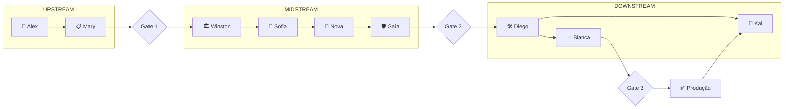

# 🚀 Avanade™ Core - Data Engineering Agents

> **Framework de Agentes de IA especializados para projetos de Data Engineering**

**Versão:** 2.0  
**Data:** 4 de Fevereiro de 2026  
**Status:** ✅ Produção

---

## 📋 Visão Geral

O **Avanade™ Core** é um framework de 10 agentes de IA especializados que guiam equipes através de todas as fases de um projeto de dados, desde a definição do problema até a entrega em produção e melhoria contínua.

### Arquitetura de Fases

```
┌────────────────────────────────────────────────────────────────────────┐
│                        AVANADE™ CORE PIPELINE                          │
├────────────────────────────────────────────────────────────────────────┤
│                                                                        │
│   UPSTREAM (Gate 1)         MIDSTREAM (Gate 2)         DOWNSTREAM     │
│   ─────────────────         ──────────────────         ───────────    │
│                                                                        │
│   🎯 Alex                   🏛️ Winston                 🛠️ Diego        │
│   DataStrategist            DataArchitect              DataEngineerExec│
│         │                         │                          │        │
│         ▼                         ▼                          ▼        │
│   📋 Mary                   🧩 Sofia                   📊 Bianca      │
│   BusinessAnalyst           DataModeler                BiSemantic     │
│                                   │                    (opcional)     │
│                                   ▼                          │        │
│                             🛡️ Gaia                          ▼        │
│                             DataSteward              🔁 Kai            │
│                                                      Iteration         │
│                                                      Improvement       │
│                                                                        │
│                         🧭 Orion (Orchestrator)                        │
│                         🧠 Nova (AgentDesigner - OPCIONAL)             │
│                         ─────────────────────────────────              │
│                         Coordenação CORE / Meta-Level                  │
│                                                                        │
└────────────────────────────────────────────────────────────────────────┘
```

---

## 🤖 Os 10 Agentes

| # | Agente | Persona | Fase | Gate | Função |
|---|--------|---------|------|------|--------|
| 1 | **DataStrategist** | 🎯 Alex | UPSTREAM | 1 | Definição de problema, KPIs, stakeholders |
| 2 | **BusinessAnalyst** | 📋 Mary | UPSTREAM | 1 | STTM, requisitos, regras de negócio |
| 3 | **DataArchitect** | 🏛️ Winston | MIDSTREAM | 2 | Arquitetura técnica, ADRs |
| 4 | **DataModeler** | 🧩 Sofia | MIDSTREAM | 2 | Modelo lógico, contratos de dados |
| 5 | **DataSteward** | 🛡️ Gaia | MIDSTREAM | 2 | Governança, qualidade, compliance |
| 6 | **DataEngineerExec** | 🛠️ Diego | DOWNSTREAM | 3 | DDL, ETL, testes, pipelines |
| 7 | **BiSemantic** | 📊 Bianca | DOWNSTREAM | 3 | Dashboards, DAX, modelos semânticos |
| 8 | **IterationImprovement** | 🔁 Kai | DOWNSTREAM | Pós-3 | Melhoria contínua, custos, lead time |
| 9 | **Orchestrator** | 🧭 Orion | CORE | Todos | Coordenação, validação de gates |
| 10 | **AgentDesigner** | 🧠 Nova | CORE (Meta) | 2 (Opt) | Agent blueprints (OPCIONAL) |

---

## 🚀 Quick Start

### 1. Iniciar um Novo Projeto

```bash
# Ative o DataStrategist para definir o problema
@data-strategist *define-problem

# Defina KPIs
@data-strategist *create-kpis

# Mapeie os dados
@business-analyst *create-sttm

# Valide Gate 1
@orchestrator *gate-1
```

### 2. Verificar Status a Qualquer Momento

```bash
@orchestrator *status
```

### 3. Não Sabe Qual Agente Usar?

```bash
@orchestrator *route "preciso criar regras de qualidade"
# → Recomendará: @data-steward *create-dq-rules
```

---

## 📁 Estrutura do Projeto

```
Agents-Data-Engineer/
├── .github/
│   └── chatmodes/           # Definições dos 10 agentes
│       ├── data-strategist.chatmode.md      # Alex 🎯
│       ├── business-analyst.chatmode.md     # Mary 📋
│       ├── data-architect.chatmode.md       # Winston 🏛️
│       ├── data-modeler.chatmode.md         # Sofia 🧩
│       ├── agent-designer.chatmode.md       # Nova 🧠
│       ├── data-steward.chatmode.md         # Gaia 🛡️
│       ├── data-engineer-exec.chatmode.md   # Diego 🛠️
│       ├── bi-semantic.chatmode.md          # Bianca 📊
│       ├── iteration-improvement.chatmode.md # Kai 🔁
│       ├── orchestrator.chatmode.md         # Orion 🧭
│       └── master-agent.chatmode.md         # Master 🎛️
├── data-strategist-agent/   # Tasks do Alex
├── business-analyst-agent/  # Tasks da Mary
├── data-architect-agent/    # Tasks do Winston
├── data-modeler-agent/      # Tasks da Sofia
├── agent-designer-agent/    # Tasks da Nova
├── data-steward-agent/      # Tasks da Gaia
├── data-engineer-exec-agent/ # Tasks do Diego
├── bi-semantic-agent/       # Tasks da Bianca
├── iteration-improvement-agent/ # Tasks do Kai
├── orchestrator-agent/      # Tasks do Orion
└── Docs/
    ├── GUIA-DE-USO-AGENTES.md    # Guia completo
    ├── AGENT-MAPPING.md          # Mapeamento de agentes
    └── WORKFLOWS-ESTEIRAS-GATES.md # Fluxos e validações
```

---

## 🎯 Gates (Pontos de Validação)

| Gate | Transição | Artefatos Obrigatórios | Validador |
|------|-----------|------------------------|-----------|
| **Gate 1** | UPSTREAM → MIDSTREAM | problem-statement, kpis, sttm, dq-initial | Orion |
| **Gate 2** | MIDSTREAM → DOWNSTREAM | architecture, data-model, dq-rules, governance | Orion |
| **Gate 3** | DOWNSTREAM → PRODUCTION | ddl, etl, tests, documentation | Orion |

---

## 📚 Documentação

| Documento | Descrição |
|-----------|-----------|
| [GUIA-DE-USO-AGENTES.md](Docs/GUIA-DE-USO-AGENTES.md) | Guia completo de uso dos 10 agentes |
| [AGENT-MAPPING.md](Docs/AGENT-MAPPING.md) | Mapeamento e comandos de todos os agentes |
| [WORKFLOWS-ESTEIRAS-GATES.md](Docs/WORKFLOWS-ESTEIRAS-GATES.md) | Fluxos de trabalho e validações |

---

## 🔄 Fluxo Recomendado



---

## 💡 Dicas

- **Começou agora?** → `@data-strategist *define-problem`
- **Projeto existente?** → `@orchestrator *status`
- **Precisa de código?** → `@data-engineer-exec *create-pipeline`
- **Precisa de BI?** → `@bi-semantic *create-semantic-model`
- **Otimizar custos?** → `@iteration-improvement *cost-optimization`

---

## 📞 Suporte

Para ajuda sobre o framework:

```bash
@orchestrator *help
```

---

*Powered by Avanade™ Core - Data Engineering Agents v2.0*
