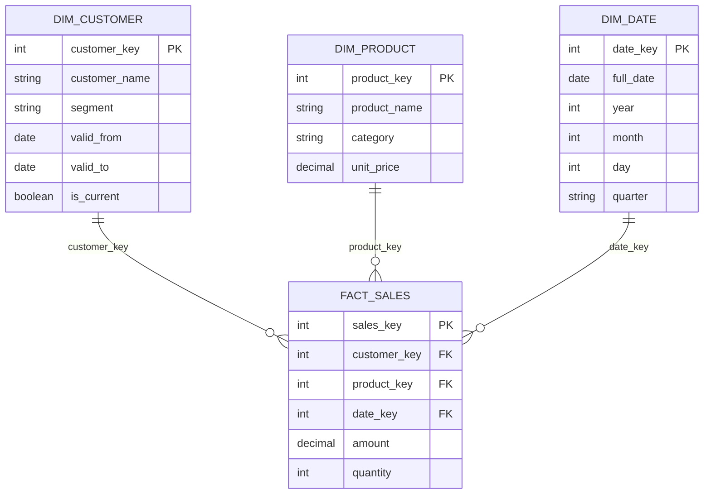

# Data Model Template

## Model Overview

**Project:** {project_name}  
**Version:** {version}  
**Last Updated:** {date}  
**Owner:** Sofia (DataModeler)

---

## Model Summary

| Aspect | Value |
|--------|-------|
| Total Entities | {count} |
| Fact Tables | {count} |
| Dimension Tables | {count} |
| Bridge Tables | {count} |
| Reference Tables | {count} |

---

## Entity Relationship Diagram

---

## Fact Tables

### fact_{name}

| Attribute | Value |
|-----------|-------|
| **Grain** | One row per {event} |
| **Update Frequency** | {frequency} |
| **Retention** | {period} |

**Columns:**

| Column | Type | Description | Key |
|--------|------|-------------|-----|
| {name}_key | INT | Surrogate key | PK |
| {dim}_key | INT | Foreign key to dim_{dim} | FK |
| {measure} | DECIMAL | {description} | - |

**Measures:**

| Measure | Type | Aggregation |
|---------|------|-------------|
| amount | DECIMAL | SUM |
| quantity | INT | SUM |

---

## Dimension Tables

### dim_{name}

| Attribute | Value |
|-----------|-------|
| **Grain** | One row per {entity} |
| **SCD Type** | Type {1/2/3} |
| **Update Frequency** | {frequency} |

**Columns:**

| Column | Type | Description | Key |
|--------|------|-------------|-----|
| {name}_key | INT | Surrogate key | PK |
| {name}_id | VARCHAR | Natural key | NK |
| {attribute} | VARCHAR | {description} | - |
| valid_from | DATE | SCD2 start date | - |
| valid_to | DATE | SCD2 end date | - |
| is_current | BOOLEAN | Current record flag | - |

**Hierarchies:**

| Hierarchy | Levels |
|-----------|--------|
| {hierarchy_name} | Level1 > Level2 > Level3 |

---

## Granularity Matrix

| Layer | Table | Grain |
|-------|-------|-------|
| Landing | lnd_{source}_{entity} | 1:1 with source |
| Silver | slv_{entity} | One clean entity |
| Gold Fact | fact_{subject} | One business event |
| Gold Dim | dim_{entity} | One master entity |

---

## Relationships

| From | To | Cardinality | Type |
|------|-----|-------------|------|
| fact_sales | dim_customer | N:1 | Identifying |
| fact_sales | dim_product | N:1 | Identifying |
| fact_sales | dim_date | N:1 | Identifying |

---

## SCD Specifications

| Dimension | Type | Tracked Attributes | History Retention |
|-----------|------|-------------------|-------------------|
| dim_customer | 2 | name, segment, address | Unlimited |
| dim_product | 1 | name, category | No history |

---

## Naming Conventions

| Object Type | Convention | Example |
|-------------|------------|---------|
| Fact Table | fact_{subject} | fact_sales |
| Dimension | dim_{entity} | dim_customer |
| Bridge | bridge_{rel} | bridge_customer_segment |
| Reference | ref_{lookup} | ref_country |
| Column PK | {table}_key | customer_key |
| Column FK | {dim}_key | customer_key |
| Column Date | {event}_date | order_date |
| Column Amount | {measure}_amount | sales_amount |

---

## Validation Rules

| Rule | Description |
|------|-------------|
| No orphan facts | All FK must have matching PK in dimension |
| Complete dimensions | All required attributes present |
| Valid dates | date_from < date_to for SCD2 |
| Single current | Only one is_current=true per natural key |
