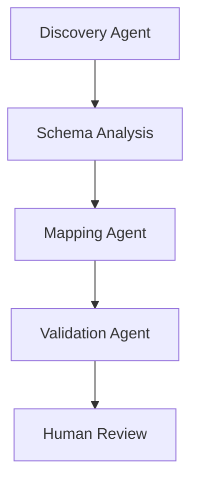
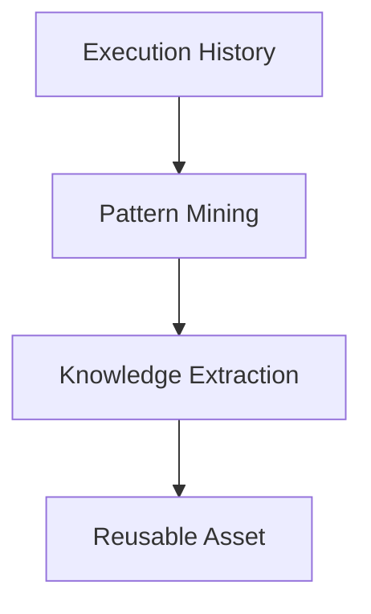

# Harness OS — Visão Geral

Contexto: proposta de arquitetura para rastreabilidade, avaliação e reaproveitamento de execuções de agentes.

Principais capacidades:
- Telemetria
- Replay (reexecução determinística)
- Engine de Avaliação (scores por execução)
- Cost Tracking
- Governança (auditoria, decisões reconstruíveis)

## Layer 1 — Execution Graph

Toda execução gera um DAG (grafo acíclico dirigido) que representa as etapas da pipeline e suas dependências.

Exemplo (fluxo simplificado):



- Cada nó: entrada, saída, metadados (versão do agente, inputs, timestamp, custo)
- O grafo é versionado e imutável por execução — permite replay e auditoria

## Layer 2 — Knowledge Graph

Não usar apenas vetores; usar um grafo de conhecimento relacional que exponha entidades, propriedades e relacionamentos.

Exemplo:

```mermaid
graph LR
  SAP_ECC["SAP ECC"]
  SAP_ECC --> Vendor
  Vendor --> "Business Partner"
  SAP_ECC --> Material
  Material --> Product
```

- O grafo permite inferência por relacionamento (ex.: derivar dono de dados, impacto de alteração de um `Material` sobre `Product`).
- Indexação híbrida: grafo relacional + embeddings para busca semântica.

## Layer 3 — Evaluation Engine

Cada execução recebe métricas e um score composto.

Métricas básicas:
- Accuracy
- Cost
- Latency
- Reuse
- Human Approval

Exemplo de saída de uma execução:

```
Execution #7821
Accuracy: 95%
Cost: $0.004
Reuse: 87%
```

- Scores armazenados por execução e agregados por agente, playbook e asset.
- Regras de aceitação configuráveis (thresholds) para automações e gates humanos.

## Layer 4 — Pattern Mining

Após milhares de execuções, extrair padrões acionáveis.



- Saídas: playbooks, regras, mapeamentos, estratégias reutilizáveis
- Feedback loop: assets gerados retroalimentam o `Knowledge Graph` e os playbooks são testados via `Evaluation Engine`.

## Capacidades Operacionais

- Reconstruir decisão: armazenar grafo de execução + snapshot de inputs + versão de modelos/agents
- Replay determinístico: executar DAG com o mesmo ambiente e inputs (ou emulado)
- Auditoria: trilha imutável com provas (hashes, checksums, assinaturas)
- Custo por execução: agregar custo por nó, por recurso (compute, I/O, API calls)
- Avaliação contínua: recalcular scores quando novas ground-truths chegam

## Componentes sugeridos (alto nível)

- Event Store / Execution Store: append-only (ex.: Event Hubs / Kafka / CosmosDB changefeed)
- Graph Database: Neo4j / Azure CosmosDB Graph / JanusGraph (com conector a search/embeddings)
- Vector Search: Azure Cognitive Search (vector-capable) para lookup semântico
- Evaluation Service: microservice que calcula e agrega métricas por execução
- Replay Engine: orquestrador que reconstrói DAG e executa nós em modo emulado/determinístico
- Governance API: registro de decisões, gerenciamento de thresholds, evidências de auditoria

## Modelo de Dados (resumo)

- Execution { id, timestamp, dag, inputs_ref, outputs_ref, metrics, cost, status }
- Node { id, type, agent_version, input_refs, output_refs, metadata }
- Event { id, execution_id, node_id, type, payload, timestamp }
- KnowledgeEntity { id, type, properties }
- Relationship { src_id, dst_id, type, properties }
- Pattern { id, signature, support, confidence }
- Asset { id, type, spec, tests }

## APIs mínimas

- POST /executions — registrar nova execução
- GET /executions/{id} — recuperar execução + DAG + métricas
- POST /replay/{execution_id} — iniciar replay (options: deterministic/emulated)
- GET /kg/query — consultar Knowledge Graph (graph query + semantic overlay)
- GET /patterns — listar padrões descobertos
- POST /assets — publicar asset reutilizável (playbook, mapping)

## Observabilidade & Telemetria

- Coletar traces (por nó), métricas (latency, memory, cost), e logs estruturados
- Correlacionar traceId com executionId e com entidades do Knowledge Graph
- Exportar para painel (Power BI / Grafana interno) e alertas (Teams)

## Governança

- Política de retenção e versão de entradas
- Gates de aprovação baseados em thresholds do `Evaluation Engine`
- Registro de decisões com prova (hashes + metadados de autor)

## Next steps

1. Validar requisitos não-funcionais (RTO, RPO, SLAs de custo/latência)
2. Escolher POC: implementar Execution Store + minimal Replay Engine
3. Definir esquema mínimo do Knowledge Graph e conector para indexação semântica
4. Especificar contrato da `Evaluation Service` (input/output, thresholds)

---
